{/* Source: Intercom article 8693859 - https://oloid.help/en/articles/8693859-webkey-how-to-create-and-configure-a-webkey-application-in-tenant-admin-portal */}
{/* Generated by intercom_to_mintlify.py - re-running overwrites this file. */}

## Introduction

Tenant Admin can create and configure a WebKey application from the Tenant Admin Portal to define authentication methods, customize the login experience, and control security and session behavior.

## Prerequisite

- You must have access to the Tenant Admin portal.

## Steps to create and configure WebKey application

1. Log in to the **Tenant Admin Portal**. For more details refer [How to log in to the Tenant Admin Portal](/platform/tenant-admin-portal/tenant-admin-portal-how-to-log-in-to-the-tenant-admin-portal).
2. On the **Applications** page, click **Create Application** in the top right corner.

   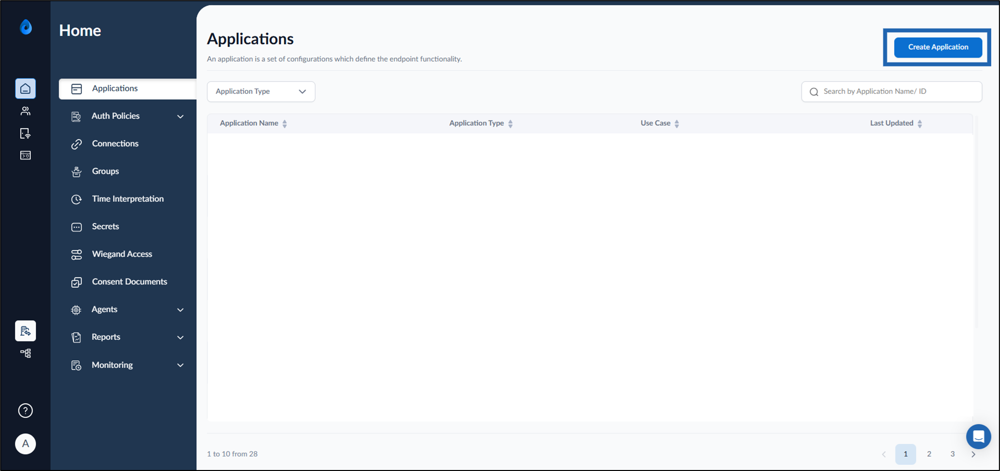

   The **Create New Application** pop-up box is displayed.
3. Do the following:
   1. Enter **Application Name** and select **Application Type** as **Passwordless**.

      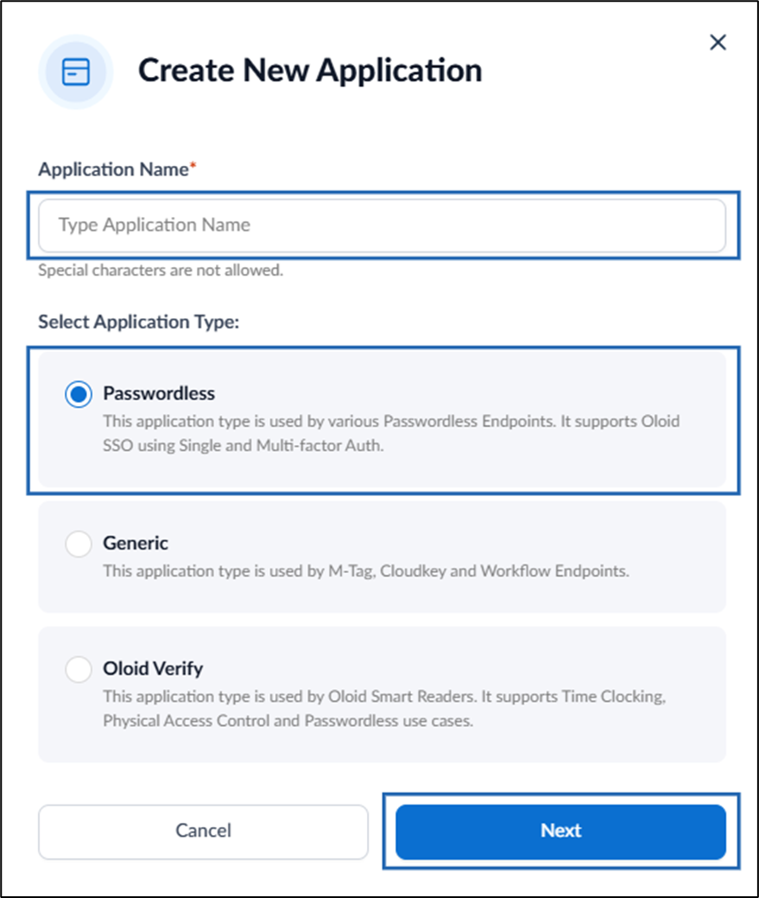

   2. Click **Next**.
      The **Select Passwordless Use Case** page is displayed.
   3. Select **WebKey** > click **Create**.

      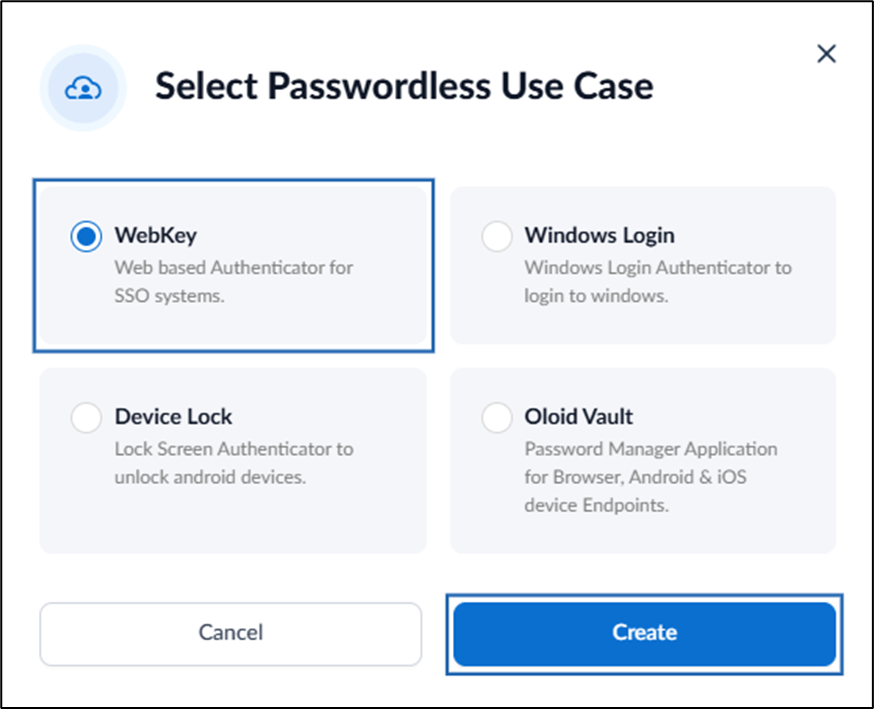

      The Application is created successfully.

      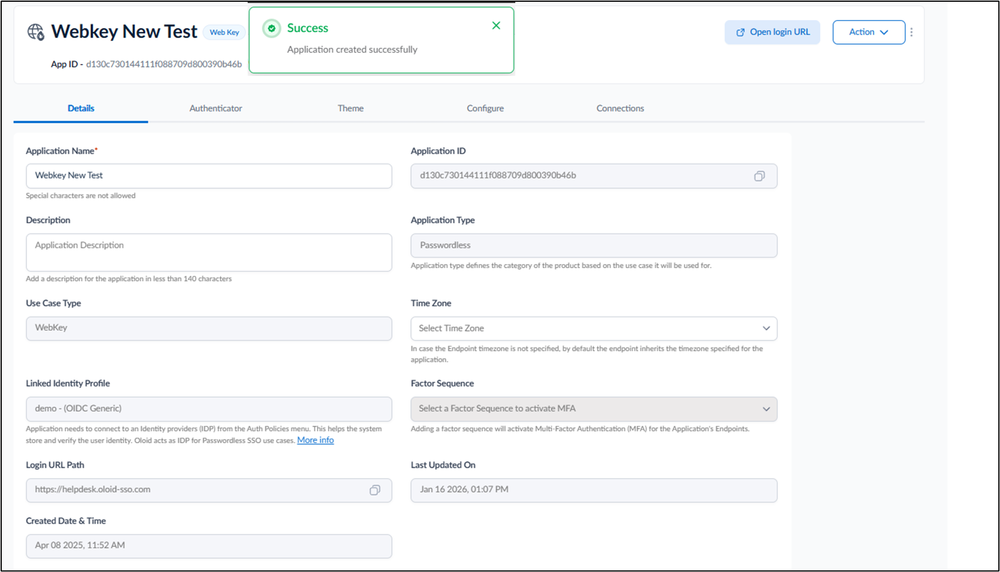

4. Do the following:
   1. [Configure Details tab](#configure-details-tab)
   2. [Configure Authenticator tab](#configure-authenticator-tab)
   3. [Configure Theme tab](#configure-theme-tab)
   4. DesignConfigure tab
   5. [Configure Connections tab](#configure-connections-tab)

<Note>
  **Note:** These are one-time settings and all the default settings are recommended.
</Note>

### Configure Details Tab

1. Edit **Application Name** if required.
2. Add **Description**. (Optional)
3. View **Linked Identity Profile** to to identify the configured Identity Provider Profile.
4. Select **Time Zone** from the dropdown list. (Optional)
5. Copy **Login URL Path** to sign in to WebKey app.

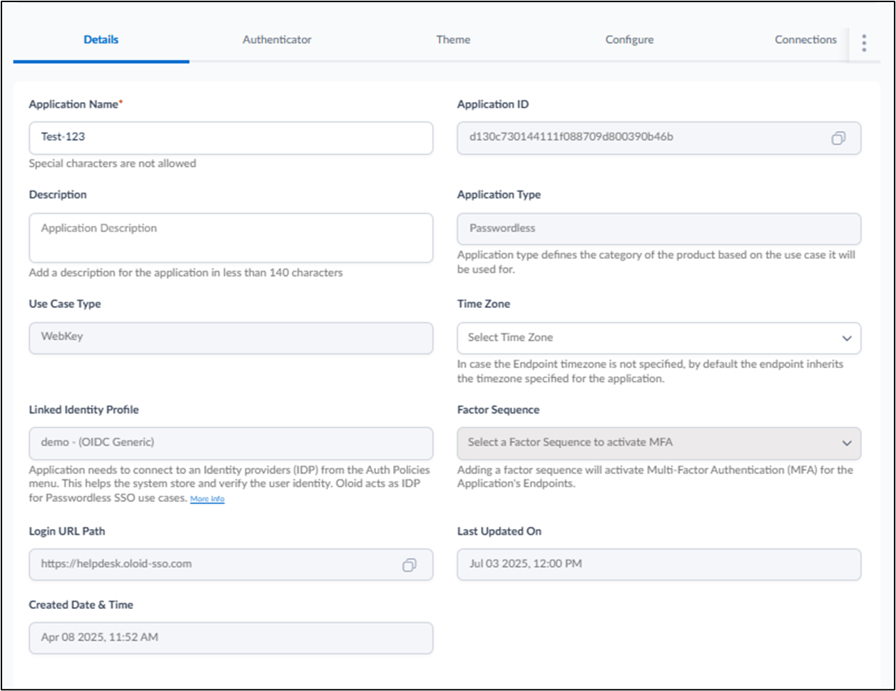

### Configure Authenticator Tab

You may enable one or more credential options based on your requirements.

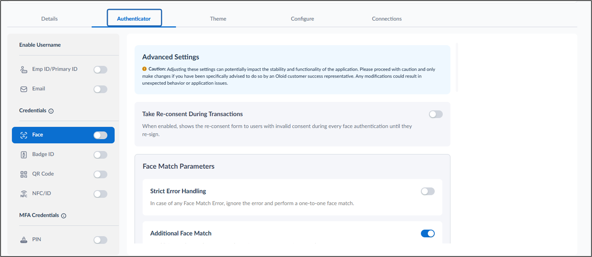

#### Enable Username

##### Emp ID/ Primary ID

Enable Employee ID/Primary ID as Username: Enabling this option will prompt the user to enter their Employee ID or Primary ID before authentication.

<Note>
  **Note:** A custom label can be added which will be shown instead of Emp ID/Primary ID on the login screen.
</Note>

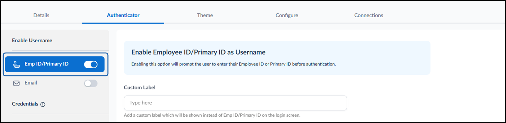

##### Email

Enabling this option will prompt the user to enter their Email ID before authentication.

<Note>
  **Note:** Login through Email ID will not be available for Apps.
</Note>

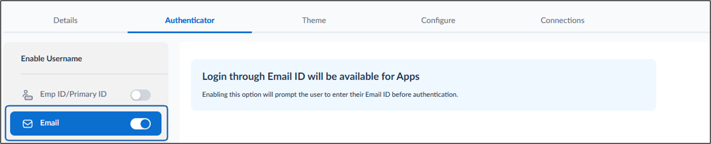

#### Credentials

##### Face

To use face as credential, enable **Face** option.

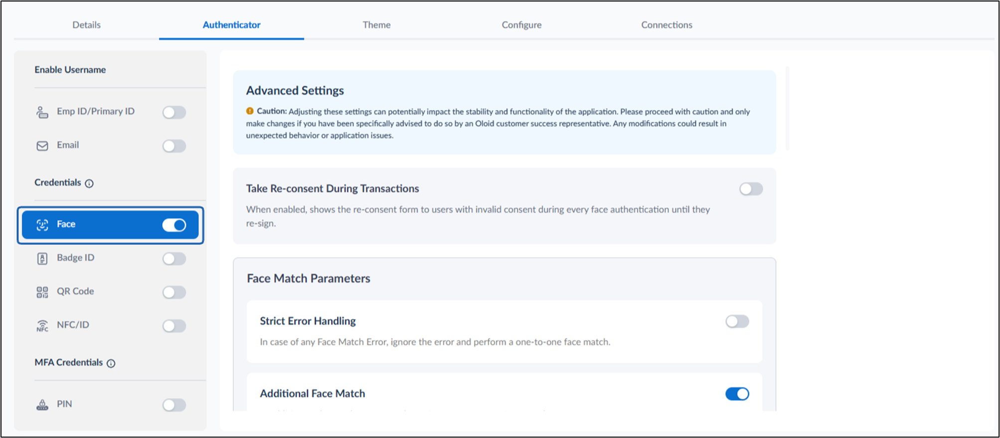

The **Advanced Settings** section is displayed.

1. Enable **Take Re-consent During Transactions** to show the re-consent form to users with invalid consent during every face authentication until they re-sign.
2. Select **Face Capture Mode** from the dropdown.
   1. The **Precision Capture (Default)** mode provides balanced performance across most environments. It delivers an optimal combination of speed, image quality, and reliable auto-capture.
      (or)
   2. The **Precision Capture X** mode offers enhanced performance and adaptability. It provides faster processing, improved image quality, and advanced auto-capture powered by machine learning.
3. Configure **Face Match Parameters**, and **Liveliness Check Parameters** on the Advanced Settings page.

<Note>
  **Note:** The parameters are pre-configured. This is done by Oloid admin.
</Note>

Configure the following:

- [Face Match Parameters](#face-match-parameters)
- Liveliness Check Paraments

##### Face Match Parameters

<Note>
  **Note:** You must consult your Oloid representative before making any changes to the **Face Match Parameters** to ensure optimal authentication performance.
</Note>

1. Turn on **Strict Error Handing** toggle to skip the error and perform a direct one-to-one face match.
2. Turn on **Enable Virtual Camera** to allow third-party virtual camera app to be used for face capture. If a user attempts to spoof the system using a third-party app, this feature helps detect and flag potential spoofing attempts.
3. Turn on **Additional Face Match** toggle to perform a one-to-one face match alongside the standard face matching process.
4. Adjust the **Face Match Threshold** slider or enter a value directly into the input box to set the face match threshold value.

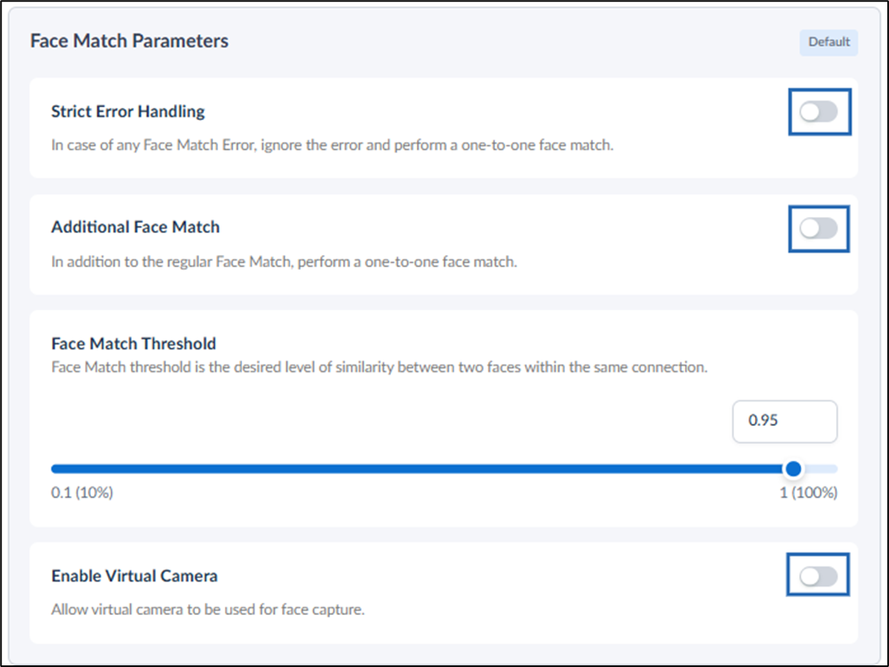

##### Liveness Check Parameters

<Note>
  **Note:** You must consult your Oloid representative before making any changes to the **Liveness check parameters** value to ensure optimal authentication performance.
</Note>

1. **Min Liveness Probability**: Specifies the threshold used to determine whether an image is live or spoofed.
   1. Default value: 0.5
   2. Images with a liveness probability of **0.5 or higher** are classified as live.
2. **Min Liveness Quality**: Specifies the minimum quality required for an image to be suitable for a liveness check.
   1. Default: 0.1
   2. Images with a quality score of **0.1 or higher** are considered suitable for liveness verification.

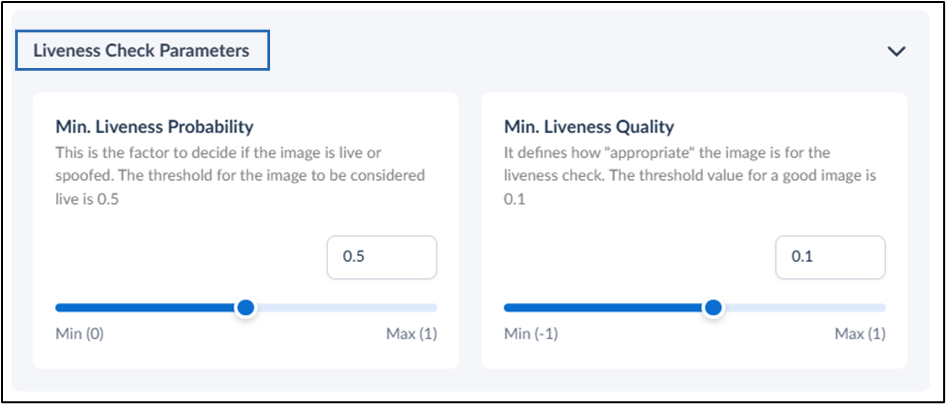

##### Additional Settings

1. **Enable Manual Capture Accessibility** toggle to allow users manually capture their face during the face recognition process.
   1. Select **Disable Auto-capture** to disable automatic face capture. When enabled, users must manually capture their face using:
      1. **Enter** or **Space bar** on desktops and laptops.
      2. **Tap anywhere** on the screen for mobile and tablet devices.

         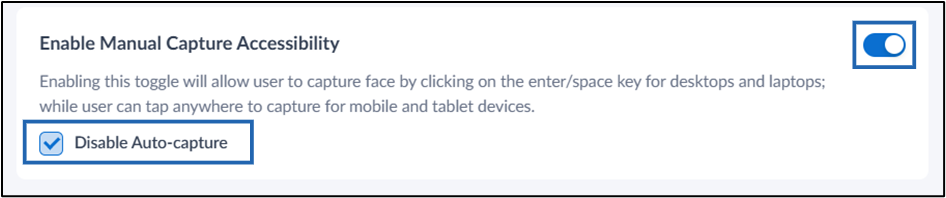

2. **Enable Timed Auto-Capture** to allow the system to automatically capture the user's face if it is not captured within a set time.
- Set the **Time-out Duration** in seconds.
- After the timer ends, the system captures the face automatically, even without user action.

  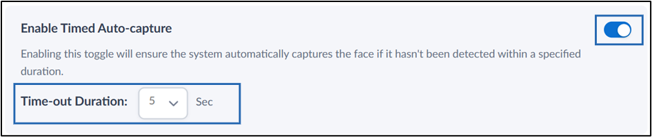

**Configure Image Capture Resolution.**

- **Select Capture Resolution** from the **Select Resolution** dropdown list.
- **Low: 640×480:** Lower quality image.
- **Medium: 1280×720:** Balanced quality.
- **High: 1920×1080:** High-quality image, Best clarity.

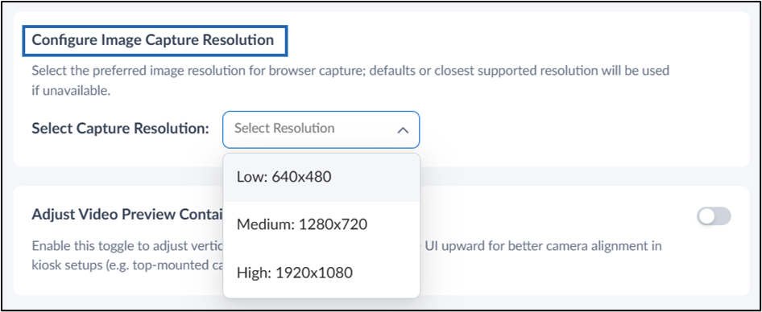

Enable **Adjust Video Preview Container Spacing From Top** toggle to move the face capture preview upward for better alignment with the camera.

- Click **Save**.

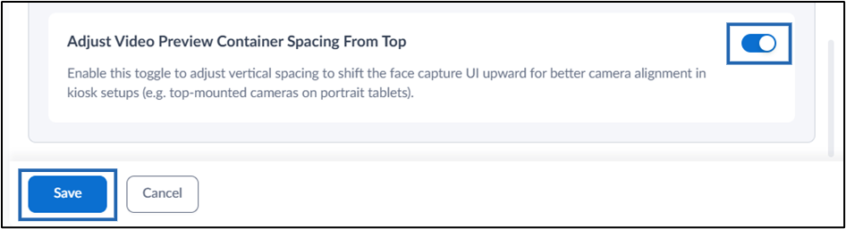

##### Badge ID

To use **Badge ID** as credential, enable **Badge ID**. Select a **Badge Type** from the dropdown list.

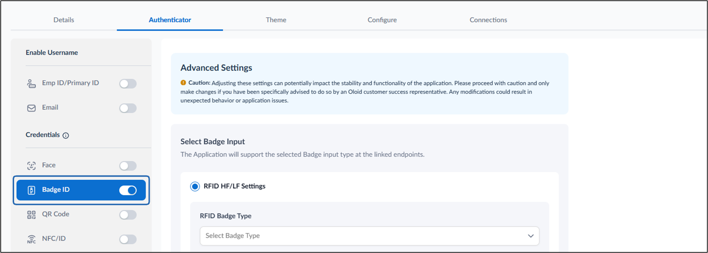

<Note>
  **Note:** Enable Badge ID, then enable PIN for multi-factor authentication (if applicable).
</Note>

##### QR Code

1. To use QR Code as credential, enable **QR Code** option to sign in to WebKey application.
   By default, the front camera opens for QR code scanning.
2. Enable **Show Camera Flip button** to allow users to switch between the front and rear cameras.
   This option displays a camera flip button on the preview screen during QR code scanning.
3. Under **Default camera selection**, select a camera option:
   - **Front Camera** (default)
   - **Rear Camera**

     <Note>
       **Note:** This feature is available only for iOS devices and Android devices.
     </Note>

4. Click **Save**.

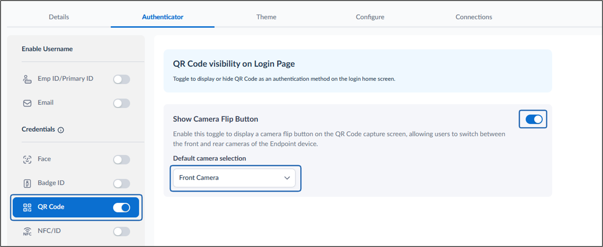

##### NFC/ID

To use NFC/IDcredential, enable **NFC/ID** to sign in to WebKey application from your desktop/laptop.

The **NFC/ID option** section is displayed.

Do the following:

1. Enable **Use Web-NFC** to allow NFC Login from the Mobile Phone and Tablet browser that supports NFC (such as Google Chrome on Android)
2. Enable **Replace the Credential Label - NFC Tag** to replace the default **"NFC"** or **"NFC Tag"** label with a custom name.
3. Enter the new label in the **Replace label with** field. Example: Replace **NFC Tag** with **RFID**.
4. Provide **NFC Scan Instruction** to guide users on scanning their NFC badge for login.
5. **Authentication Success Message**: Enter a message to display when authentication is successful.
6. **Authentication Failure Message**: Enter a message to display when authentication fails.

   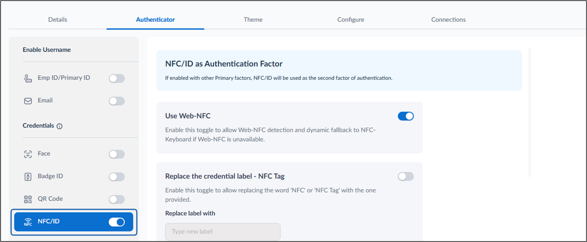

   <Note>
     **Note:** Enable NFC/ID, and then enable PIN for multi-factor authentication (if applicable).
   </Note>

#### MFA Credentials: PIN

To use PIN credentials, enable **PIN** as a multi-factor authentication method for signing into the WebKey application.

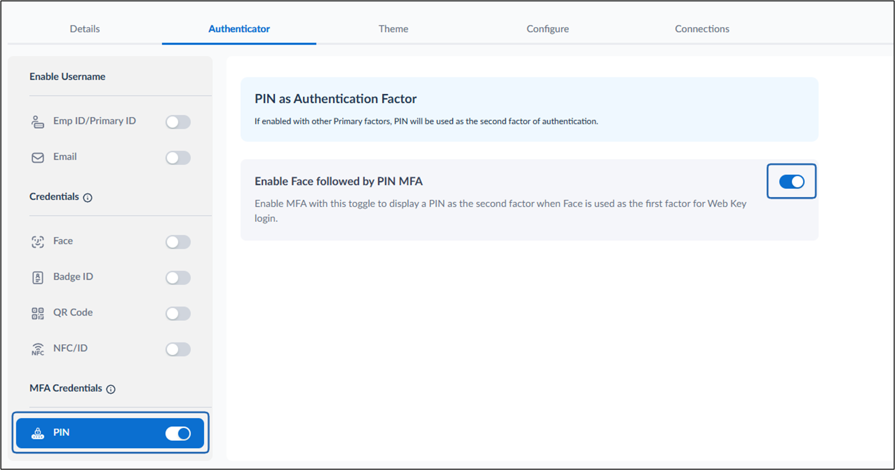

### Configure Theme Tab

You can customize theme of your login page of the WebKey application by following the onscreen instructions.

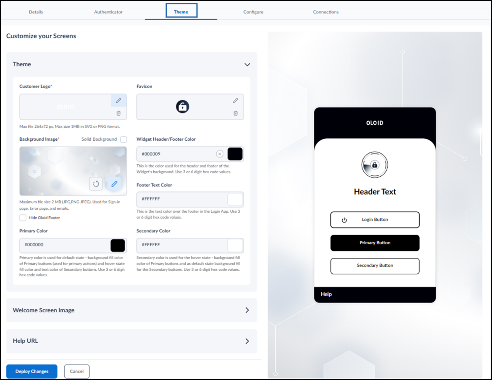

### Design Configure Tab

You can set up the configure tab by configuring browser settings and customizing button labels.

#### Configure Settings Tab

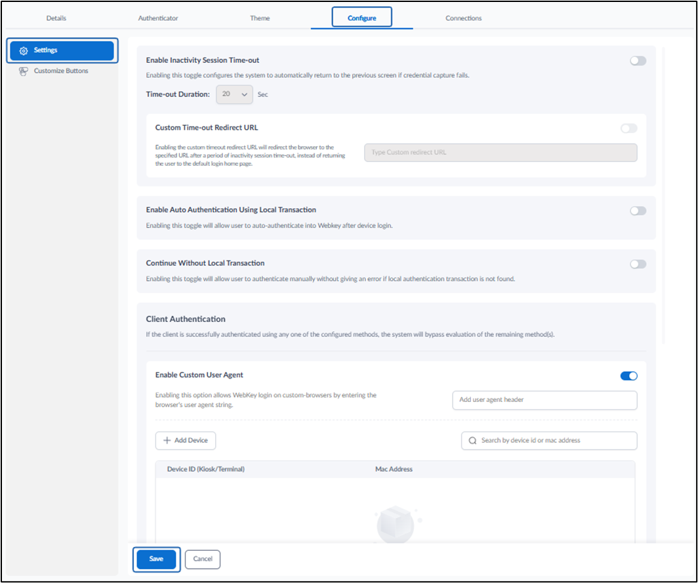

**Do the following:**

1. Enable **Inactivity Session Time Out** toggle button to automatically return to the previous screen if credential capture fails within the set time-out duration.
2. Enable **Auto-Authentication using Local transactions** toggle button will allow user to auto-authenticate into Webkey after device login.
3. Enable **Continue Without Local Transaction** toggle button will allow user to authenticate manually without giving an error if local authentication transaction is not found.

#### Client Authentication

1. **Enable Custom User Agent** to allow users to log in to WebKey app from custom browsers.
2. Select **Enable Browser Fingerprint** to allow WebKey login to function only on registered browsers.
   Do one of the following:
   1. Select **+ Browser Fingerprint** to manually add browser fingerprint.
   2. Select **Transactions** > **Action** dropdown > **Add Browser Fingerprint to Application**. For more information, see [How to configure Browser Fingerprint for WebKey](/platforms/web/webkey/webkey-how-to-configure-browser-fingerprint-from-failed-transactions)
   3. Click **Save**.
   4. Select **Add Device** to register devices for Webkey Login. Refer: [How to configure Custom User Agent in WebKey Application](/platforms/web/webkey/webkey-how-to-configure-a-custom-user-agent-for-webkey)

#### Configure Customize Buttons Tab

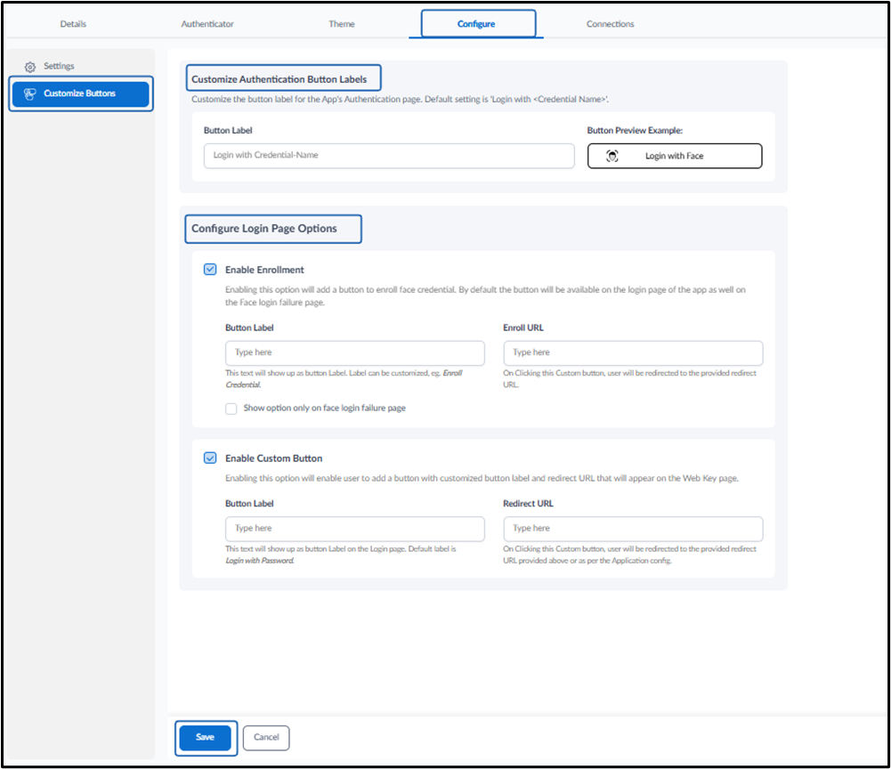

Do the following:

1. Enter customized **Button Label** to display on the Web Key application.
2. Select **Enable Face Enrollment** option to add a customized button label and enrollment URL to the login page of the WebKey application.
3. Select **Enable Custom Button** option to add a customized button label and redirect URL to the login page of WebKey application.

   <Note>
     **Note:** Click **Save** after each action to save your configuration
   </Note>

##### Enable Custom Button in Authentication Flow

This option allows you to add a custom button to the authentication screen and define its behaviour based on user interaction.

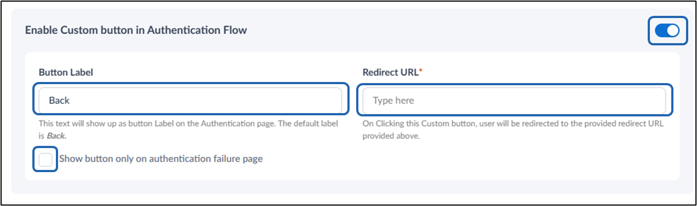

To configure Custom Button in Authentication Flow do the following:

1. Turn on the **Enable Custom Button in Authentication Flow** toggle.
2. **Button Label**
   Enter the text to be displayed on the custom button in the authentication page.
   *Example: Back*
3. **Redirect URL**
   Enter the URL where the user will be redirected when the custom button is clicked.
4. **Show button only on authentication failure page**
   Select this checkbox to display the custom button **only when authentication fails**.
   If not selected, the button will be visible on the main authentication screen.
5. Click **Save**.
   The Custom button is enabled for authentication flow.

### Configure Connections Tab

Do the following:

1. Select **+ Add Connections** to map a connection to the application.

   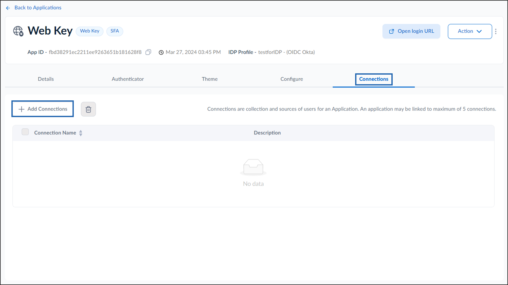

2. On the **Add Connections** pop-up box, select connection name(s) from the **Select Connection** dropdown list and click **Add**.

   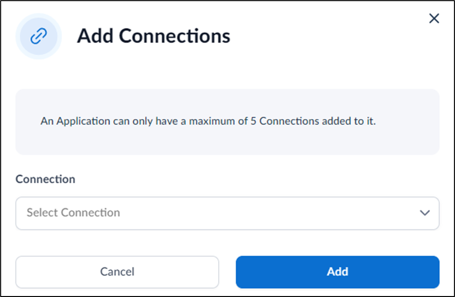

<Note>
  **Note:** Click **Save** after each action to save your configuration.
</Note>

The **WebKey** application is configured and listed on the Application page.
