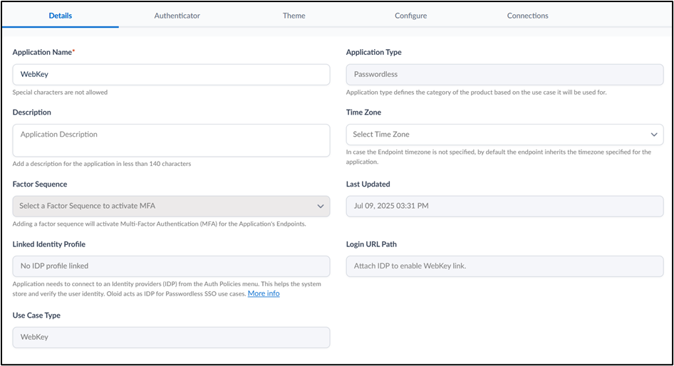
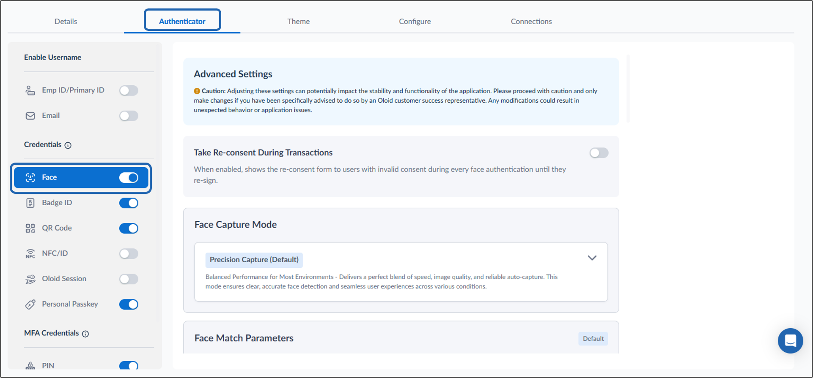
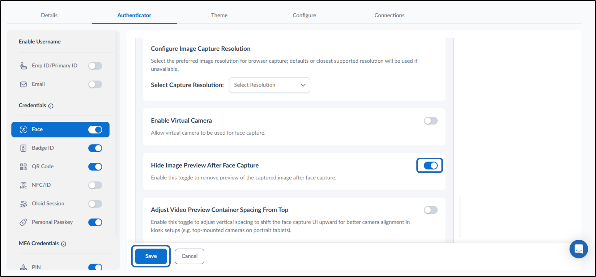
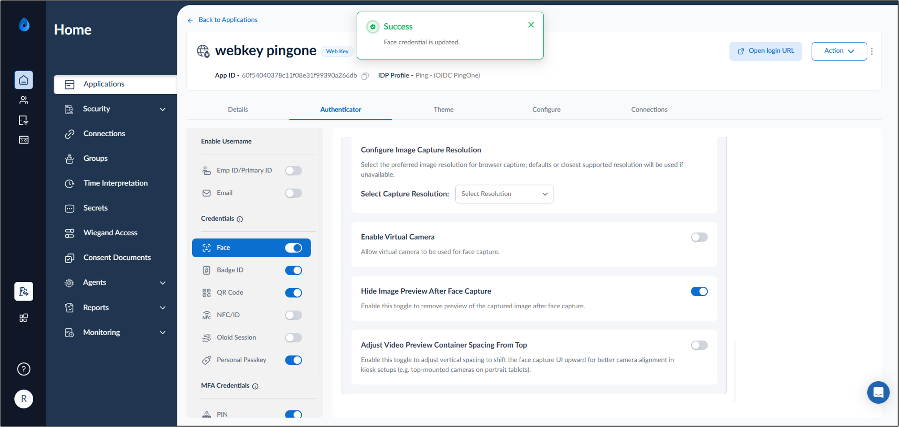
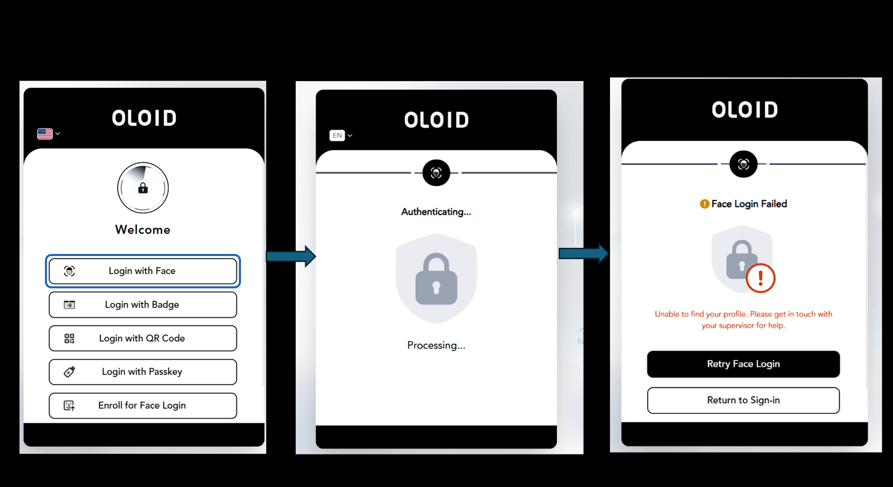

{/* Source: Intercom article 16106492 - https://oloid.help/en/articles/16106492-webkey-how-to-enable-hide-image-preview-after-face-capture */}
{/* Generated by intercom_to_mintlify.py - re-running overwrites this file. */}

## Introduction

The **Hide Image Preview After Face Capture** setting prevents the captured face image from being displayed to users after a successful face capture.

## Prerequisites

You must have access to the Tenant Admin Portal.

## Steps to Enable Hide Image Preview After Face Capture

1. Log in to the **Tenant Admin Portal**.
2. On the **Applications** page, select the Webkey application to edit.

   

   The application page is displayed.

   

3. Go to **Authenticator tab >** click **Face.**

   

   The Face Capture page is displayed.
4. Enable the **Hide Image Preview After Face Capture** toggle to hide the captured face image preview. After the face is captured, the preview image is not displayed.
5. Click **Save.**

Hide Image Preview after Face Capture is successfully enabled.

---

##### Sample Screen

