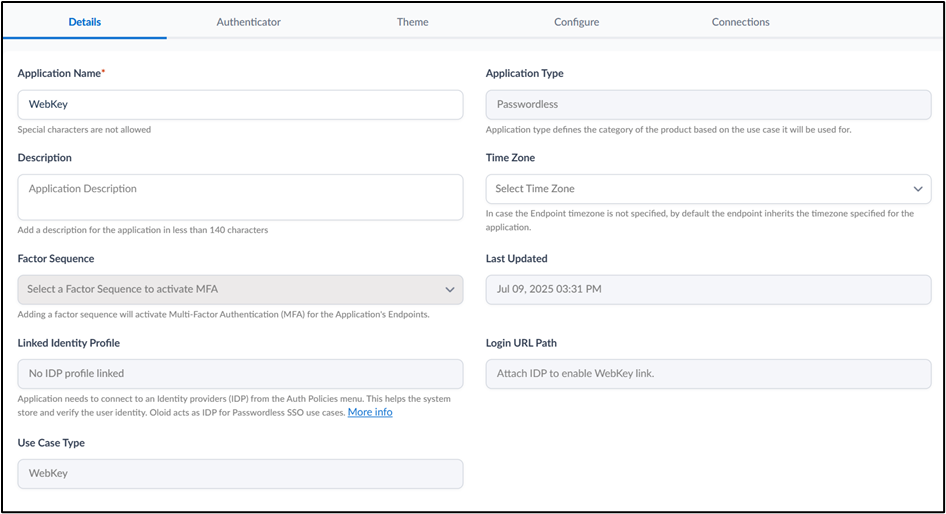
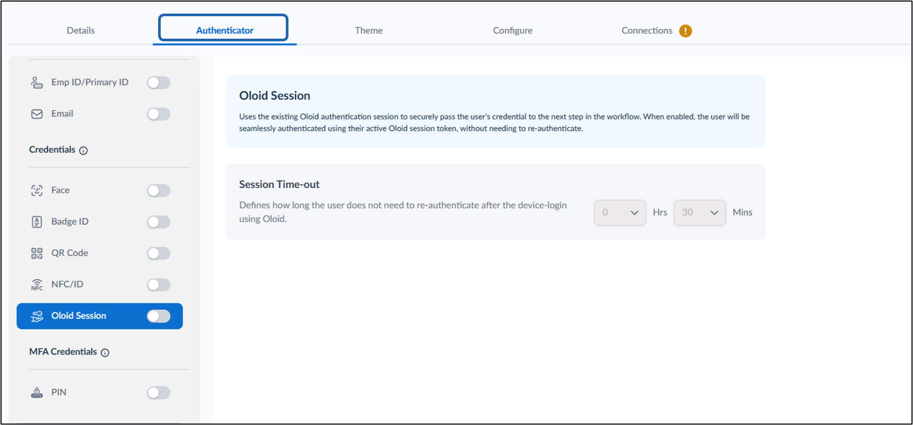
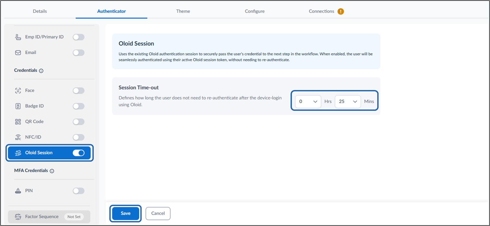
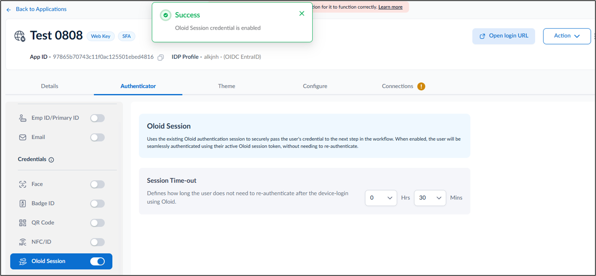

{/* Source: Intercom article 15420148 - https://oloid.help/en/articles/15420148-webkey-how-to-enable-oloid-session-in-the-tenant-admin-portal */}
{/* Generated by intercom_to_mintlify.py - re-running overwrites this file. */}

## Introduction

Oloid Session uses the existing Oloid authentication session to securely pass the user's credential to the next step in the workflow. When enabled, the user will be seamlessly authenticated using their active Oloid session token, without needing to re-authenticate.

## Prerequisites

- You must have access to the Tenant Admin Portal.
- Ensure **Enable Auto Authentication of Webkey using Local Transaction** is enabled. Refer: [How to Enable Auto Authentication using Windows Oloid Session](/platforms/web/webkey/webkey-how-to-edit-configure-tab).
- Enable Auto authentication using Local transaction for Windows Login. Refer: [Windows Login - How to create and configure Windows Login application in the Tenant Admin Portal](/platforms/windows/windows-login/windows-login-how-to-create-and-configure-windows-login-application)

## Steps to Enable Oloid Session

1. Log in to the **Tenant Admin Portal**.
2. On the **Applications** page, select the Webkey application to edit.

   

   The application page is displayed.

   

3. Go to **Authenticator tab.**

   

   The Authenticator page is displayed.
4. Do the following:
   1. Turn on **Oloid Session** toggle.
   2. Set the **Session Time-out** duration.
      **Session Time-out** duration specifies how long users can continue to access the device without re-authenticating after an Oloid sign-in.
   3. Click **Save.**

Oloid Session is successfully enabled.

