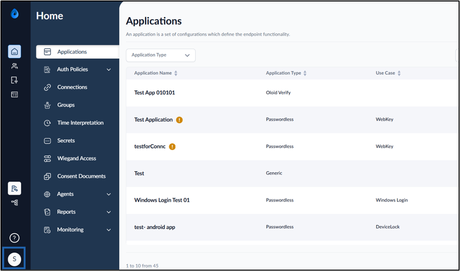
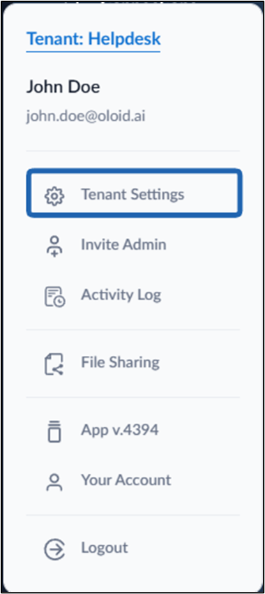
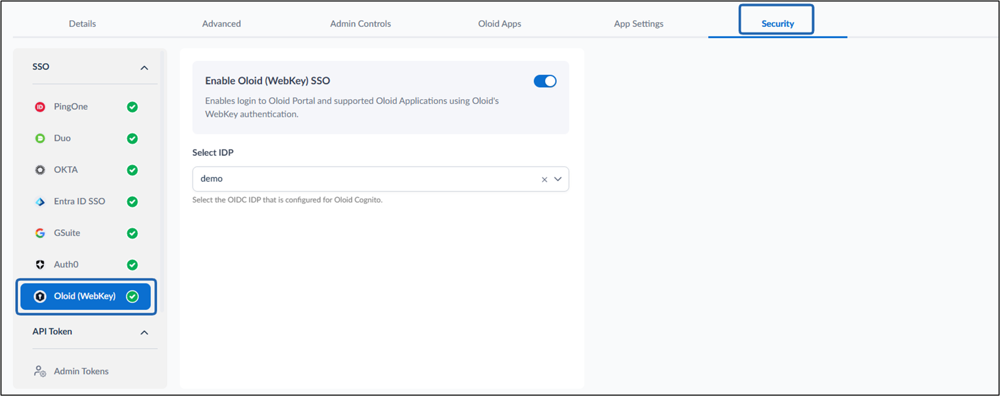
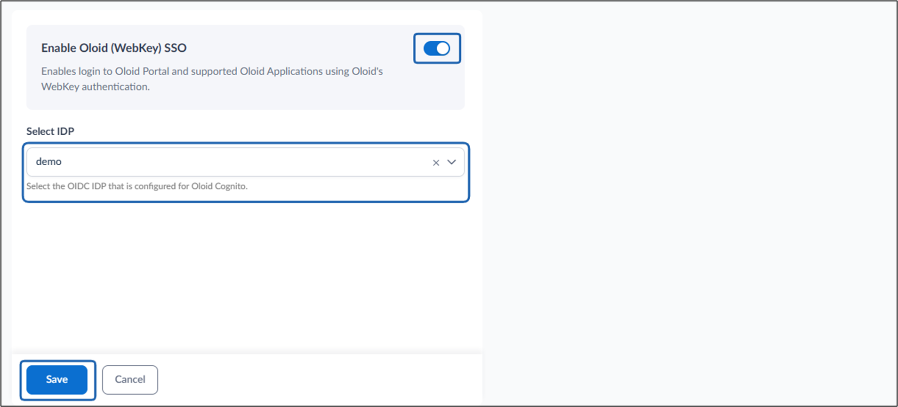

{/* Source: Intercom article 13597272 - https://oloid.help/en/articles/13597272-webkey-how-to-enable-oloid-webkey-sso-login */}
{/* Generated by intercom_to_mintlify.py - re-running overwrites this file. */}

## Introduction

By enabling Oloid (WebKey) SSO from the Tenant Admin Portal and selecting the appropriate IDP, admins can provide users with secure single sign-on (SSO) authentication using an external Identity Provider (IDP).

## Prerequisite

- You must have a Tenant Admin account.
- OKTA IDP must be created for the application. To create, refer [How to create IDP Profile for OIDC-Okta in the Tenant Admin Portal](/platform/tenant-admin-portal/tenant-admin-portal-how-to-create-an-oidc-okta-idp-profile)

## Steps to configure Webkey SSO

1. Login to the **Tenant Admin Portal**.
2. On the homepage of the portal, click **Profile icon** on the bottom left corner of the menu panel.

   

   The user profile menu is displayed.
3. Click **Tenant Settings**.

   

   The **Tenant Settings** page is displayed.
4. On Tenant Settings page, go to **Security** tab, and click **Webkey SSO.**

   

   The Webkey SSO configuration page is displayed.
5. Do the following:
   1. Turn on **Enable Oloid (WebKey) SSO** toggle.
   2. Select **IDP** from the dropdown.
   3. Click **Save**.

The Oloid Webkey SSO is configured.
