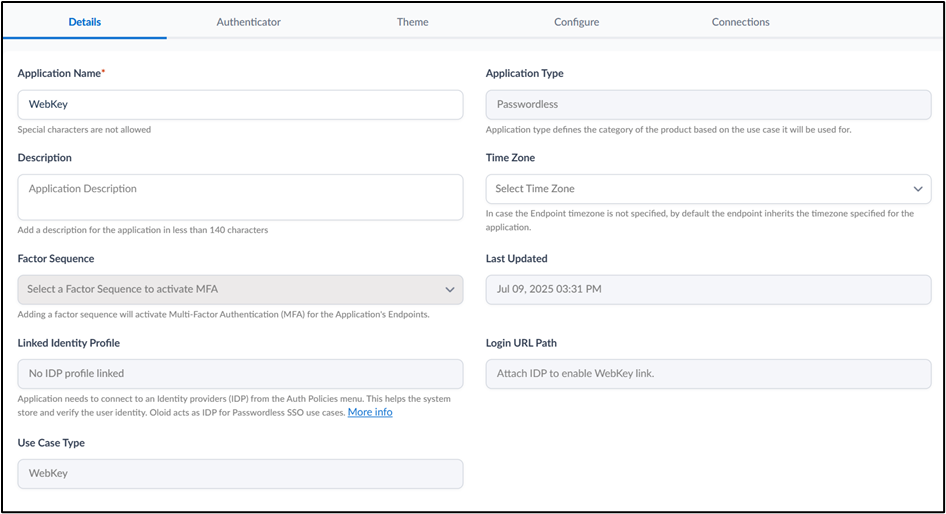
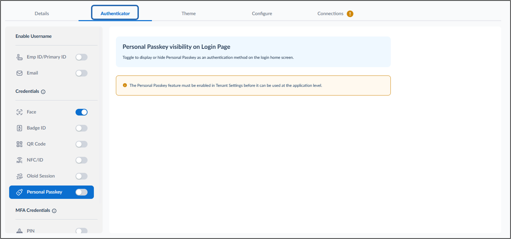
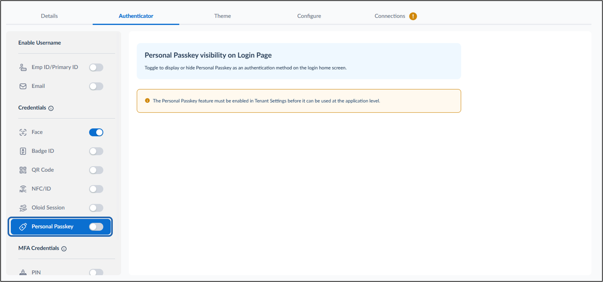
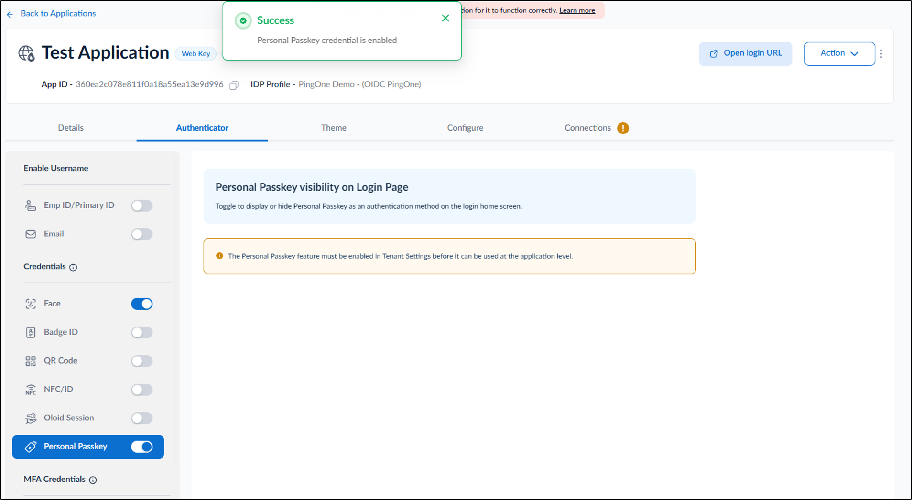

{/* Source: Intercom article 15733222 - https://oloid.help/en/articles/15733222-webkey-how-to-enable-personal-passkey-in-the-tenant-admin-portal */}
{/* Generated by intercom_to_mintlify.py - re-running overwrites this file. */}

## Introduction

Personal Passkey enables users to authenticate to supported Webkey applications using a passkey associated with their individual account.

## Prerequisite

- You must have access to Tenant Admin account.
- Personal Passkey must be enabled in the Tenant Admin portal. Refer: [How to Enable Passkey SSO in Tenant Admin Portal](/more/passwordless-authenticator/tenant-admin-portal-how-to-enable-sso-using-personal-passkey-in-the)
- Ensure Personal Passkey is created for the user. Refer: [How to Generate Personal Passkey in the Tenant Admin Portal](/more/passwordless-authenticator/tenant-admin-portal-how-to-generate-personal-passkey)

## Steps to Enable Personal Passkey

1. Log in to the **Tenant Admin Portal**.
2. On the **Applications** page, select the Webkey application to edit.

   

   The application page is displayed.

   

3. Go to **Authenticator tab.**

   

   The Authenticator page is displayed.
4. Turn on **Personal Passkey** toggle.

Personal Passkey is successfully Enabled.

