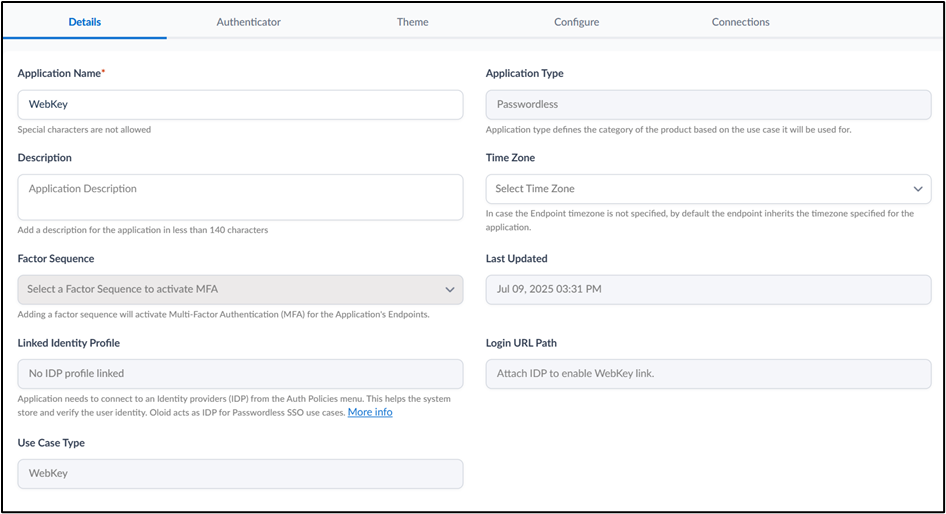
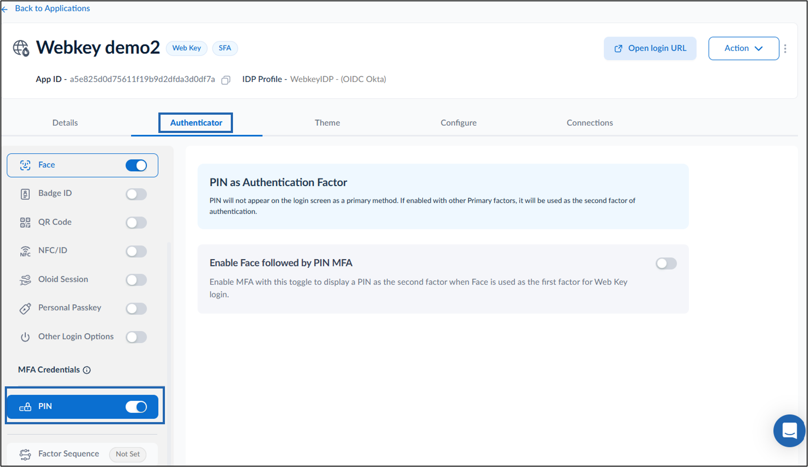
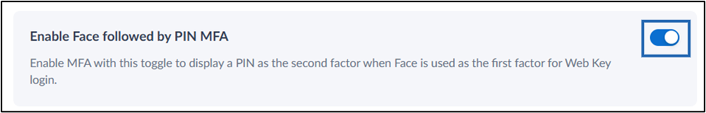
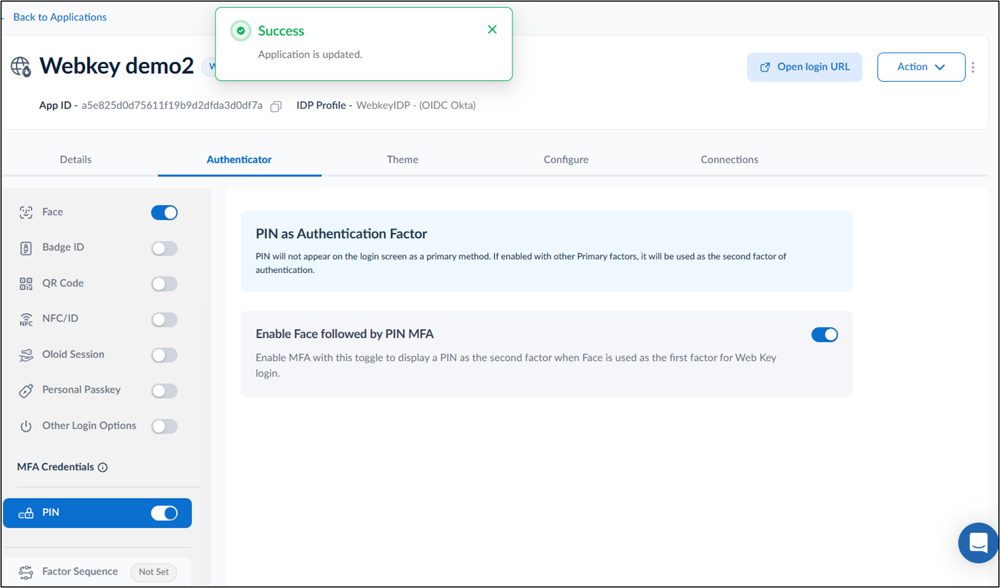

{/* Source: Intercom article 11501228 - https://oloid.help/en/articles/11501228-webkey-how-to-enable-pin-credential-for-webkey-application */}
{/* Generated by intercom_to_mintlify.py - re-running overwrites this file. */}

## Introduction

The PIN credential feature in the Tenant Admin Portal allows admins to enable PIN-based multi-factor authentication (MFA) for the WebKey application. When PIN is enabled, users can sign in to endpoints using a secure PIN as a second factor.

## Prerequisites

- You must have admin access to the Tenant Admin Portal.
- You must create a Passwordless application of type WebKey. For further details, refer [How to create a WebKey application](/platforms/web/webkey/webkey-how-to-create-and-configure-a-webkey-application-in-tenant).

## Steps to Configure PIN Credential

1. Log in to the **Tenant Admin Portal**.
2. On the **Applications** page, select the Webkey application to edit.

   

   The application page is displayed.

   

3. Go to **Authenticator tab >** turn on **PIN** toggle.

   

   The PIN is enabled successfully.
4. **(Optional) Enable Face followed by PIN MFA** toggle to log in with a PIN after successful face verification.

   <Note>
     **Note:** This enables two-step multi-factor authentication during Web Key login.
   </Note>

   

   The PIN authenticator for WebKey application is configured successfully.

   
