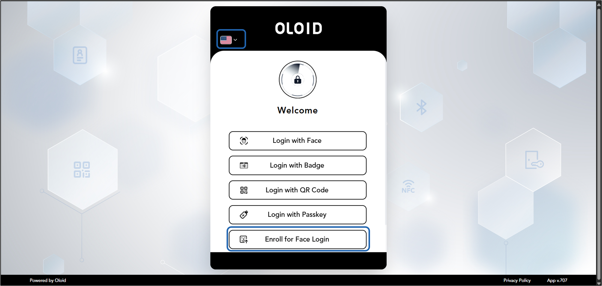
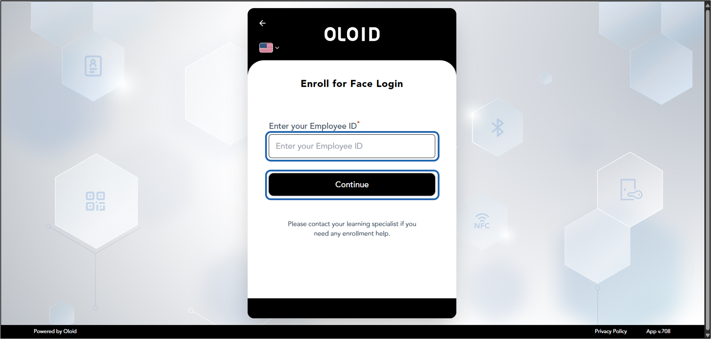
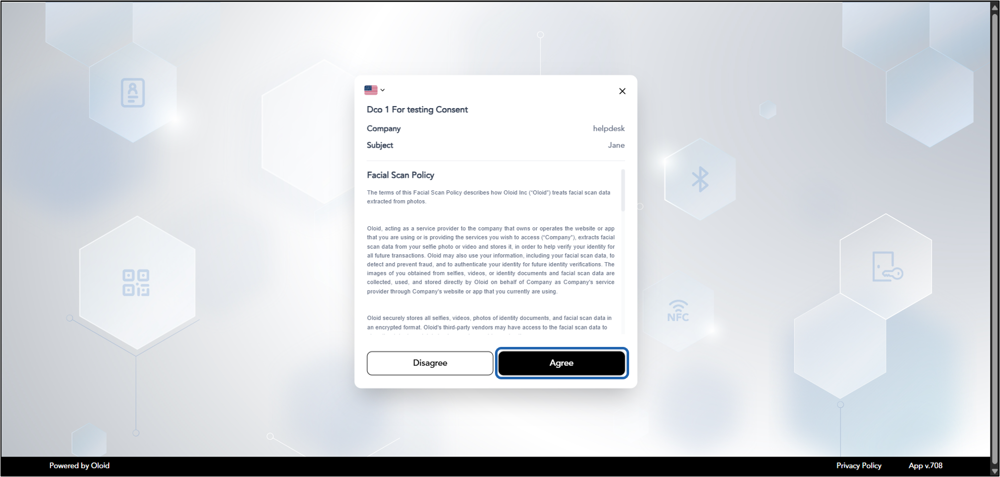
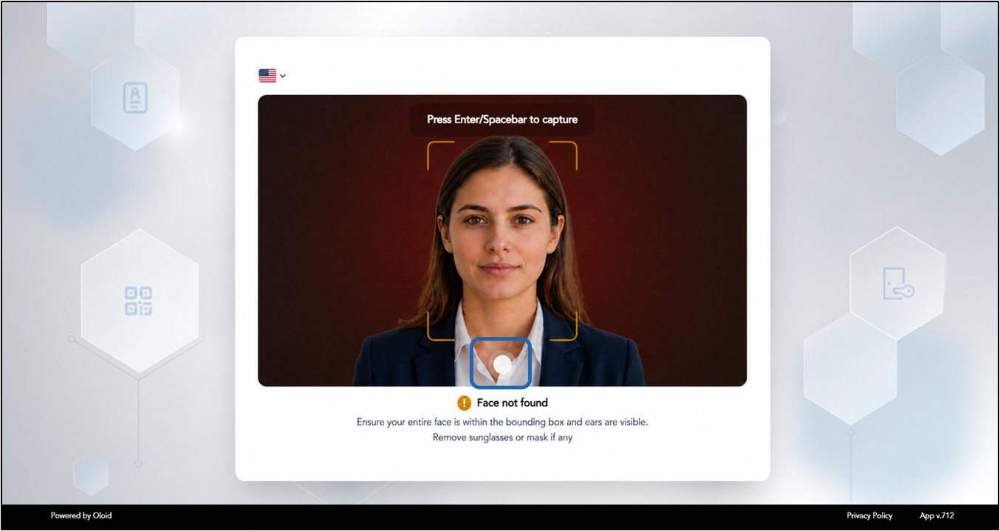
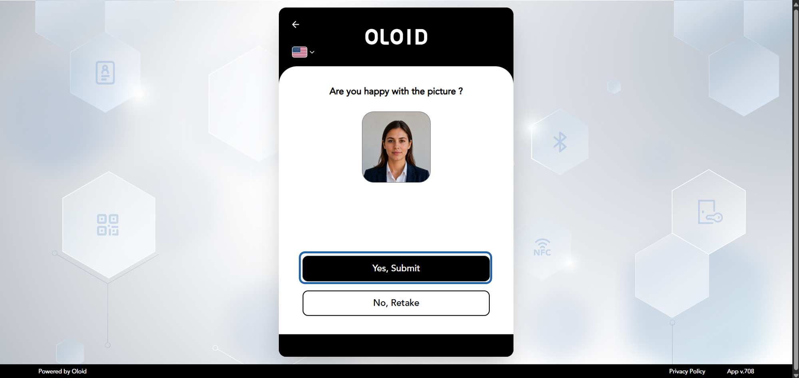
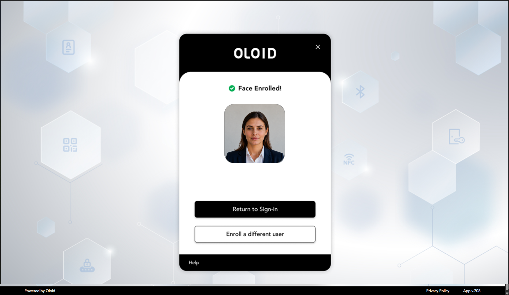

{/* Source: Intercom article 9263144 - https://oloid.help/en/articles/9263144-webkey-how-to-enroll-face-using-webkey */}
{/* Generated by intercom_to_mintlify.py - re-running overwrites this file. */}

## Introduction

Webkey allows users to enroll their face as a credential for face-based authentication. During enrollment, the user provides consent and captures an image that is associated with their profile for use during future authentication.

## Prerequisites

- User Image must be imported into HR Picture Verification. For more information, Refer: [How to Import Faces for HR Picture Verification](/platform/tenant-admin-portal/how-to-import-faces-for-hr-picture-verification)
- Manual face capture (as per the requirement) must be configured in Oloid Portal.
- Enable Enrollment field should be selected at the application level. Refer **Create and configure Webkey >** [Configure Customize Buttons tab](/platforms/web/webkey/webkey-how-to-create-and-configure-a-webkey-application-in-tenant)

**To enroll for face login:**

1. Launch the **Webkey** Application URL in your browser.
2. Select **Enroll for Face Login**.

   <Note>
     **Note:** You can select preferred display language from the **Language Dropdown Selector**. For more information, refer [Additional information section](#additional-information).
   </Note>

   

   The **Enroll for Face Login** page is displayed.

   <Note>
     **Note:** In case, custom URL is added for your application then you will be redirected to the provided redirect URL. Follow the onscreen instructions to enroll your face.
   </Note>

3. Enter your **Employee ID** (primary ID).
4. Click **Continue**.

   

   TheConsentpage is displayed.
5. Click **Agree**.

   

   This opens the camera on your device.
6. Look at the camera to capture your face for enrollment and press **Enter or Spacebar.**

   <Note>
     **Note:** For manual capture to function it must be configured in the Tenant Admin Portal.
   </Note>

   

7. Do one of the following:
   1. Tap **Yes- Submit** to submit the image.
      The face is submitted successfully and is displayed on the details screen.
   2. Tap **No- Retake** to take the photo again.
      The camera turns on to retake the photo.

      <Note>
        **Note:** You can add a maximum of five faces per user. The user's face is added to the Oloid portal.
      </Note>

      

Face is enrolled successfully.

---

#### Additional Information

**WebKey** now supports multiple language versions, allowing users to select their preferred display language from the **Language Dropdown Selector** on the Login screen.

<Note>
  **Note:** Languages supported: English, Spanish, French, German, and Portuguese language.
</Note>

##### Sample Screen

The display language updates based on the selected language. The following sample shows the WebKey application in German.

---

##### Video Tutorial

Watch the video [How to enroll-for face using webkey- Video Tutorial](/platforms/web/videos/how-to-enroll-for-face-using-webkey-video-tutorial)
