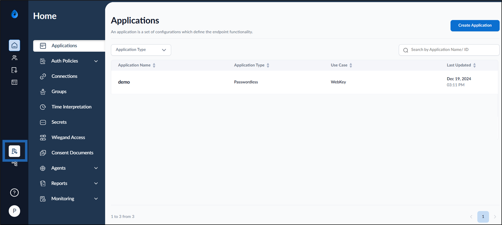
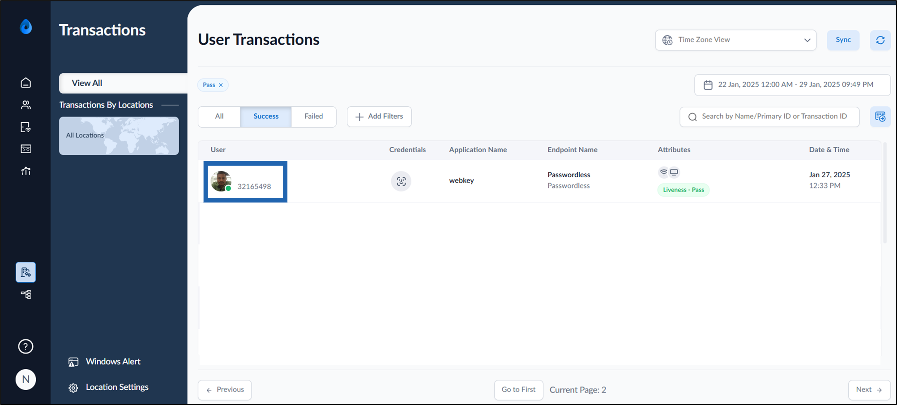
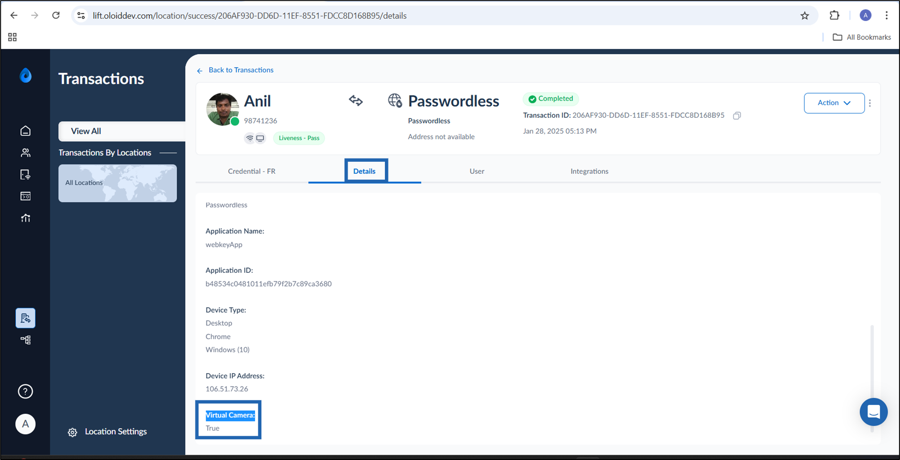

{/* Source: Intercom article 10469404 - https://oloid.help/en/articles/10469404-webkey-how-to-identify-spoofing-in-webkey */}
{/* Generated by intercom_to_mintlify.py - re-running overwrites this file. */}

Tenant Admin/Supervisor can detect spoofing attempts in WebKey application by checking if a user has logged in using a virtual camera instead of a real face scan.

**Pre-requisite:**

You must turn on **Enable Virtual Camera** in Webkey application. For more information, refer [How to create and configure WebKey application](/platforms/web/webkey/webkey-how-to-create-and-configure-a-webkey-application-in-tenant) > [Enable Virtual Camera](/platforms/web/webkey/webkey-how-to-create-and-configure-a-webkey-application-in-tenant)

To identify spoofing:

1. Log in to **Oloid Portal**.
2. Go to **Transactions** in the left menu panel.

   

   The User Transaction page is displayed.
3. Select the login transaction.

   

4. Go to **Details** tab, check **Virtual Camera** status.

   

   If Virtual Camera is **True**, the user has used a spoofing method to log in.
