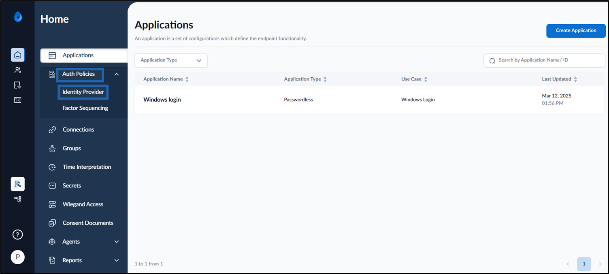
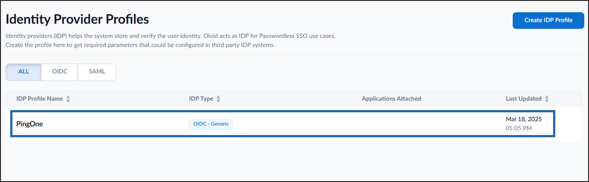
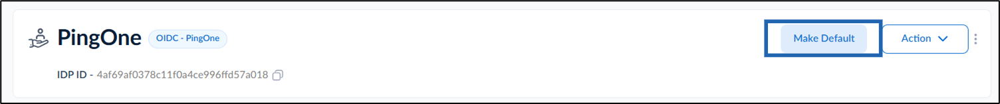
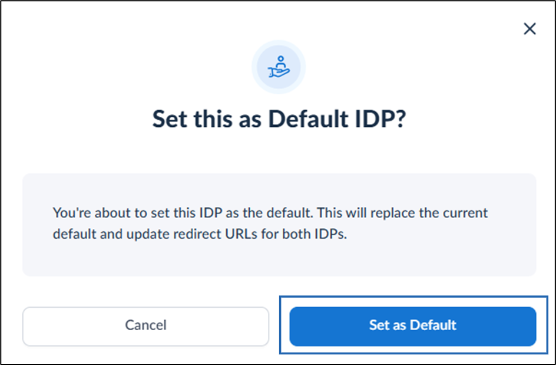
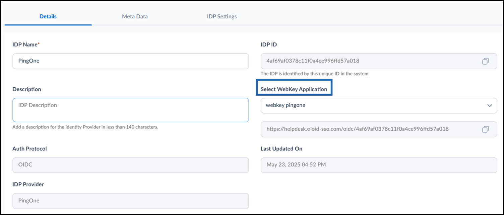
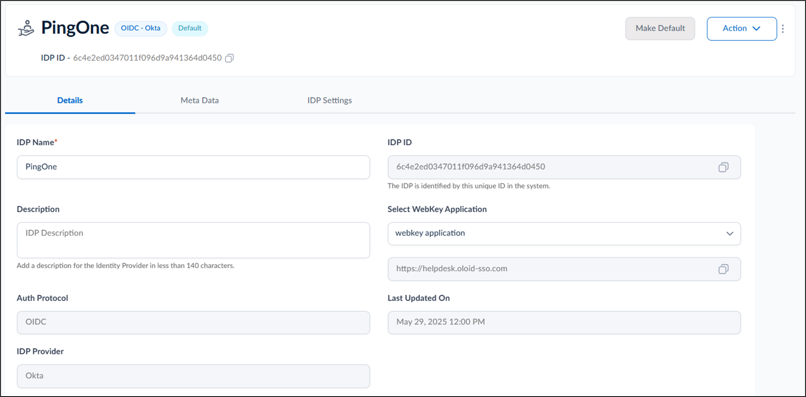

{/* Source: Intercom article 11401191 - https://oloid.help/en/articles/11401191-webkey-how-to-link-webkey-with-an-identity-provider-idp-in-tenant-admin-portal */}
{/* Generated by intercom_to_mintlify.py - re-running overwrites this file. */}

## Introduction

Each WebKey application must be mapped to a single IDP profile. The Tenant admin can configure multiple IDP profiles, but only one can be set as the default. When an IDP profile is marked as the default, users are redirected to the HRMS platform associated with the linked WebKey application during login.

## Prerequisites

- You must have access to the **Tenant Admin Portal**.
- Ensure Webkey application is already created. For more information, refer: [How to create and configure WebKey Application in Tenant Admin Portal](/platforms/web/webkey/webkey-how-to-create-and-configure-a-webkey-application-in-tenant)
- Ensure IDP is already created. For more information, refer: [How to create IDP Profile for OIDC-PingOne in Tenant Admin Portal](/platform/tenant-admin-portal/tenant-admin-portal-how-to-create-idp-profile-for-oidc-pingone)

This document comprises the following:

- [Assign WebKey application to IDP](#steps-to-assign-webkey-application-to-idp)
- [Make an IDP as default](#steps-to-make-an-idp-as-default)
  If you setup IDP as default, it will automatically update redirect URLs and replace the previously assigned default IDP.
- [Re-assign WebKey application from IDP](#steps-to-re-assign-webkey-application-from-idp)

### Steps to Assign WebKey application to IDP

1. Log in to the **Tenant Admin Portal**.
2. On the home page of the portal, select **Auth Policies** > **Identity Provider**.

   

   The **Identity Provider Profiles** page is displayed.
3. Select an IDP Profile Name to edit.

   

   The details page is displayed.
4. Select the required WebKey application from the **Select WebKey Application** dropdown list.
5. Click **Save**.
   The IDP profile is assigned successfully to the Webkey application.

   

### Steps to make an IDP as default

1. Follow this section to [Assign WebKey Application to IDP](#steps-to-assign-webkey-application-to-idp).
2. Click **Make Default** to set this IDP as the default. (Optional)

   <Note>
     **Note:** If another IDP is currently set as default, it will be replaced upon confirmation.
   </Note>

   

   The confirmation box is displayed.
3. Click **Set as Default** to designate the preferred IDP as default.

   

### Steps to re-assign WebKey application from IDP

1. Follow this section to [Assign WebKey Application to IDP](#steps-to-assign-webkey-application-to-idp)
2. Select a different WebKey application to reassign.

The IDP is configured successfully.

<Note>
  **Note:** Each WebKey application can only be associated with one IDP profile. If you attempt to configure the same application ID with another profile, an error will be displayed.
</Note>
