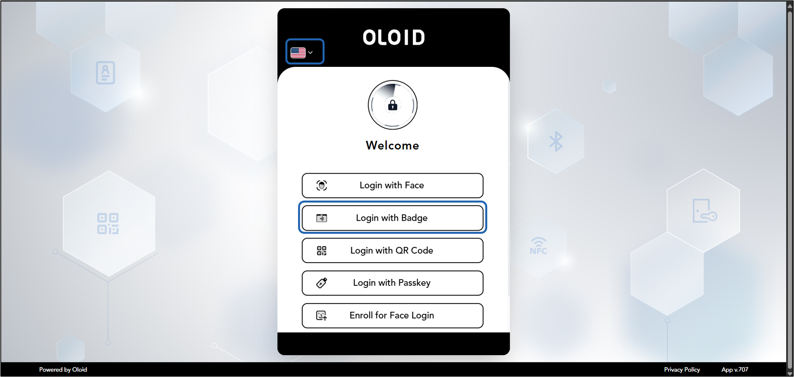
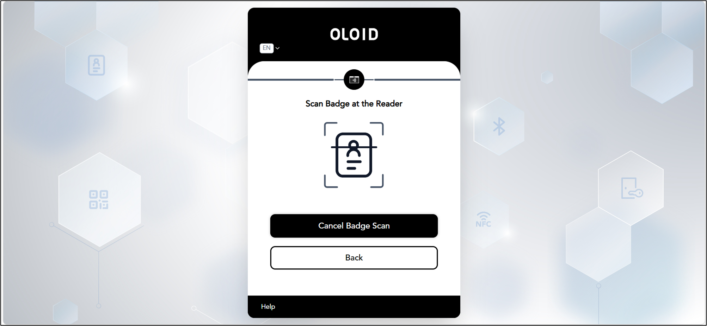

{/* Source: Intercom article 9259058 - https://oloid.help/en/articles/9259058-webkey-how-to-log-into-workforce-hrms-platform-using-badge-through-webkey */}
{/* Generated by intercom_to_mintlify.py - re-running overwrites this file. */}

## Introduction

Badge Authentication enables users to securely sign in to supported Workforce and HRMS platforms by scanning a registered badge on a connected badge reader. Once the badge is verified, Webkey authenticates the user and signs them in to the configured HRMS platform.

## Prerequisites

- You must have an Okta account.
- The Okta credential must be added to the user detail page. For more details, refer [How to configure user details](/platform/tenant-admin-portal/tenant-admin-portal-how-to-configure-user-details)
- In the Tenant Admin Portal, you must do the following:
  - Assign badge to the user. For more details, refer[How to assign Badge ID as credential to users](/platform/tenant-admin-portal/how-to-assign-badge-id-as-credential-to-users)
  - Enable badge option under the Webkey Application. For more details, refer [How to create and configure Webkey application](/platforms/web/webkey/webkey-how-to-create-and-configure-a-webkey-application-in-tenant)

## Steps to Login with Badge

1. Launch the **Webkey** Application URL in your browser.
2. On the home page of the app, select **Login with Badge**.
   **Note: I**f configured in the Tenant Admin Portal, you can select your preferred display language from the Language Dropdown Selector.

   

   The **Scan Badge at the Reader** screen is displayed.
3. Tap the **Badge** on the **Badge Reader** to scan it.

On Badge authentication, you are signed in to the **Workforce /HRMS** platform.

---

##### Video Tutorial

Watch the video [How to log into Workforce Management platforms using Badge through WebKey - Video Tutorial](/platforms/web/videos/how-to-log-into-workforce-management-platforms-using-badge-through)
