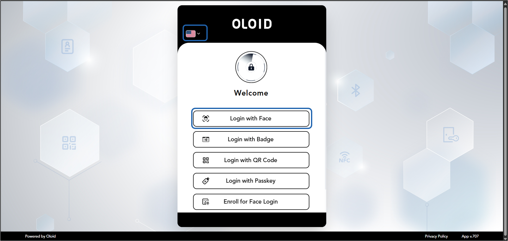
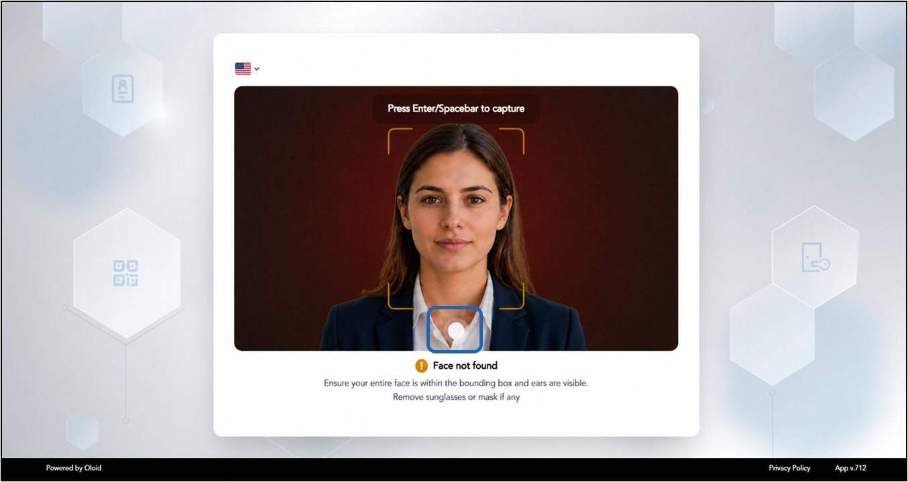
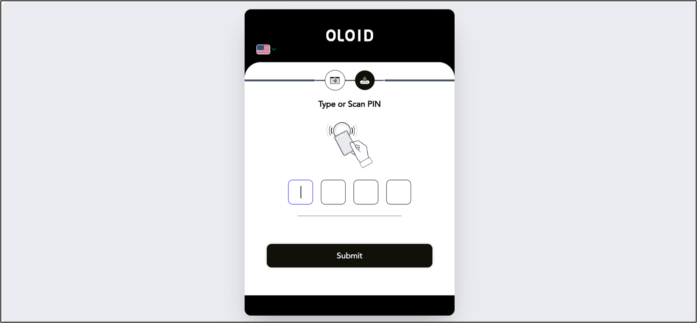
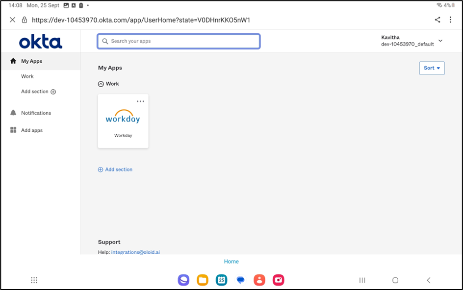

{/* Source: Intercom article 8608007 - https://oloid.help/en/articles/8608007-webkey-how-to-log-into-workforce-hrms-platform-using-face-and-pin-through-webkey */}
{/* Generated by intercom_to_mintlify.py - re-running overwrites this file. */}

## Introduction

This document provides step-by-step instructions for logging in with face and PIN to Workforce /HRMS platform.

## Prerequisites

- You must have an Okta account.
- The Okta credential must be added to the user detail page. For more details, refer [How to configure user details](/platform/tenant-admin-portal/tenant-admin-portal-how-to-configure-user-details)
- In the Tenant Admin Portal, you must do the following:
  - Add Face to the user. For more details, refer [How to onboard face of a single user](/platform/tenant-admin-portal/tenant-admin-portal-how-to-add-face-of-a-single-user)
  - Add PIN for the user. For more details, refer[How to add PIN as credential to users](/platform/tenant-admin-portal/tenant-admin-portal-how-to-add-pin-credential-for-user)
  - Enable Face and PIN under the WebKey Application. For more details, refer [How to create and configure WebKey application](/platforms/web/webkey/webkey-how-to-create-and-configure-a-webkey-application-in-tenant)
  - Manual face capture (as per the requirement) must be configured in Tenant Admin Portal.

## Steps to Login with Face

1. Launch the **Webkey** application URL in your browser.
2. On the home screen of the app, select **Login with Face**.
   **Note: I**f configured in the Tenant Admin Portal, you can select your preferred display language from the Language Dropdown Selector.

   

3. Place your face in front of the camera for facial authentication and press **Enter or Spacebar.**

   <Note>
     **Note:** For manual capture to function it must be configured in the Tenant Admin Portal.
   </Note>

   

4. On Face authentication, the **Type or Scan PIN** screen is displayed.
5. Do any of the following:
   1. Enter **PIN**.
   2. Tap the card which contains the PIN on the **Reader** to scan it.

      <Note>
        **Note:** The Reader should be connected to your system.
      </Note>

Click **Submit**.

On PIN authentication, you are signed in to the **Workforce /HRMS** platform.

---

##### Video Tutorial

Watch the video [How to log into Workforce /HRMS platform using Face and PIN through WebKey- Video Tutorial](/platforms/web/videos/how-to-log-into-workforce-hrms-platform-using-face-and-pin-through)
