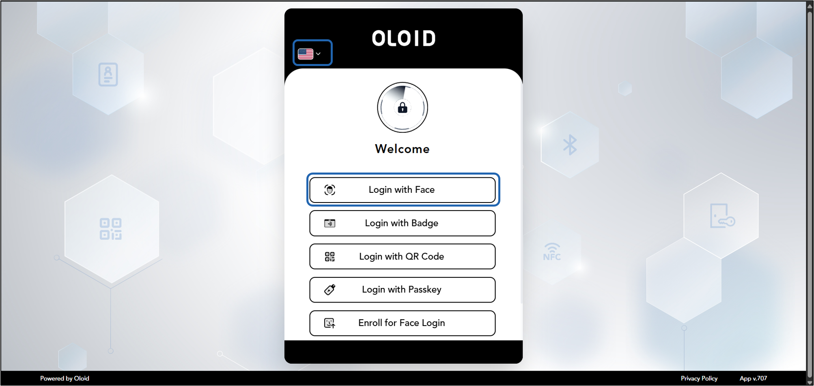
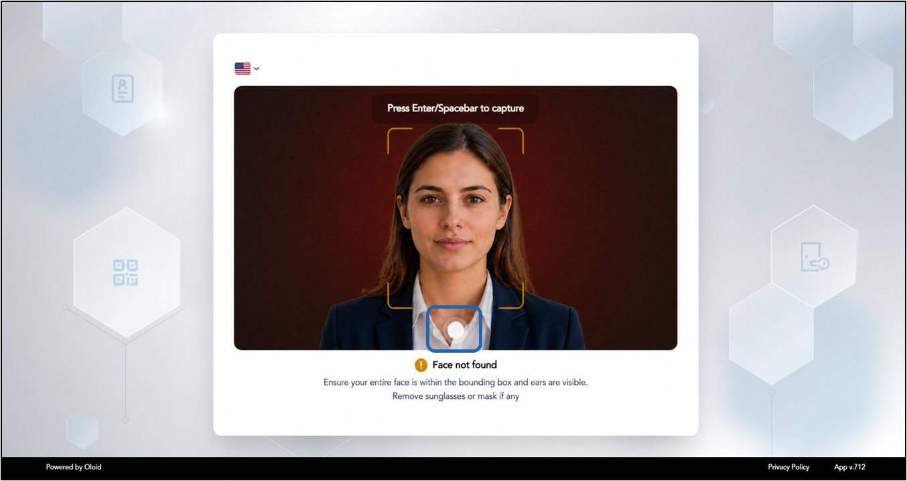
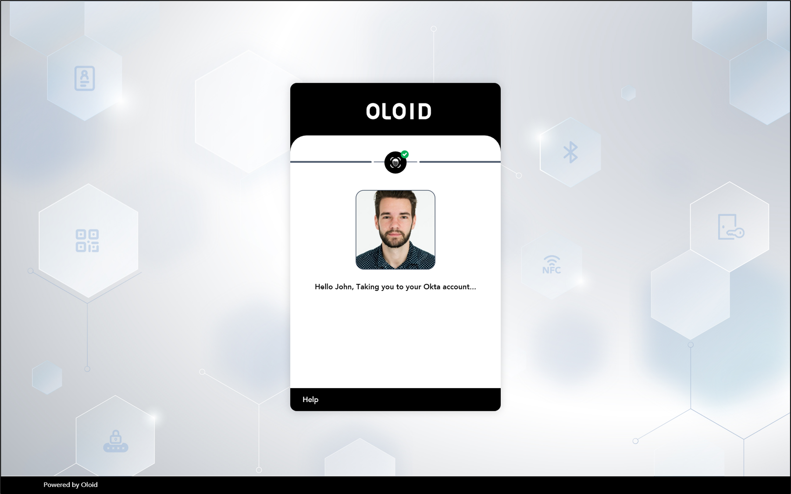

{/* Source: Intercom article 9259082 - https://oloid.help/en/articles/9259082-webkey-how-to-log-into-workforce-hrms-platform-using-face-through-webkey */}
{/* Generated by intercom_to_mintlify.py - re-running overwrites this file. */}

## Introduction

This document provides step-by-step instructions for logging in with face to Workforce /HRMS platform.

## Prerequisites

- You must have an Okta account.
- The Okta credential (user email ID) must be added to the user detail page.
- In the Tenant Admin Portal, you must do the following:
  - Add Face to the user. For more details, refer [How to onboard face of a single user](/platform/tenant-admin-portal/tenant-admin-portal-how-to-add-face-of-a-single-user)
  - Enable Face under the WebKey Application. For more details, refer [How to create and configure WebKey application](/platforms/web/webkey/webkey-how-to-create-and-configure-a-webkey-application-in-tenant)
  - Manual face capture (as per the requirement) must be configured in Oloid Portal. You need to turn on [Enable Manual Capture Accessibility](/platforms/web/webkey/webkey-how-to-create-and-configure-a-webkey-application-in-tenant)toggle buttonin WebKey Configuration. For detailed instruction see, [WebKey: Platform Configuration for manual capture of face](/platforms/web/webkey/webkey-how-to-configure-manual-face-capture-for-webkey)

## Steps to Login using Face

1. Launch the **Webkey** Application URL in your browser.
2. On the home page of the app, select **Login with Face**.
   **Note: I**f configured in the Tenant Admin Portal, you can select your preferred display language from the Language Dropdown Selector.

   

   Place your face in front of the camera for facial authentication.
3. The camera auto-captures the user's face.
   If manual capture is enabled, press **Enter or Spacebar,** or click on the camera icon.

Authentication in progress.

You are signed in to the **Workforce / HRMS** platform when facial authentication is done.

---

##### Video Tutorial

Watch the video [How to log into Workforce /HRMS platform using Face through WebKey - Video Tutorial](/platforms/web/videos/how-to-log-into-workforce-hrms-platform-using-face-through-webkey)
