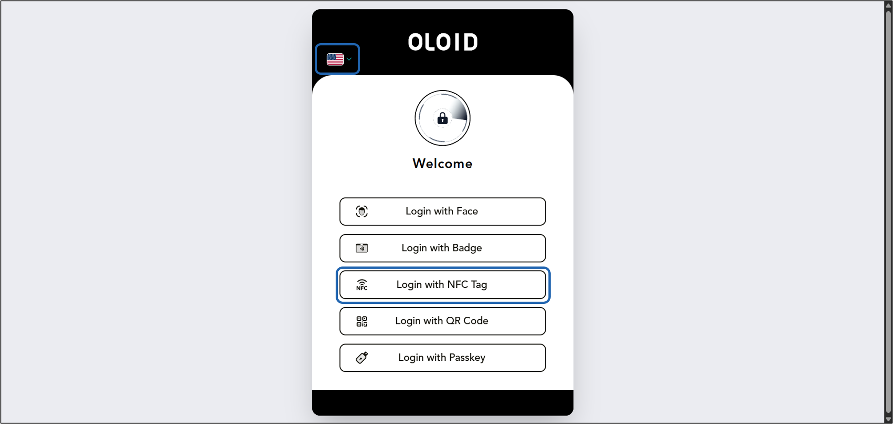
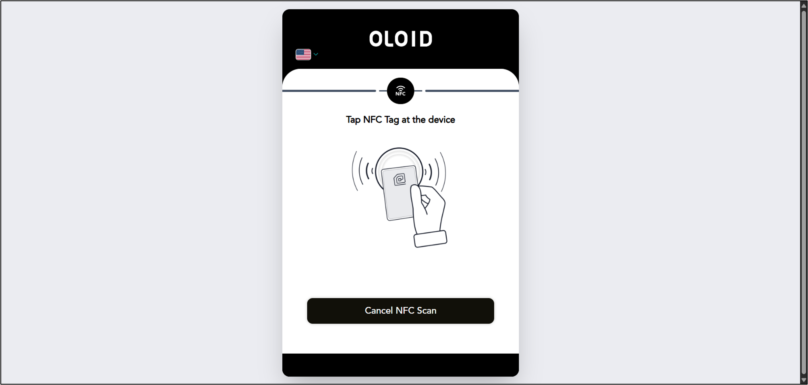

{/* Source: Intercom article 9286137 - https://oloid.help/en/articles/9286137-webkey-how-to-log-into-workforce-hrms-platform-using-nfc-id */}
{/* Generated by intercom_to_mintlify.py - re-running overwrites this file. */}

## Introduction

This document provides step-by-step instructions for logging in to the Workforce / HRMS platform using NFC/ID authentication through Webkey.

## Prerequisites

- You must have an Okta account.
- The Okta credential must be added to the user detail page. For more details, refer [How to configure user details](/platform/tenant-admin-portal/tenant-admin-portal-how-to-configure-user-details)
- In the Tenant Admin Portal, you must do the following:
  - Assign NFC/ID to the user. For more details, refer [How to assign NFC/ID as a credential to the user](/platform/tenant-admin-portal/how-to-assign-nfc-id-as-a-credential-to-the-user)
  - Enable NFC/ID under the WebKey Application. For more details, refer [How to create and configure WebKey application](/platforms/web/webkey/webkey-how-to-create-and-configure-a-webkey-application-in-tenant) >[Configure Authenticator tab](/platforms/web/webkey/webkey-how-to-create-and-configure-a-webkey-application-in-tenant)

### Steps to Login using the NFC/ID

1. Launch the **WebKey** Application URL in your browser.
2. On the home page of the app, select **Login with NFC/ID**.

   <Note>
     **Note:** You can select preferred display language from the **Language Dropdown Selector**. For more information, refer [Additional information section](#additional-information).
   </Note>

   

   The **Scan NFC/ID Tag** screen is displayed.
3. Tap the **NFC/ID** tag on the **Reader** to scan it.

   <Note>
     **Note:** The Reader should be connected to your system.
   </Note>

   

   You are signed in to the **Workforce / HRMS** platform when NFC authentication is done.

   

---

#### Additional Information

**WebKey** now supports multiple language versions, allowing users to select their preferred display language from the **Language Dropdown Selector** on the Login screen.

<Note>
  **Note:** Languages supported: English, Spanish, French, German, and Portuguese language.
</Note>

##### Sample Screen

The display language updates based on the selected language. The following sample shows the WebKey application in German.

---

##### Video Tutorial

Watch the video [How to log into Workforce Management platforms using NFC/ID through WebKey - Video Tutorial](/platforms/web/videos/how-to-log-into-workforce-management-platforms-using-nfc-id-through)
