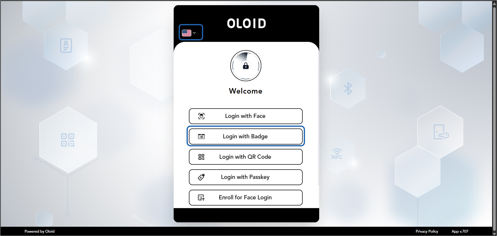
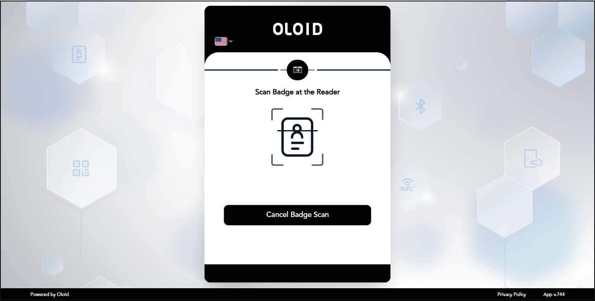
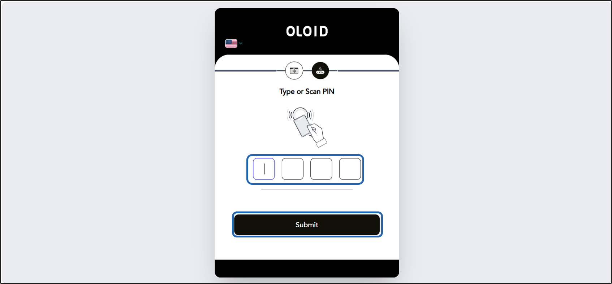

{/* Source: Intercom article 8611424 - https://oloid.help/en/articles/8611424-webkey-how-to-log-into-workforce-hrms-platforms-using-badge-and-pin-through-webkey */}
{/* Generated by intercom_to_mintlify.py - re-running overwrites this file. */}

## Introduction

Users must first authenticate by scanning their registered badge and then verify their identity using their PIN before being signed in to the configured Workforce or HRMS platform.

## Prerequisites

- You must have an Okta account.
- The Okta credential must be added to the user detail page. For more details, refer [How to configure user details](/platform/tenant-admin-portal/tenant-admin-portal-how-to-configure-user-details)
- In the Tenant Admin Portal, you must do the following:
  - Assign badge to the user. For more details, refer [How to assign Badge ID as credential to users](/platform/tenant-admin-portal/how-to-assign-badge-id-as-credential-to-users)
  - Add a PIN for the user. For more details, refer [How to add PIN as credential to users](/platform/tenant-admin-portal/tenant-admin-portal-how-to-add-pin-credential-for-user)
  - Enable Badge and PIN options under the WebKey Application. For more details, refer [How to create and configure Webkey application](/platforms/web/webkey/webkey-how-to-create-and-configure-a-webkey-application-in-tenant)

## Steps to Log in using Badge

1. Launch the **Webkey** Application URL in your browser.
2. On the home page of the app, select **Login with Badge**.
   **Note: I**f configured in the Tenant Admin Portal, you can select your preferred display language from the Language Dropdown Selector.

   

   The **Scan Badge at the Reader** screen is displayed.
3. Tap the **Badge** on the **Reader** to scan it.

   

   On Badge authentication, the **Type or Scan PIN** screen is displayed.
4. Do any of the following:
   1. Enter **PIN**.
      OR
   2. Tap the card that contains the PIN on the **Reader** to scan it.

      <Note>
        **Note:** The Reader should be connected to your system.
      </Note>

5. Enter the **PIN**.
6. Click **Submit**.

On PIN authentication, you are signed in to the **Workforce /HRMS** platform.

---

##### Video Tutorial

Watch the video [How to log into Workforce Management platforms using Badge and PIN through WebKey - Video Tutorial](/platforms/web/videos/how-to-log-into-workforce-management-platforms-using-badge-and-pin)
