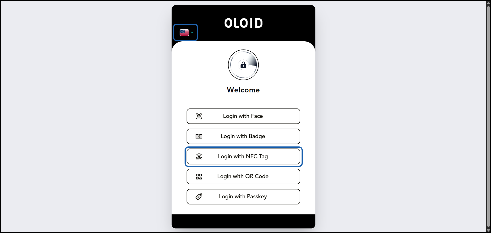
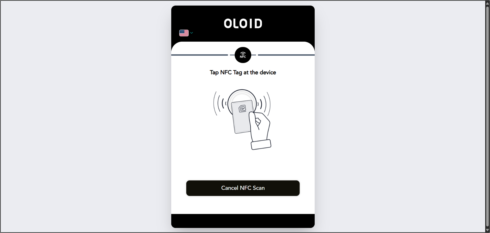
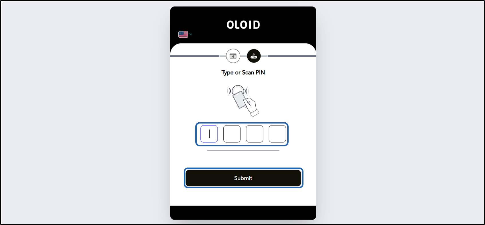
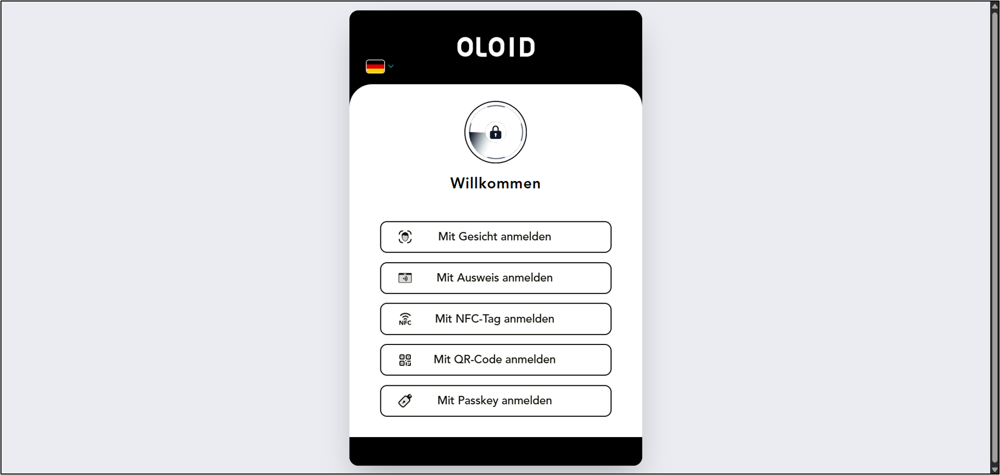

{/* Source: Intercom article 9245333 - https://oloid.help/en/articles/9245333-webkey-how-to-log-into-workforce-hrms-platforms-using-nfc-id-and-pin-in-webkey */}
{/* Generated by intercom_to_mintlify.py - re-running overwrites this file. */}

## Introduction

This document provides step-by-step instructions for logging in with NFC/ID and PIN to Workforce / HRMS platforms.

## Prerequisites

- You must have an Okta account.
- In the Tenant Admin Portal, you must do the following:
  - Assign NFC to the user. For more details, refer [How to assign NFC/ID as a credential to the user](/platform/tenant-admin-portal/how-to-assign-nfc-id-as-a-credential-to-the-user)
  - Add a PIN for the user. For more details, refer [How to add PIN as credential to users](/platform/tenant-admin-portal/tenant-admin-portal-how-to-add-pin-credential-for-user)
- In the Tenant Admin Portal, you must enable NFC/ID and PIN under the WebKey Application. For more details, refer [How to create and configure Webkey application](/platforms/web/webkey/webkey-how-to-create-and-configure-a-webkey-application-in-tenant) > [Configure Authenticator tab](/platforms/web/webkey/webkey-how-to-create-and-configure-a-webkey-application-in-tenant)

## Login using Badge and PIN

1. Launch the **Webkey** Application URL in your browser.
2. On the home page of the app, select **Login with NFC/ID**.
   **Note: I**f configured in the Tenant Admin Portal, you can select your preferred display language from the Language Dropdown Selector.

   

   The **Scan NFC/ID Tag** screen is displayed.
3. Tap the **NFC/ID** tag on the **Reader** to scan it.

   <Note>
     **Note:** The Reader should be connected to your system.
   </Note>

   

   On NFC/ID authentication, the **Type or Scan PIN** screen is displayed.
4. Do any of the following:
   1. Tap the card that contains the PIN on the **Reader** to scan it.

<Note>
  **Note:** The Reader should be connected to your system.
</Note>

**(OR)**

1. Enter the **PIN**.
2. Click **Submit**.

On PIN authentication, you are signed in to the **Workforce /HRMS** platform.

---

#### Additional Information

**WebKey** now supports multiple language versions, allowing users to select their preferred display language from the **Language Dropdown Selector** on the Login screen.

<Note>
  **Note:** Languages supported: English, Spanish, French, German, and Portuguese language.
</Note>

##### Sample Screen

The display language updates based on the selected language. The following sample shows the WebKey application in German.

---

##### Video Tutorial

Watch the video [How to log into Workforce Management platforms using NFC/ID and PIN through WebKey - Video Tutorial](/platforms/web/videos/how-to-log-into-workforce-management-platforms-using-nfc-id-and-pin)
