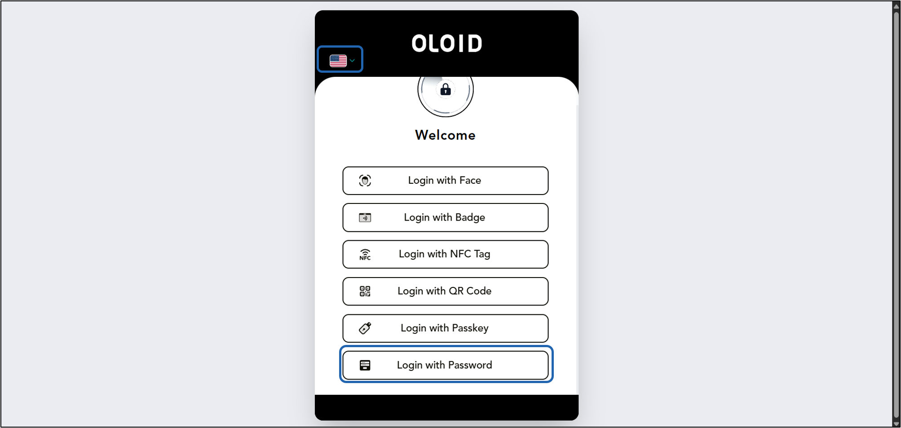
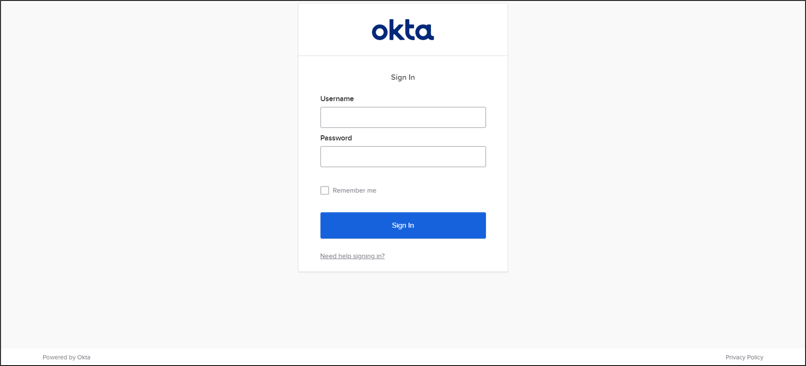

{/* Source: Intercom article 8856182 - https://oloid.help/en/articles/8856182-webkey-how-to-log-into-workforce-hrms-platforms-using-password-through-webkey */}
{/* Generated by intercom_to_mintlify.py - re-running overwrites this file. */}

## Introduction

This document provides step-by-step instructions for logging in with Password to Workforce / HRMS platform.

## Prerequisites

- You must have an Okta account.
- The Okta credential must be added to the user detail page. For more details, refer [How to configure user details](/platform/tenant-admin-portal/tenant-admin-portal-how-to-configure-user-details)
- In the Tenant Admin Portal, you must enable custom login option under the WebKey application. For more details, refer [How to create and configure WebKey application](/platforms/web/webkey/webkey-how-to-create-and-configure-a-webkey-application-in-tenant) > [Design Configure Tab](/platforms/web/webkey/webkey-how-to-create-and-configure-a-webkey-application-in-tenant) > [Configure Login Page Options](/platforms/web/webkey/webkey-how-to-create-and-configure-a-webkey-application-in-tenant).

### Steps to Log in with Password

1. Launch the **Webkey** Application URL in your browser.
2. On the home page of the app, select **Login with Password**.
   **Note: I**f configured in the Tenant Admin Portal, you can select your preferred display language from the Language Dropdown Selector.

   

   The Okta Sign In page is displayed.
3. Enter your login credential.

On password authentication, you are successfully signed in to the Okta system.

---

##### Video Tutorial

Watch the video [How to log into Workforce Management platforms using Password through WebKey - Video Tutorial](/platforms/web/videos/how-to-log-into-workforce-management-platforms-using-password-through)
