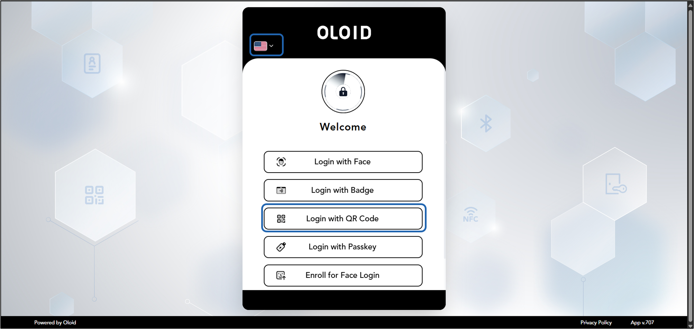
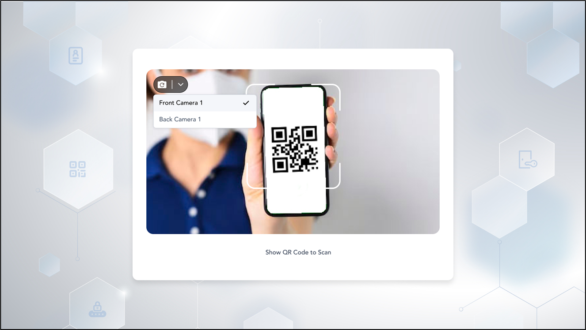
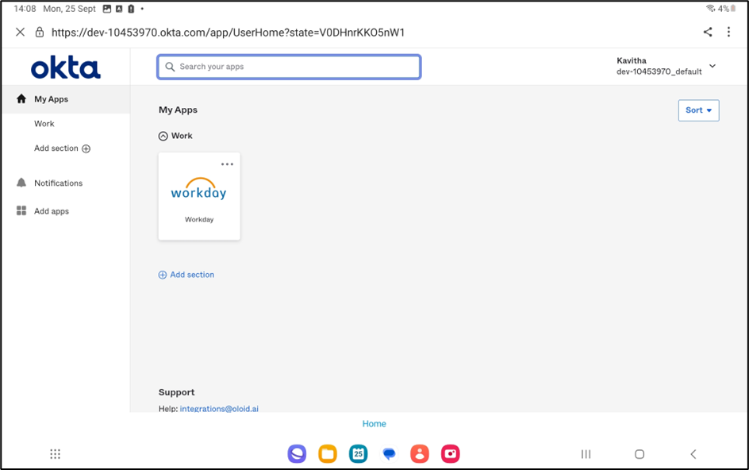

{/* Source: Intercom article 8855767 - https://oloid.help/en/articles/8855767-webkey-how-to-log-into-workforce-hrms-platforms-using-qr-code-through-webkey */}
{/* Generated by intercom_to_mintlify.py - re-running overwrites this file. */}

## Introduction

This document provides step-by-step instructions for logging in with QR Code to Workforce /HRMS platform.

### Pre-requisite

- You must have an Okta account.
- The Okta credential must be added to the user detail page. For more details, refer [How to configure user details](/platform/tenant-admin-portal/tenant-admin-portal-how-to-configure-user-details)
- In the tenant Admin Portal, you must do the following:
  - Create QR Code for the user. For more details, refer [How to create QR code as credential for User](/platform/tenant-admin-portal/tenant-admin-portal-how-to-create-and-share-qr-code-credential-with)
  - Enable QR Code option under the WebKey Application. For more details, refer [How to create and configure WebKey application](/platforms/web/webkey/webkey-how-to-create-and-configure-a-webkey-application-in-tenant)
  - If you are using Android phones, tablets, dual-camera laptops, and laptops with external cameras, you can select camera options (front/rear). To configure camera options, refer to [Show Camera Flip button](/platforms/web/webkey/webkey-how-to-create-and-configure-a-webkey-application-in-tenant)

### Using the QR Code

1. Launch the **Webkey** Application URL in your browser.
2. On the home page of the app, select **Login with QR Code**.
   **Note: I**f configured in the Tenant Admin Portal, you can select your preferred display language from the Language Dropdown Selector.

   

   By default, the front camera opens for QR code scanning.
3. Hold your mobile device or tablet with the QR code facing the preview screen. Next, scan QR Code for QR Code authentication.

   

4. If your device supports multiple cameras, then do the following:
   1. Tap the **Camera Flip Button** in the preview screen.
   2. Select **Front Camera** or **Back Camera** as needed.
   3. Scan the QR code.

<Note>
  **Note:** The Camera Flip option must be configured for WebKey application.
</Note>

You are logged into the Workforce /HRMS platform when QR Code authentication is done.

---

##### Video Tutorial

Watch the video [How to log into Workforce Management platforms using QR Code through WebKey -Video Tutorial](/platforms/web/videos/how-to-log-into-workforce-management-platforms-using-qr-code-through)
