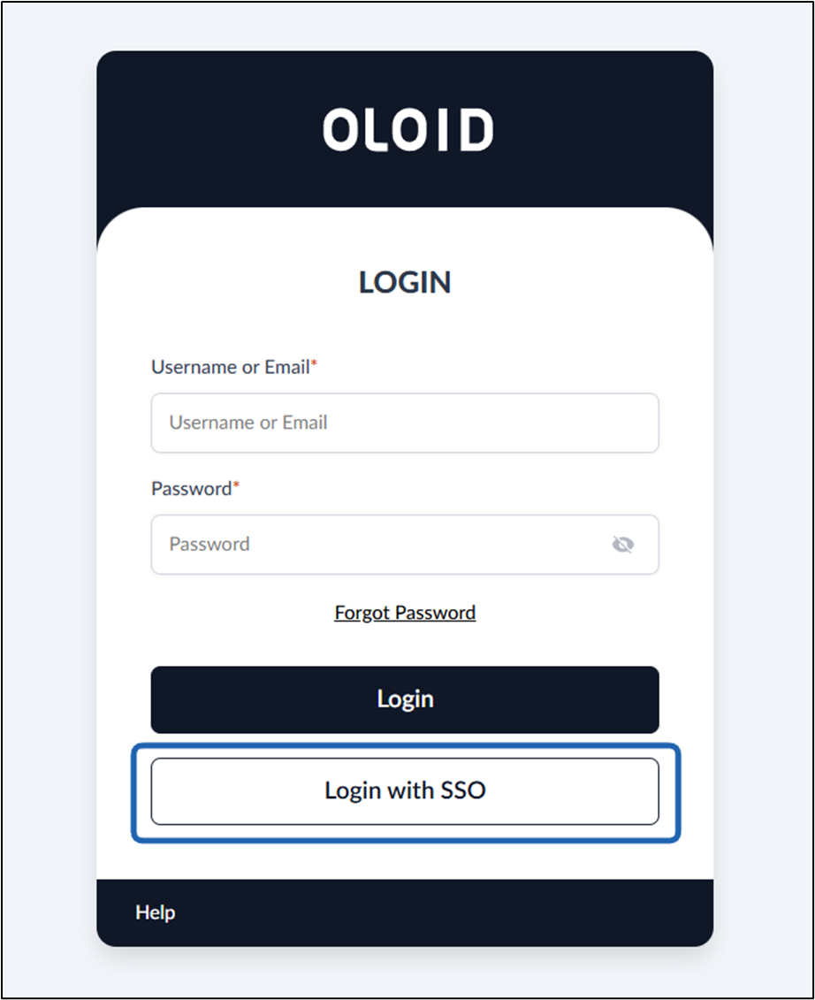
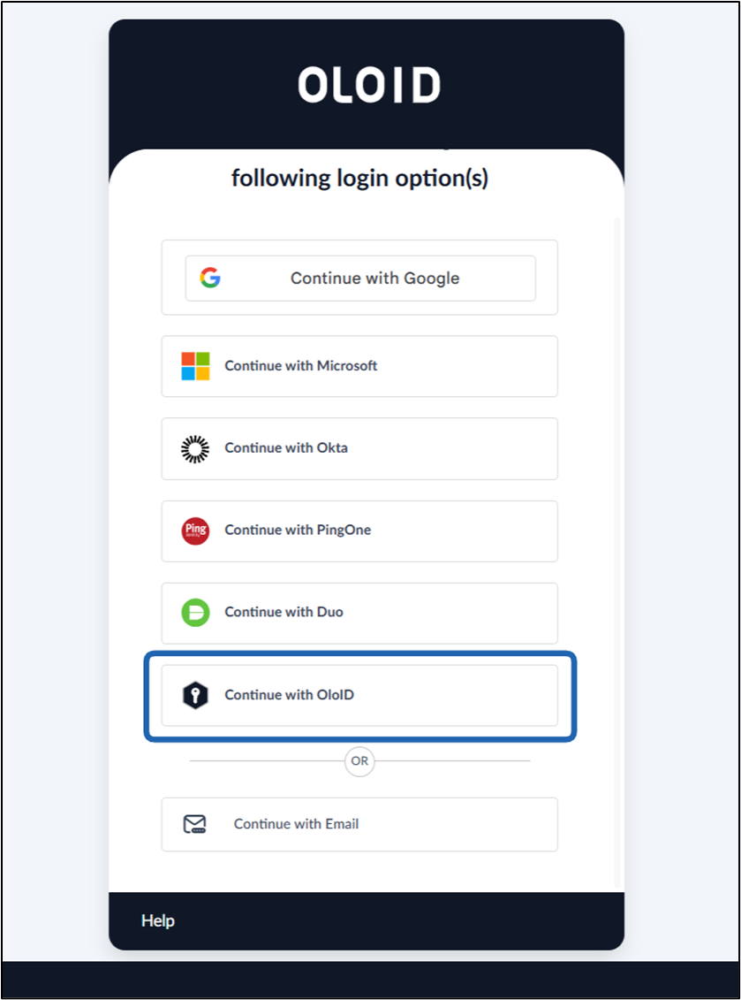
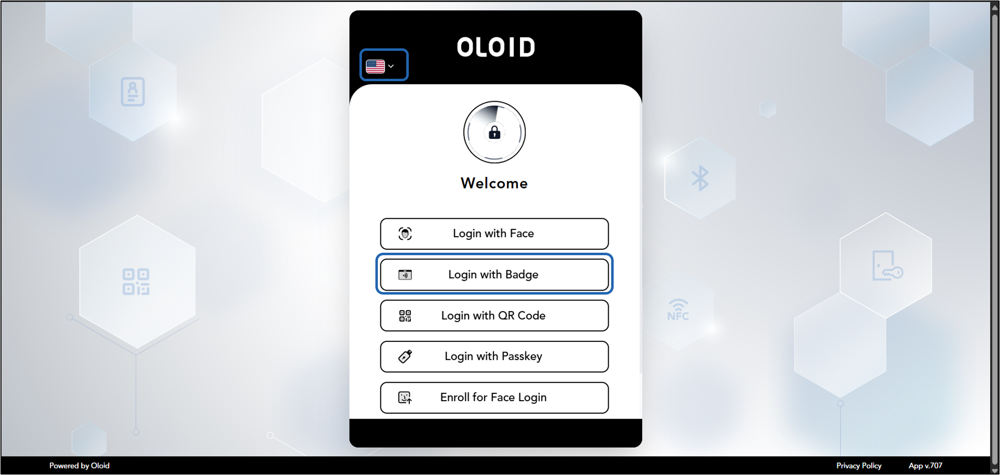
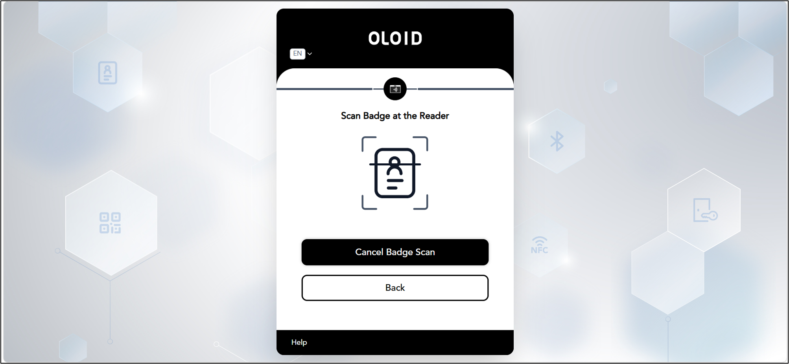
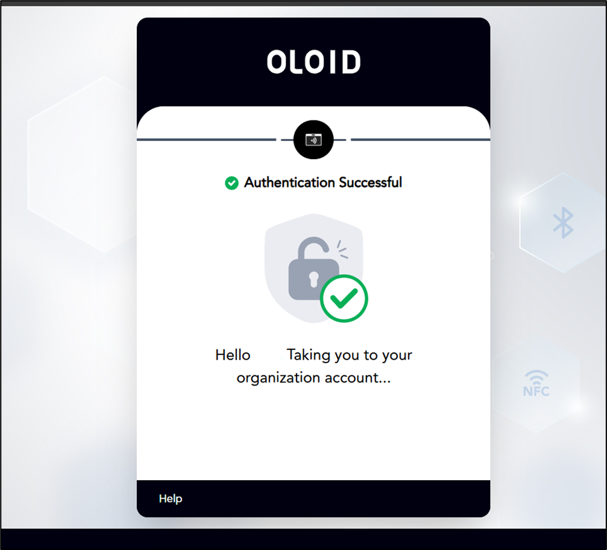
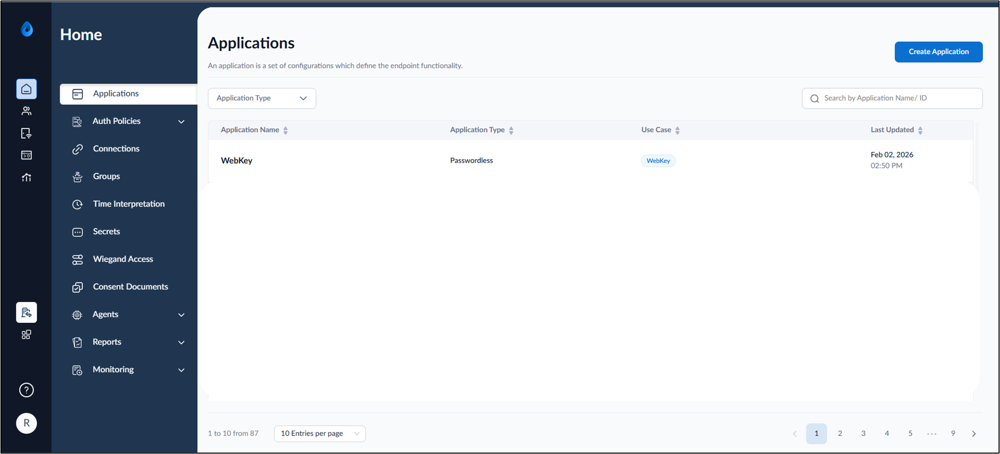

{/* Source: Intercom article 13597429 - https://oloid.help/en/articles/13597429-webkey-how-to-login-to-tenant-admin-portal-with-oloid-webkey-sso */}
{/* Generated by intercom_to_mintlify.py - re-running overwrites this file. */}

## Introduction

Oloid WebKey SSO enables the Tenant Admin to securely access the Tenant Admin Portal using single sign-on authentication.

## Prerequisites

- You must have access to a Tenant Admin account.
- Credential configuration must be configured for Webkey application. For more information, refer: [How to create and configure WebKey Application in Tenant Admin Portal](/platforms/web/webkey/webkey-how-to-create-and-configure-a-webkey-application-in-tenant)
- Webkey SSO is **enabled for your account**. Refer: [Oloid Webkey - How to Enable Webkey SSO login](/platforms/web/webkey/webkey-how-to-enable-oloid-webkey-sso-login)

## Steps to log into Tenant Admin Portal using Webkey SSO

1. Launch your browser.
2. Enter the provided **URL** in the browser’s address bar and press **Enter**.
   The **Oloid Login** page is displayed.
3. Click **Login with SSO**.

   

   The configured login options are displayed.
4. Click **Continue with OloID**.

   

   The Authentication screen is displayed.
5. Select a credential to log in and complete authentication.

   <Note>
     **Note:** You can select preferred display language from the **Language Dropdown Selector**. For more information, refer [Additional information section](#additional-information).
   </Note>

   

   **For Example:** If User selects **Login with Badge** the scan badge screen is displayed.
6. Tap the **Badge** on the **Reader** to scan it.

   

The authentication successful message is displayed.

The user is logged into Tenant Admin Portal.

---

#### Additional Information

**WebKey** now supports multiple language versions, allowing users to select their preferred display language from the **Language Dropdown Selector** on the Login screen.

<Note>
  **Note:** Languages supported: English, Spanish, French, German, and Portuguese language.
</Note>

##### Sample Screen

The display language updates based on the selected language. The following sample shows the WebKey application in German.

