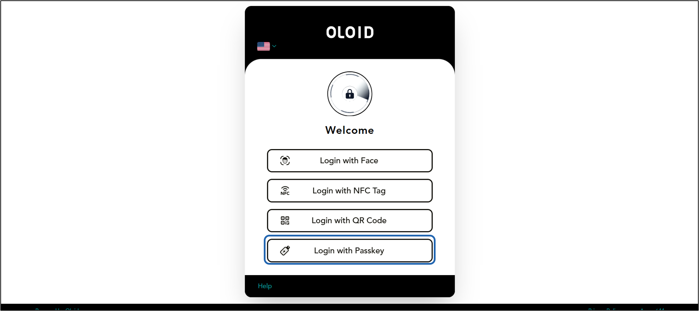
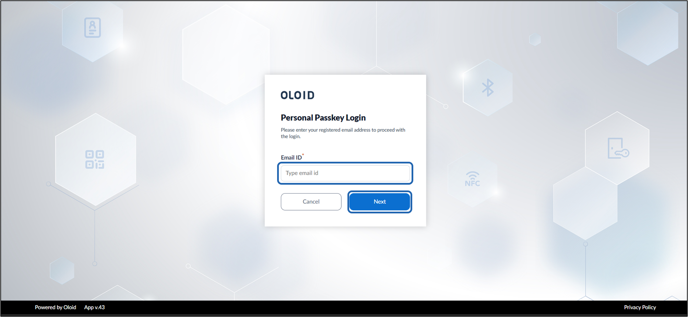
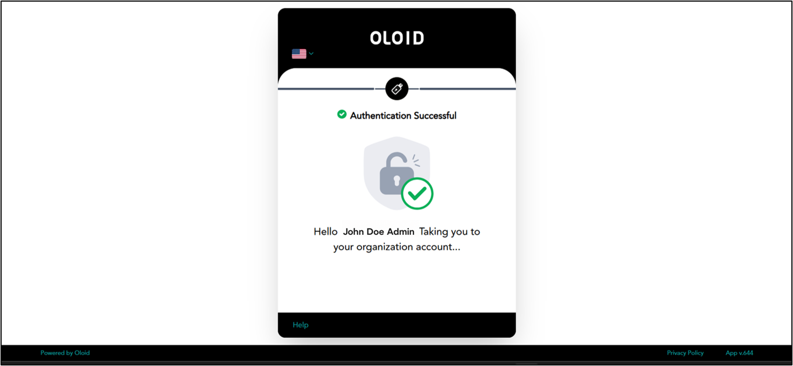

{/* Source: Intercom article 15737154 - https://oloid.help/en/articles/15737154-webkey-how-to-login-to-workforce-hrms-using-personal-passkey */}
{/* Generated by intercom_to_mintlify.py - re-running overwrites this file. */}

## Introduction

This document provides step-by-step instructions to log in to Workforce/ HRMS using a Personal Passkey.

## Prerequisites

- Ensure Personal Passkey is created for the user. Refer: [How to Generate Personal Passkey in the Tenant Admin Portal](/more/passwordless-authenticator/tenant-admin-portal-how-to-generate-personal-passkey)
- Ensure Personal Passkey is enabled for Webeky. refer: Webkey - How to Enable Personal Passkey in the Tenant Admin Portal

## Steps to Log in using Personal Passkey

1. Launch the **WebKey** Application URL in your browser.
2. On the home page of the app, select **Login with Passkey**.

   <Note>
     **Note:** You can select preferred display language from the **Language Dropdown Selector**. For more information, refer [Additional information section](#additional-information).
   </Note>

   

   The Oloid login page is displayed.
3. Enter **Email ID** > click **Next**.

   

   The user is authenticated using passkey.

   

   The User signed in to the **Workforce /HRMS** platform.

   

---

#### Additional Information

**WebKey** now supports multiple language versions, allowing users to select their preferred display language from the **Language Dropdown Selector** on the Login screen.

<Note>
  **Note:** Languages supported: English, Spanish, French, German, and Portuguese language.
</Note>

##### Sample Screen

The display language updates based on the selected language. The following sample shows the WebKey application in German.

