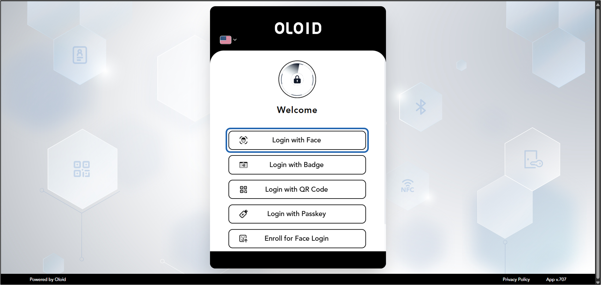
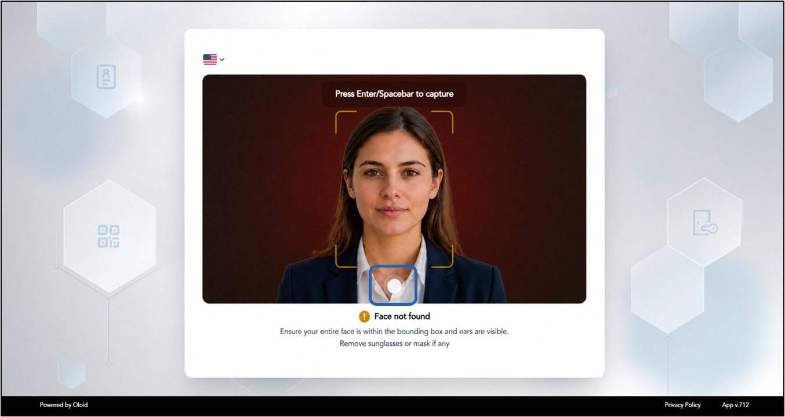
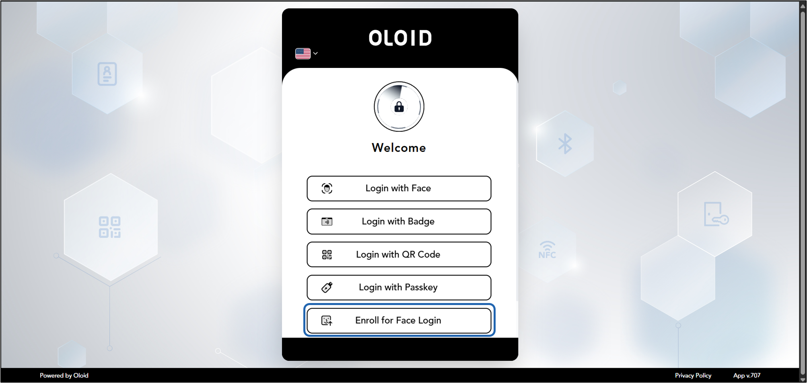
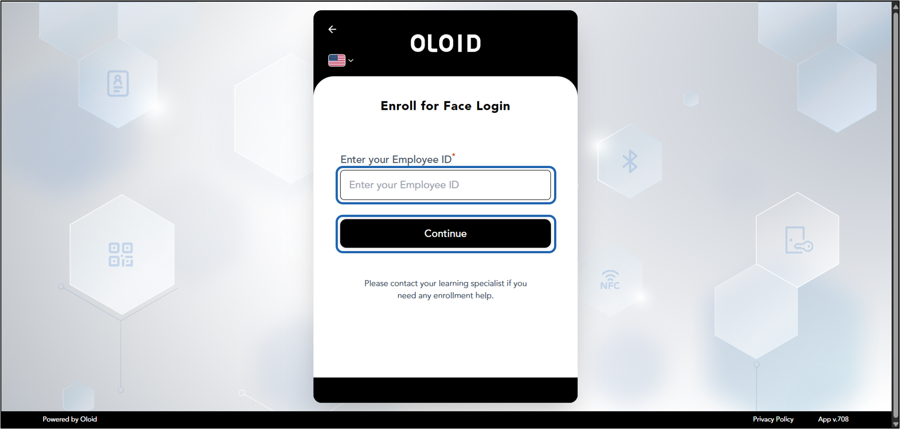
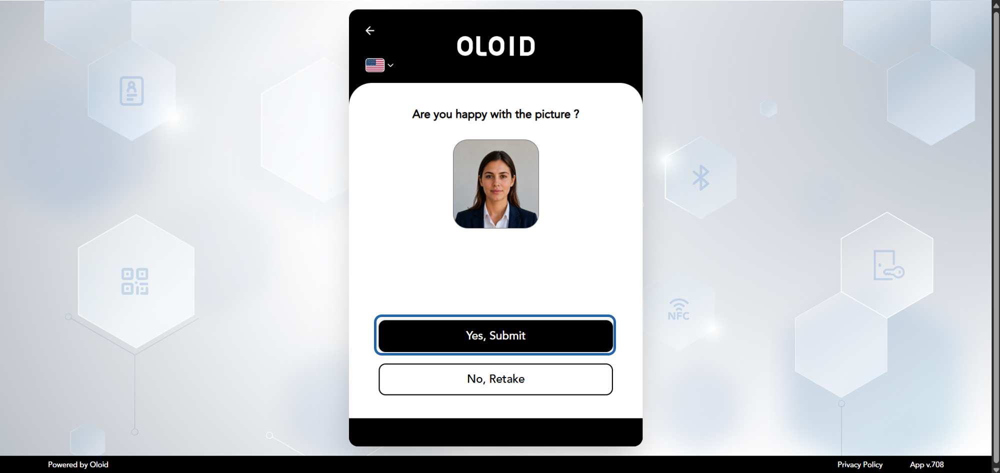
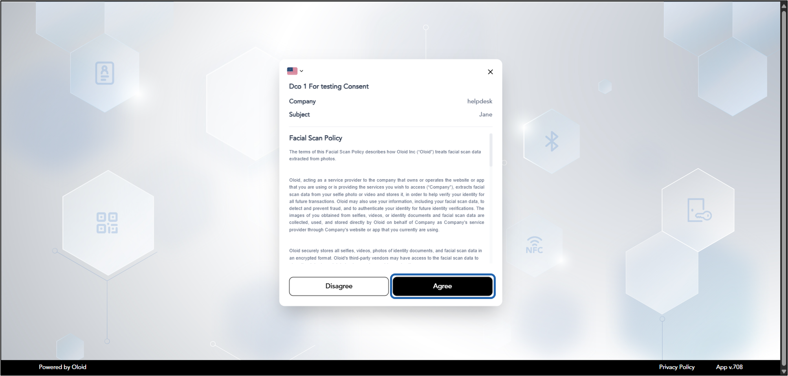
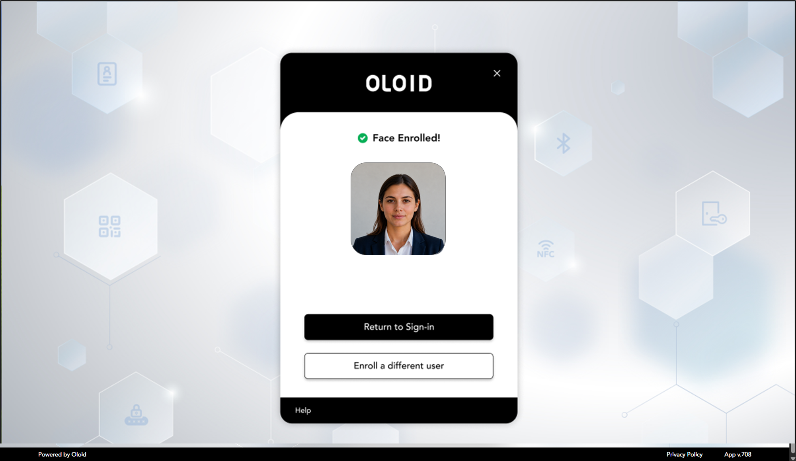

{/* Source: Intercom article 13165653 - https://oloid.help/en/articles/13165653-webkey-how-to-re-submit-consent */}
{/* Generated by intercom_to_mintlify.py - re-running overwrites this file. */}

## Introduction

Re-submit Consent ensures that users explicitly acknowledge and accept updated consent documents before continuing with face-based authentication or enrollment. When the consent content is modified, users are prompted to re-consent.

## Prerequisite

Resubmit-consent pop-up will only appear if the consent document is updated.

## Steps to re-submit consent

Reconsent Document must be submitted for the following cases:

1. [For login using face authentication](#re-submit-consent-for-login-using-face-authentication)(if the consent document has been updated)
2. For Enrolling Face (if the consent document has been updated)

### Re-submit consent for login using face authentication

1. Launch the **Webkey** Application URL in your browser.
2. Select **Login with Face**.

   <Note>
     **Note:** You can select preferred display language from the **Language Dropdown Selector**. For more information, refer [Additional information section](#additional-information).
   </Note>

   

   The camera opens.
3. Position your face in front of the camera and tap the Capture button to authenticate face.

   <Note>
     **Note:** If you do not tap the Capture button, the app automatically captures your face after a few seconds.
   </Note>

   

4. The re-submit consent screen appears.
5. Click **Agree.**

   

   <Note>
     **Note:** You need to provide your consent to proceed to next steps if consent is enabled for you.
   </Note>

   Face is successfully authenticated and user is taken to their organization account.

---

### Re-submit consent to Enroll for Face

1. Launch the WebKey Application URL in your browser.
2. Select **Enroll for Face Login**.

   

   The **Enroll For Face Login** pageisdisplayed.
3. Enter the Employee ID (primary ID) > click **Continue**.

   

   The camera opens.
4. Position your face in front of the camera to capture your face for enrollment. If auto capture is enabled the system captures user image directly.

   <Note>
     **Note:** If auto capture is not configured press **Enter or Spacebar** to capture face.
   </Note>

   

   The Picture confirmation screen is displayed.
5. Click **Yes** to Submit.

   

   The Re-submit consent page is displayed.
6. Click **Agree**.

<Note>
  **Note:** You need to provide your consent to proceed to next steps if consent is enabled for you.
</Note>

Face enrollment is complete. You can now use Face Authentication to sign in to the workplace platform.

---

#### Additional Information

**WebKey** now supports multiple language versions, allowing users to select their preferred display language from the **Language Dropdown Selector** on the Login screen.

<Note>
  **Note:** Languages supported: English, Spanish, French, German, and Portuguese language.
</Note>

##### Sample Screen

The display language updates based on the selected language. The following sample shows the WebKey application in German.

