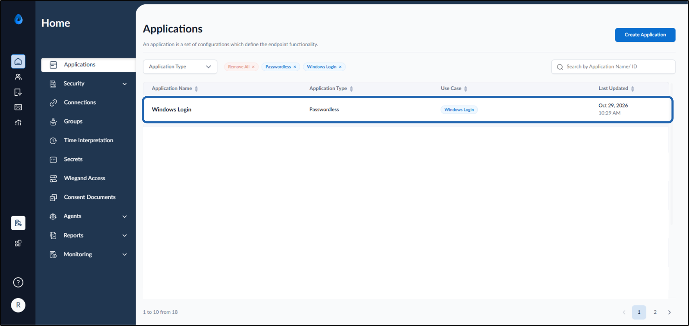
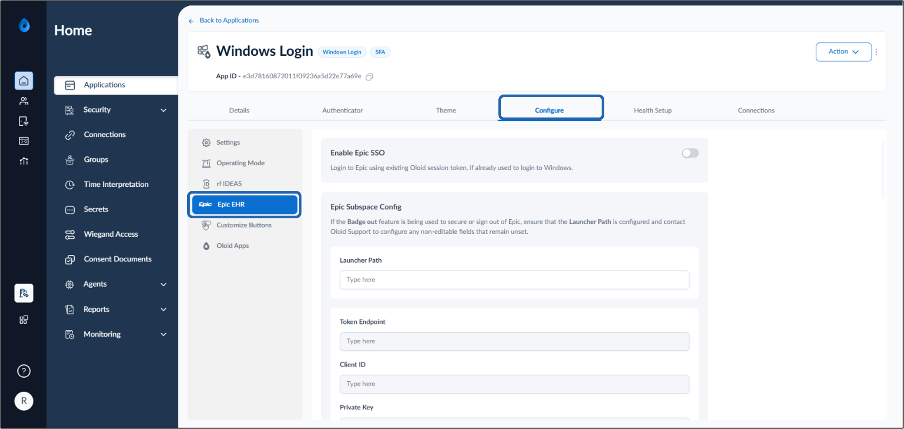
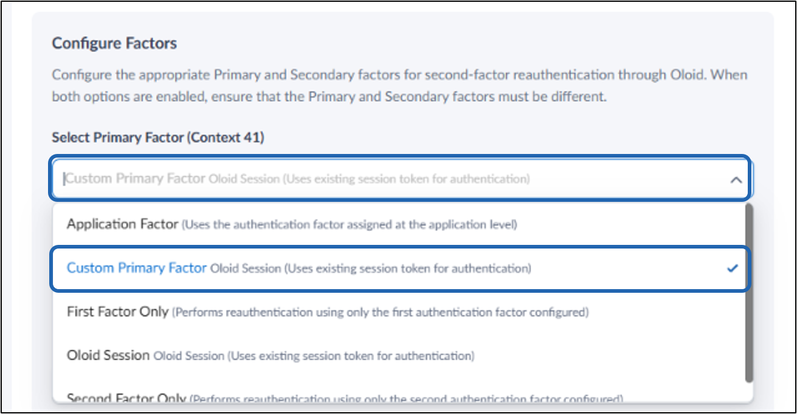
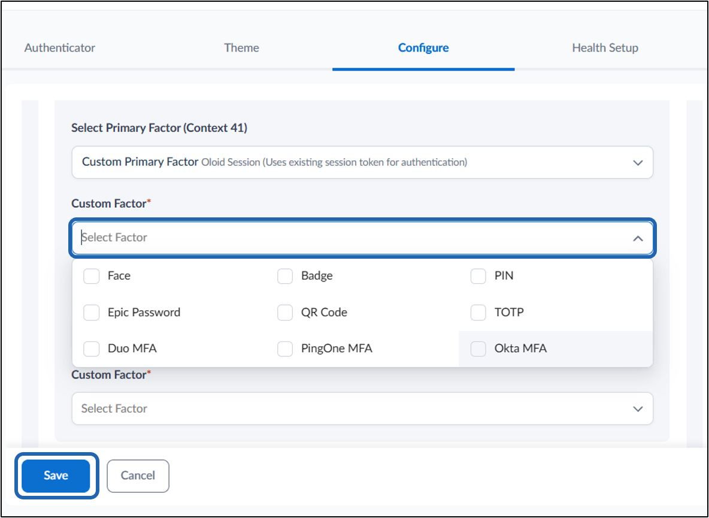
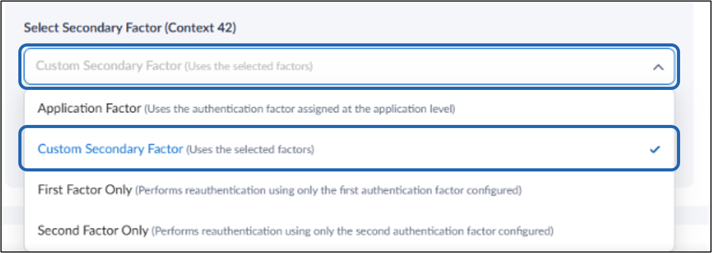
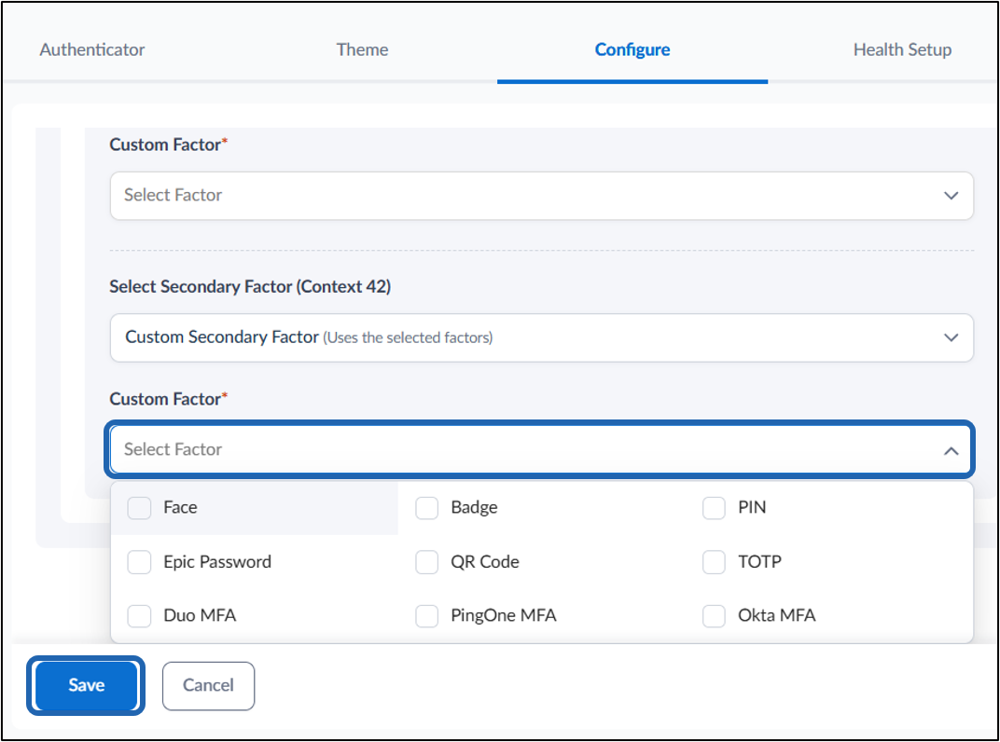
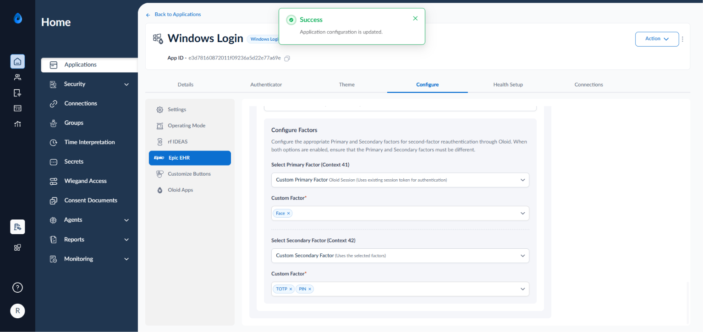

{/* Source: Intercom article 17764224 - https://oloid.help/en/articles/17764224-windows-login-healthcare-how-to-configure-custom-factor-for-epic-ehr-in-tenant-admin-portal */}
{/* Generated by intercom_to_mintlify.py - re-running overwrites this file. */}

## Introduction

The Epic EHR Re-Authentication Workflow for the Windows Login application lets admins define which authentication factors users must complete when Epic prompts them to re-authenticate. Admins configure this workflow from the Epic EHR section of the Configure tab in the Tenant Admin Portal. Admins can select one or more custom factors for each context.

## Prerequisites

- You must have access to Tenant Admin account.
- The Windows Login application must be created in the Tenant Admin Portal, for more information refer: [How to create and configure Application Type - Passwordless](/platform/tenant-admin-portal/how-to-create-and-configure-application-type-passwordless)

## Steps to Configure Re-authentication Workflow

1. Log in to the Tenant Admin Portal.
2. On the **Applications** page, select the preferred **Windows Login application**.

   

   The application details page is displayed.
3. Click **Configure** tab > **Epic EHR**.

   

   The Epic EHR page is displayed.
4. To configure factors, do the following:
   1. Under **Select Primary Factor (Context 41)**, select **Custom Primary Factor** from dropdown:
      - **Custom Primary Factor** : Uses the factors that you select in the **Custom Factor** dropdown.

        

   2. From the **Custom Factor** dropdown, select one or more factors, such as Face, Badge, PIN, Epic Password, QR Code, TOTP, Duo MFA, Ping MFA or Okta MFA.
   3. Click **Save.**

      <Note>
        **Note:** The **Custom Factor** dropdown lists all factors supported for your tenant.
      </Note>

      

   4. Under **Select Secondary Factor (Context 42)**, select **Custom Secondary Factor** from dropdown:
      - **Custom Secondary Factor**: Uses the factors that you select in the **Custom Factor** dropdown.

        

   5. From the **Custom Factor** dropdown, select one or more factors, such as Face, Badge, PIN, Epic Password, QR Code, TOTP, Duo MFA, Ping MFA or Okta MFA.

      <Note>
        **Note:** Factors already selected for the Primary Factor (Context 41) are disabled in the Secondary Factor list, and vice versa.
      </Note>

   6. Click **Save**.

      <Note>
        **Note:** The Primary and Secondary factors must always be different. **Select at least one custom factor.**
      </Note>

      

      Custom factors are successfully configured.

      
