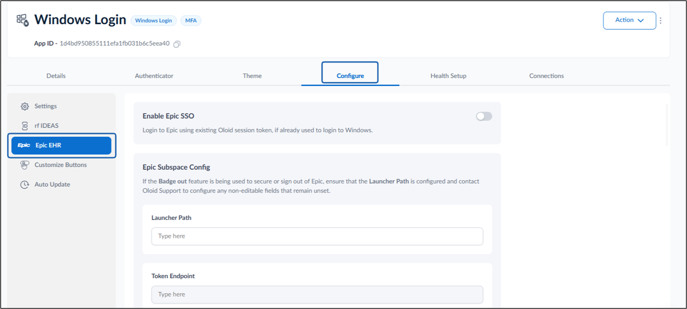
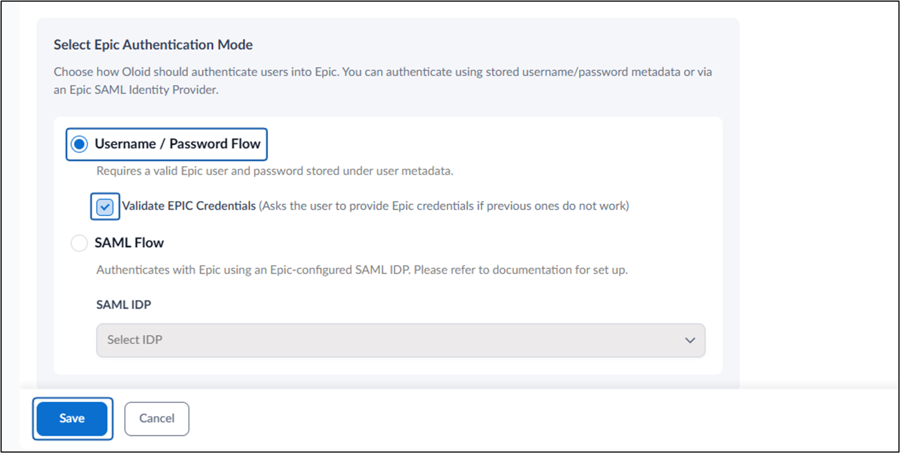
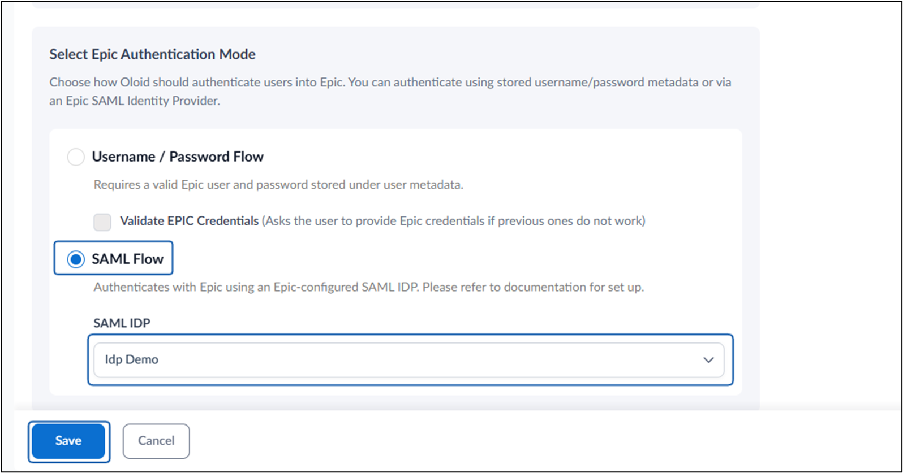
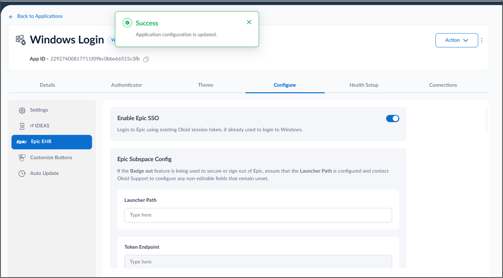

{/* Source: Intercom article 13714282 - https://oloid.help/en/articles/13714282-windows-login-healthcare-how-to-configure-epic-ehr-in-the-tenant-admin-portal */}
{/* Generated by intercom_to_mintlify.py - re-running overwrites this file. */}

## Introduction

Tenant Admin can configure **Epic EHR for Windows Login** in the Tenant Admin Portal which enables secure authentication into Epic applications using Windows Authenticator (Healthcare). This setup allows Tenant Admins to define how users are authenticated into Epic

## Prerequisites

- You must have a Tenant Admin account.
- The Windows Login application must be created in the Tenant Admin Portal, for more information see: [How to create and configure Application Type - Passwordless](/platform/tenant-admin-portal/how-to-create-and-configure-application-type-passwordless)
- Windows Authenticator Healthcare build must be installed in the system.
- Epic Vault Password must be created for both the user.

  <Note>
    **Note:** Vault Password is required for Username/ Password flow. For more information, refer: [Chrome Vault - How to create Vault Password for a user](/platform/tenant-admin-portal/tenant-admin-portal-how-to-create-vault-password-for-a-user)
  </Note>

- Ensure that Epic Hyperspace is installed. For more Information. refer: [How to Install Epic Hyperspace for Epic EHR](/platforms/windows/industry-workflows/healthcare/windows-login-healthcare-how-to-install-epic-hyperspace-for-epic-ehr)
- Ensure Epic Subspace Config is configured from the sys admin portal.

## Steps to configure Epic EHR for Windows Login

1. Login to the Tenant Admin Portal.
2. On the homepage on the left menu panel select **Home** > **Applications.**

   

3. Select the application that is configured in the Supervisor App (Windows Authenticator App).
   The application details page is displayed.
4. Click **Configure** tab> **Epic EHR** tab.

   

   The Epic EHR page is displayed.
5. Turn on the **Enable Epic SSO** toggle. For more information, refer: [Windows Login (Healthcare) - How to Enable Epic SSO in the Tenant Admin Portal](/platforms/windows/industry-workflows/healthcare/windows-login-healthcare-how-to-enable-epic-sso-in-the-tenant-admin)

   

6. [Configure Epic Authentication Mode](#configure-epic-authentication-mode)
7. Click **Save** to apply changes.
   Epic EHR is successfully configured.

### Configure Epic Authentication Mode

This section allows admins to define how Oloid authenticates users into Epic.

You can configure authentication using either:

- Stored Epic username/password (metadata-based authentication), or
- [Epic-configured SAML Identity Provider (SAML Flow)](#saml-flow)

#### Username / Password Flow

1. Select **Username / Password Flow**.

   <Note>
     **Note:** Ensure each user has a valid Epic username and password stored under their metadata.
   </Note>

2. Enable **Validate EPIC Credentials** if required.

   <Note>
     **Note:** Check **Validate EPIC Credentials** to prompt users to enter Epic credentials if previously stored credentials are incorrect or invalid.
   </Note>

3. Click **Save**.

   

#### SAML Flow

Use this option to authenticate users using an Epic-configured SAML Identity Provider.

1. Select **SAML Flow**.
2. From the **SAML IDP** dropdown, select the configured Identity Provider.

   <Note>
     **Note:** Ensure the SAML IDP configuration has been completed in Epic and Oloid prior to selection. For More: [How to Create IDP Profile for Security Assertion Markup Language (SAML) in the Tenant Admin Portal](/platform/tenant-admin-portal/tenant-admin-portal-how-to-create-idp-profile-for-security-assertion)
   </Note>

3. Click **Save**.

Epic EHR is successfully configured.

---

##### Related Documents

**[How to Configure Re-authentication Workflow for Epic EHR in Tenant Admin Portal](/platforms/windows/industry-workflows/healthcare/windows-login-healthcare-how-to-configure-reauthentication-workflow)**

---

##### Sync Configuration to Apply Changes

You must sync configuration in the supervisor app to apply changes . For Detailed steps, see [How to sync configuration in Supervisor App](/platforms/windows/supervisor-app/how-to-sync-configuration-in-supervisor-app)
