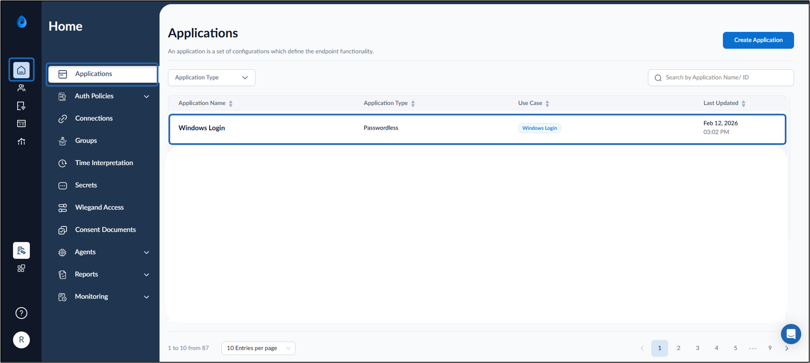
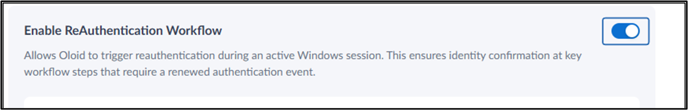
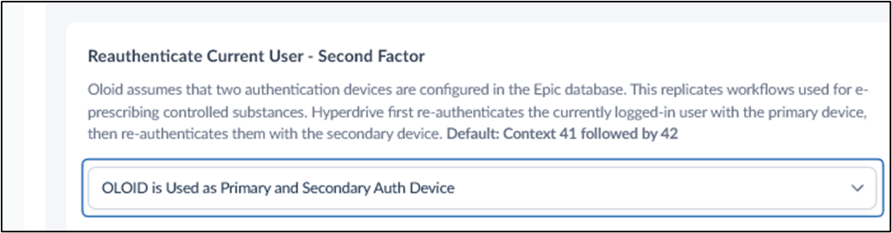
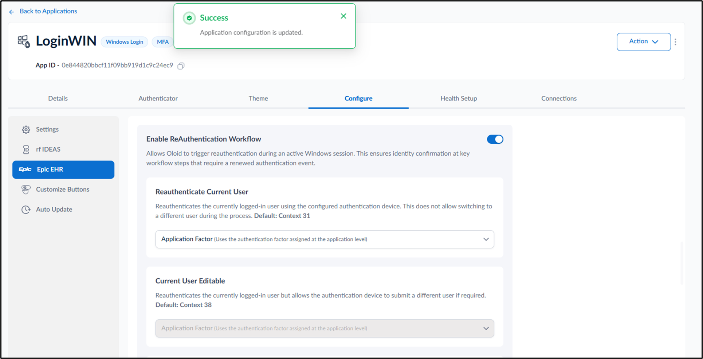

{/* Source: Intercom article 15103078 - https://oloid.help/en/articles/15103078-windows-login-healthcare-how-to-configure-reauthenticate-current-user-second-factor-in-tenant-admin-portal */}
{/* Generated by intercom_to_mintlify.py - re-running overwrites this file. */}

## Introduction

The **Reauthenticate Current User – Second Factor** workflow requires the logged-in user to verify their identity using an additional authentication factor during an active session. Tenant Admin can configure the authentication process, either as a primary or secondary authentication device, based on security requirements.

## Prerequisites

- You must have access to Tenant Admin account.
- The Windows Login application must be created in the Tenant Admin Portal, for more information refer: [How to create and configure Application Type - Passwordless](/platform/tenant-admin-portal/how-to-create-and-configure-application-type-passwordless)

## Steps to Enable Reauthenticate Current User - Second Factor

1. Log in to the Tenant Admin Portal.
2. On the **Applications** page, select the preferred **Windows Login application**.

   

   The application details page is displayed.

   

3. Click **Configure** tab> **Epic EHR** .

   

   The Epic EHR page is displayed.
4. Do the following:
   1. Turn on **Enable Reauthentication Workflow** toggle button.

      

   2. Select **Reauthenticate Current User - Second Factor**.
   3. From the Application Factor dropdown, choose the authentication factor assigned at the application level:
      1. OLOID is Used as Primary and Secondary Auth Device
      2. OLOID is Used as Primary Authentication Device
      3. OLOID is Used as Secondary Authentication Device
   4. Click **Save.**

      

Reauthenticate Current User - Second Factor is successfully configured.

