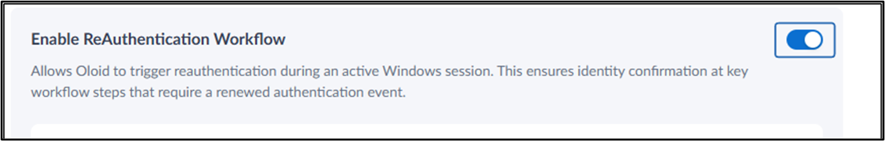
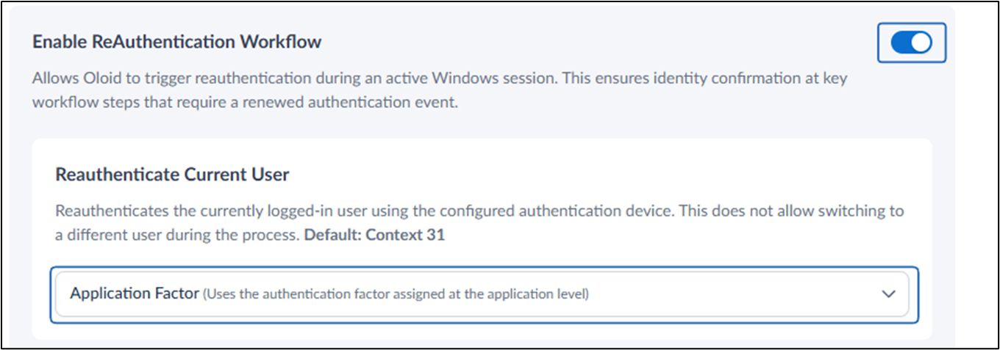
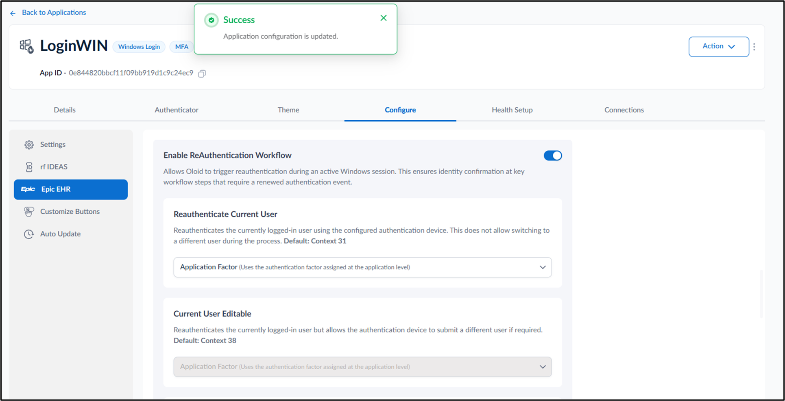

{/* Source: Intercom article 15100167 - https://oloid.help/en/articles/15100167-windows-login-healthcare-how-to-configure-reauthenticate-current-user-for-epic-ehr-in-tenant-admin-portal */}
{/* Generated by intercom_to_mintlify.py - re-running overwrites this file. */}

## Introduction

The **Reauthenticate Current User** workflow allows the logged-in user to verify their identity again during an active session in Epic workflows. Admins can configure this workflow in the Tenant Tenant Admin Portal.

## Prerequisites

- You must have access to Tenant Admin account.
- The Windows Login application must be created in the Tenant Admin Portal, for more information refer: [How to create and configure Application Type - Passwordless](/platform/tenant-admin-portal/how-to-create-and-configure-application-type-passwordless)

## Steps to Configure Reauthenticate Current User

1. Log in to the Tenant Admin Portal.
2. On the **Applications** page, select the preferred **Windows Login application**.

   

   The application details page is displayed.

   

3. Click **Configure** tab> **Epic EHR** .

   

   The Epic EHR page is displayed.
4. Do the following:
   1. Turn on **Enable Reauthentication Workflow** toggle button.

      

   2. Turn on **Enable Reauthentication Workflow** toggle button.
   3. Select **Reauthenticate Current User**. From the Application Factor dropdown, choose the authentication factor.
   4. Click **Save**.

      

      Reauthenticate current user is configured.

