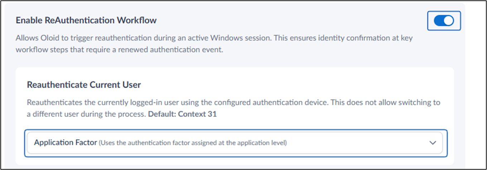
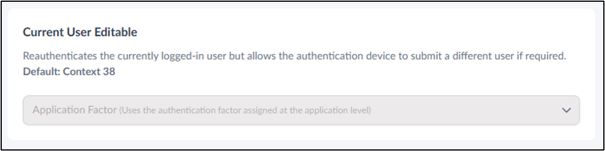
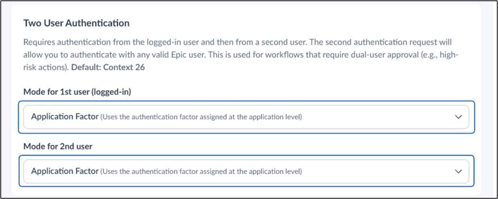
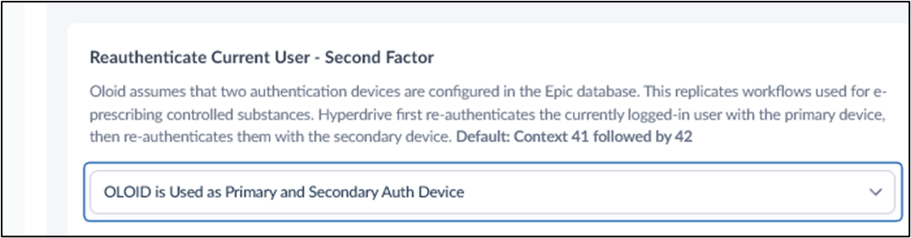
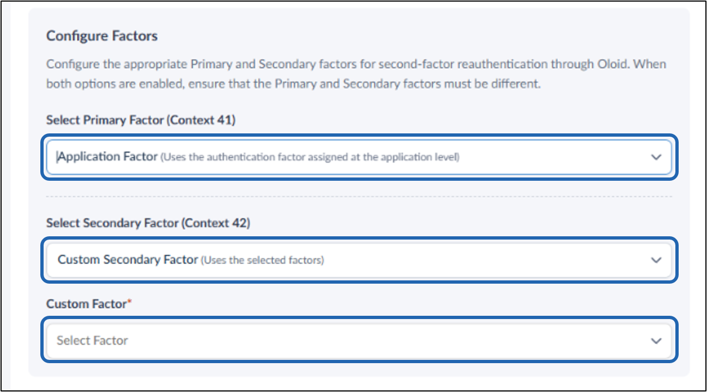
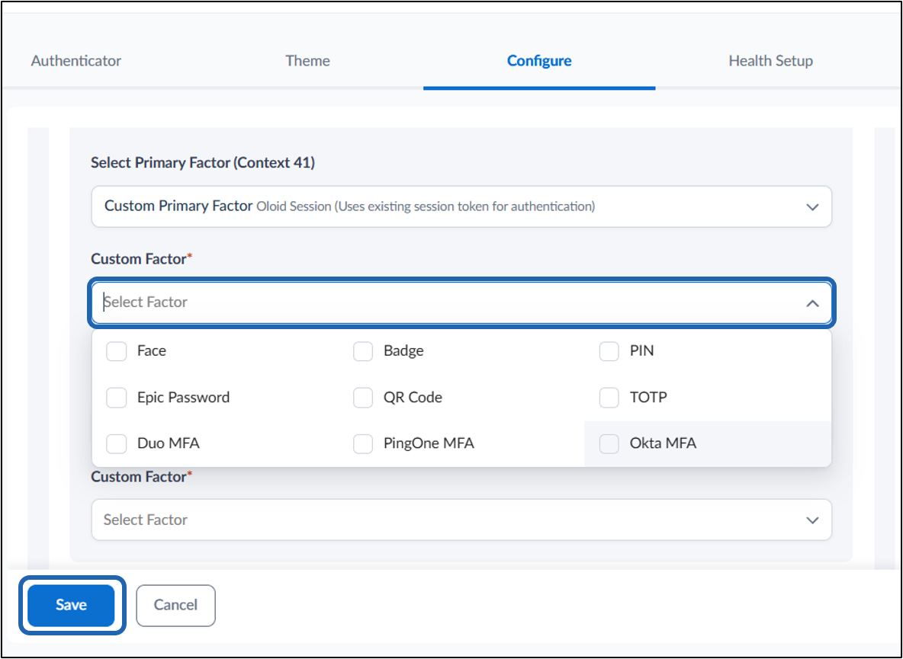
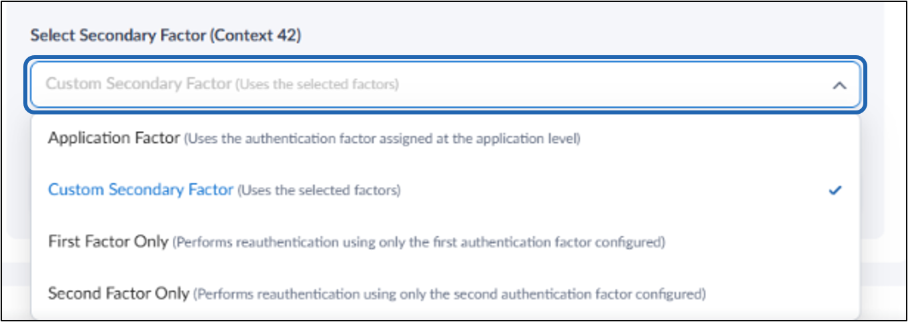
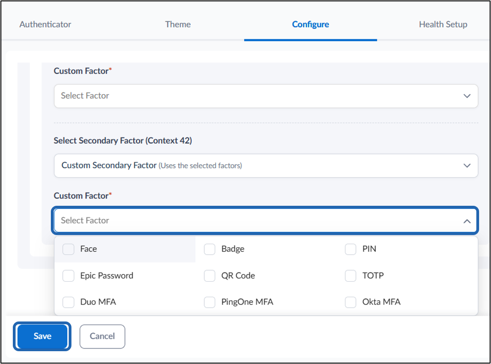
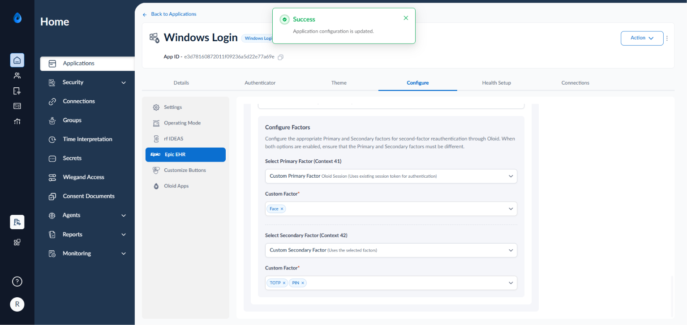

{/* Source: Intercom article 14650126 - https://oloid.help/en/articles/14650126-windows-login-healthcare-how-to-configure-reauthentication-workflow-for-epic-ehr-in-tenant-admin-portal */}
{/* Generated by intercom_to_mintlify.py - re-running overwrites this file. */}

## Introduction

The **Reauthentication Workflow** allows Tenant Admins to enforce additional authentication during an active Windows session for applications integrated with Epic EHR. This ensures that user identity is re-verified before performing sensitive actions or continuing access.

## Prerequisites

- You must have access to Tenant Admin account.
- The Windows Login application must be created in the Tenant Admin Portal, for more information refer: [How to create and configure Application Type - Passwordless](/platform/tenant-admin-portal/how-to-create-and-configure-application-type-passwordless)

## Steps to Configure Re-authentication Workflow

1. Log in to the Tenant Admin Portal.
2. On the **Applications** page, select the preferred **Windows Login application**.

   

   The application details page is displayed.

   

3. Click **Configure** tab> **Epic EHR** .

   

   The Epic EHR page is displayed.
4. Configure the following:
   1. **[Enable Reauthentication Workflow](#enable-reauthentication-workflow)**
   2. **[Configure Two User Authentication](#configure-two-user-authentication)**
   3. **Reauthentication Current User (Second Factor)**
5. Click **Save.**
   The Reauthentication workflow is successfully configured.

#### Enable Reauthentication Workflow

1. Turn on **Enable Reauthentication Workflow** toggle button.
2. Select one of the available reauthentication modes from dropdown:
   **Application Factors**: Uses authentication factors assigned at application level.
   **First Factor Only**: only reauthenticates using the first authentication factor configured.
   **Second Factor Only**: only reauthenticates using the second authentication factor configured.
3. Click **Save**.

   

   Reauthenticate Current User: Reauthenticates the currently logged-in Windows user using the configured authentication device.
4. Do the following:
   1. Select **Reauthenticate Current User**.
   2. From the Application Factor dropdown, choose the authentication factor assigned at the application level.
   3. Click **Save**.

#### Current User Editable

Reauthenticates the currently logged-in user but allows the authentication device to submit a different user if required.

<Note>
  **Note:** The default factor for this authentication is set to application factor and cannot be changed.
</Note>

#### Configure Two User Authentication

1. Under Mode for 1st user, select the **authentication factor** from dropdown.
2. Under Mode for 2nd user, select the **authentication factor** from dropdown.
3. Click **Save**.

#### Reauthenticate Current User - Second Factor

1. Select **Reauthenticate Current User - Second Factor**.
2. From the Application Factor dropdown, choose the authentication factor assigned at the application level:
   1. OLOID is Used as Primary and Secondary Auth Device
   2. OLOID is Used as Primary Authentication Device
   3. OLOID is Used as Secondary Authentication Device
3. Click **Save**.

#### Configure Factors

Configure the appropriate Primary and Secondary factors for second-factor reauthentication through Oloid.

1. To configure factors, do the following:
   1. Under **Select Primary Factor (Context 41)**, select one of the following options from dropdown:
      - **Application Factor** (default): Uses authentication factors assigned at application level.
      - **First Factor Only**: Uses only the first authentication factor configured.
      - **Second Factor Only**: Uses only the second authentication factor configured.
      - **Oloid Session**: Uses the user's existing Oloid session token, so the user is not prompted again for the primary factor. If the Oloid session is not found or has expired, Oloid falls back to **Application Factor**.
      - **Custom Primary Factor**: Uses the factors that you select in the **Custom Factor** dropdown.

        

   2. If **Custom Primary Factor**, from the **Custom Factor** dropdown, select one or more factors, such as Face, Badge, PIN, Epic Password, QR Code, TOTP, Duo MFA, Ping MFA or Okta MFA.
   3. Click **Save**.

      <Note>
        **Note:** The **Custom Factor** dropdown lists all factors supported for your tenant.
      </Note>

      

   4. Under **Select Secondary Factor (Context 42)**, select one of the following options from dropdown:
      - **Application Factor** (default): Uses authentication factors assigned at application level.
      - **First Factor Only**: Uses only the first authentication factor configured.
      - **Second Factor Only**: Uses only the second authentication factor configured.
      - **Custom Secondary Factor**: Uses the factors that you select in the **Custom Factor** dropdown.

        

   5. If you selected **Custom Secondary Factor**, from the **Custom Factor** dropdown, select one or more factors.

      <Note>
        **Note:** Factors already selected for the Primary Factor (Context 41) are disabled in the Secondary Factor list, and vice versa.
      </Note>

   6. Click **Save**.

      <Note>
        **Note:** The Primary and Secondary factors must always be different. If you select a Custom option and do not choose any factor, Save is blocked and the error **Select at least one custom factor.** is displayed.
      </Note>

      

      Reauthentication workflow successfully configured.

      
