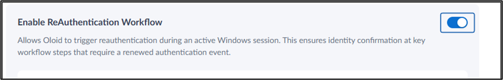
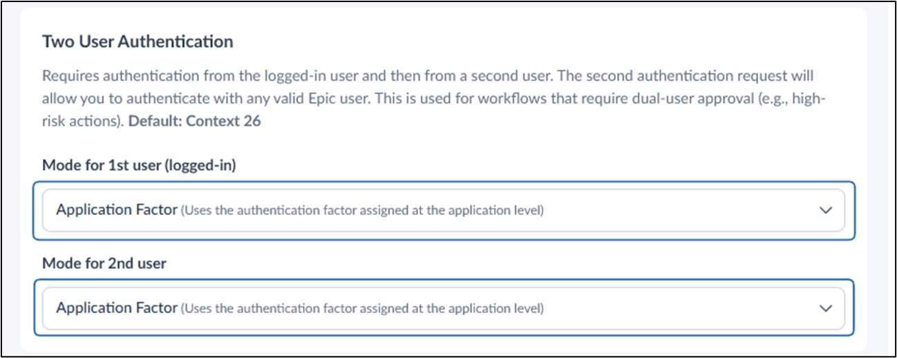
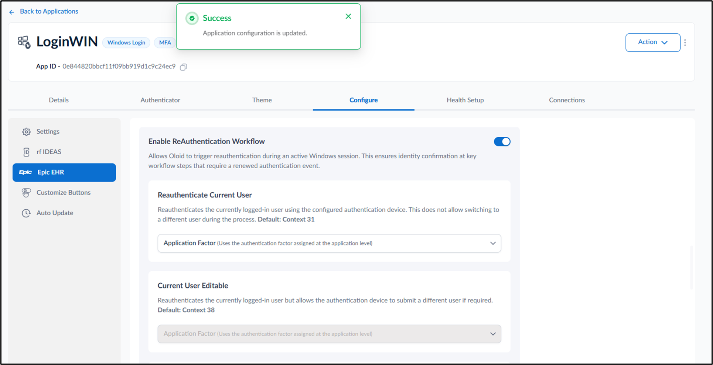

{/* Source: Intercom article 15099661 - https://oloid.help/en/articles/15099661-windows-login-healthcare-how-to-configure-two-user-authentication-workflow-for-epic-ehr-in-tenant-admin-portal */}
{/* Generated by intercom_to_mintlify.py - re-running overwrites this file. */}

## Introduction

The **Two User Authentication** reauthentication workflow in the Windows Login application requires verification from two users before granting access to Epic workflows. These workflows are configured in the Tenant Admin Portal.

## Prerequisites

- You must have access to Tenant Admin account.
- The Windows Login application must be created in the Tenant Admin Portal, for more information refer: [How to create and configure Application Type - Passwordless](/platform/tenant-admin-portal/how-to-create-and-configure-application-type-passwordless)

## Steps to Configure Two User Authentication

1. Log in to the Tenant Admin Portal.
2. On the **Applications** page, select the preferred **Windows Login application**.

   

   The application details page is displayed.

   

3. Click **Configure** tab> **Epic EHR** .

   

   The Epic EHR page is displayed.
4. Do the following:
   1. Turn on **Enable Reauthentication Workflow** toggle button.

      

   2. Select mode for Two User authentication:
      1. Under Mode for 1st user, select the **authentication factor** from dropdown.
      2. Under Mode for 2nd user, select the **authentication factor** from dropdown.
   3. Click **Save**.

      <Note>
        **Note:** Users can select one of the available reauthentication modes from dropdown:
      </Note>

      **Application Factors**: Uses authentication factors assigned at application level.
      **First Factor Only**: only reauthenticates using the first authentication factor configured.
      **Second Factor Only**: only reauthenticates using the second authentication factor

Two User Authentication is successfully configured.

