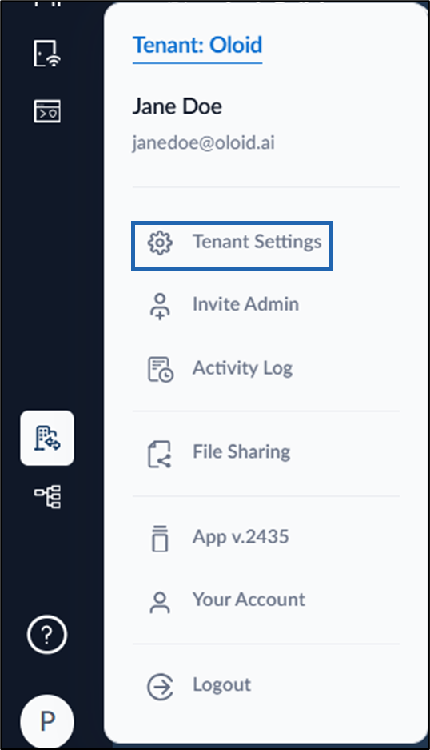
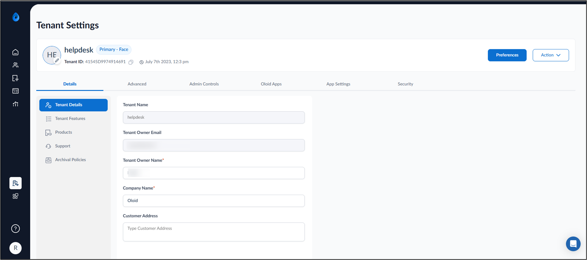
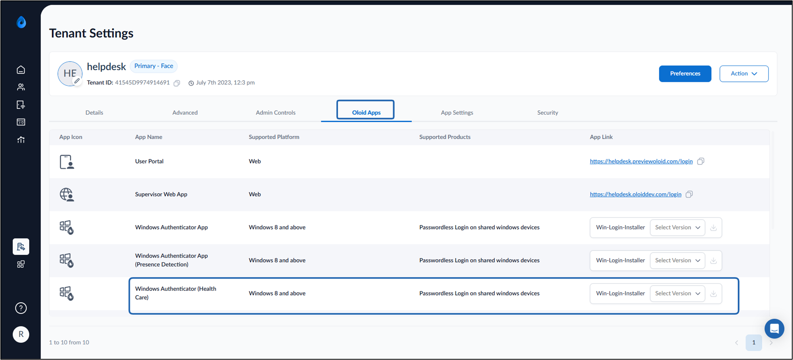
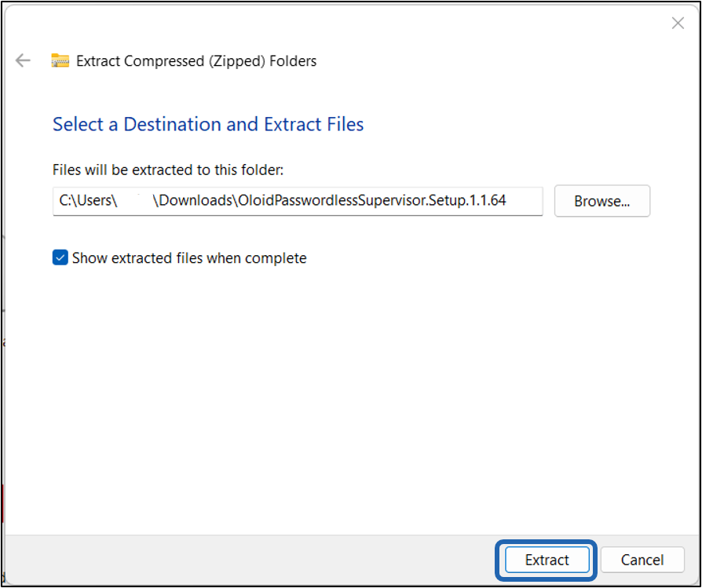
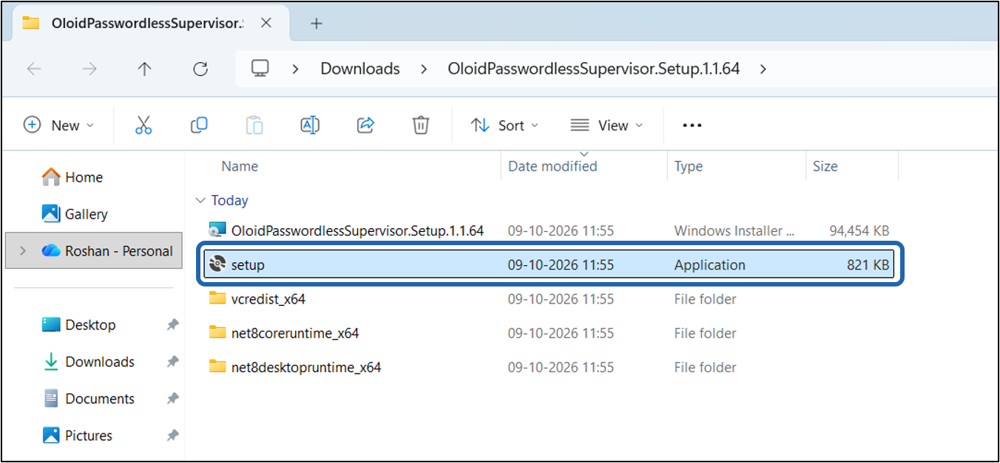
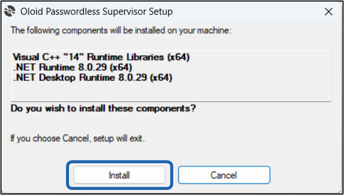
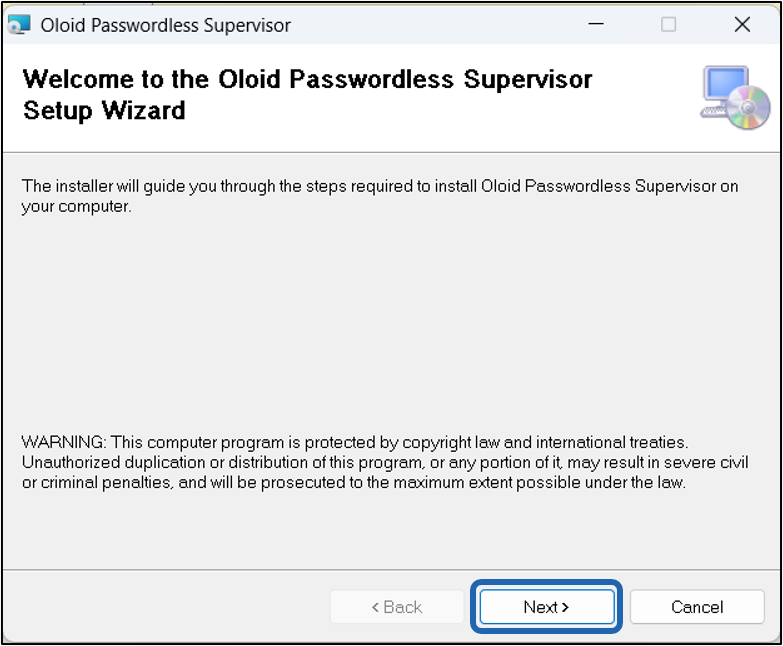
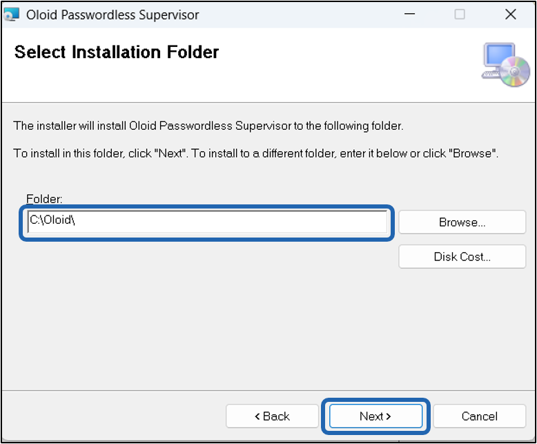

{/* Source: Intercom article 13713819 - https://oloid.help/en/articles/13713819-windows-login-healthcare-how-to-download-and-install-windows-login-app */}
{/* Generated by intercom_to_mintlify.py - re-running overwrites this file. */}

## Introduction

The **Windows** Login **(Healthcare)** application enables secure and passwordless authentication for Windows-based healthcare environments. The Tenant Admin can download the installer directly from the Tenant Admin Portal and install it on supported Windows systems.

## Prerequisites

- You must have access to a Tenant Admin account.
- You have local administrator access on the Windows machine.
- Check System Requirements. For more information, refer: [Windows Login App (Healthcare) - Hardware and Software Requirements](/platforms/windows/industry-workflows/healthcare/windows-login-healthcare-hardware-and-software-requirements)

<Note>
  **Note:** Make sure your system has the following installed components:
</Note>

- Visual C++ "14.44" Runtime Libraries (x64) or later
- .NET Runtime 8.0.7 (x64) or later 8.0.x
- .NET Desktop Runtime 8.0.7 (x64) or later 8.0.x

If any of these components are missing, you'll need to run the **setup.exe** file included in the installation file.

## Steps to download Windows Login** **App

1. Log in to **Tenant Admin Portal**.
2. On the homepage of the portal, click **User profile icon** on the bottom left corner of the menu panel.
3. The user profile menu is displayed.
4. Select **Tenant Settings**.

   

   The **Tenant Settings** screen is displayed.

   

5. Go to **Oloid Apps** tab > **Windows** Login **(Healthcare)**.

   

6. Select the preferred version from the **Win-Login-Installer** dropdown list, then click the **Download** button
   
   icon.

   

   The installer file is downloaded to your local device.
   After the download is complete, you can proceed with installing Windows Login App.

## Steps to install Windows Login** **App

1. Download **Windows** Login **Healthcare** file on your system.

   <Note>
     **Note:** Select the version as advised by your Oloid Rep.
   </Note>

   

   The **OloidPasswordlessSupervisor.Setup-H.1.1.46.zip** file is downloaded in your system.
2. Right-click and select **Extract All** > **OloidPasswordlessSupervisor.Setup.zip** file.
3. The extract folder pop-up is displayed, click **Extract.**

   

   The extracted files will be saved in the same folder as the original zipped file.
4. Open the extracted folder and Double-click on **setup.exe** file.

   

   The **Oloid Passwordless Supervisor Setup** window is displayed.

   

5. Review the listed components and click **Install** to proceed.

   <Note>
     **Note:** If any of the files are missing, the application prompts to install the missing component.
   </Note>

6. On the **Oloid Passwordless Supervisor** Setup wizard, click **Next**.

   

7. Use the default path to install the application and click **Next**.

   

8. Click **Next** to confirm the installation.

   

9. Click **Close** after the installation is complete.

   

   After successful installation, you can find the app icon on your desktop.
   For first-time installation, it is recommended to restart your system.
