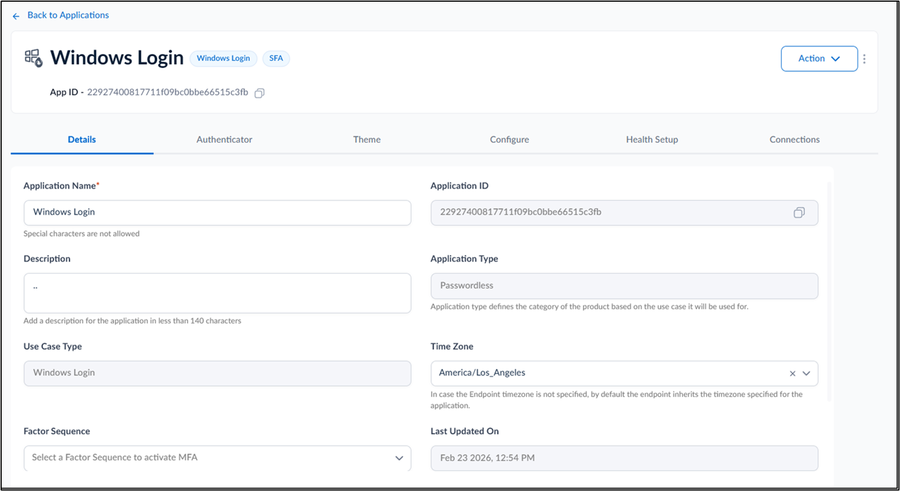
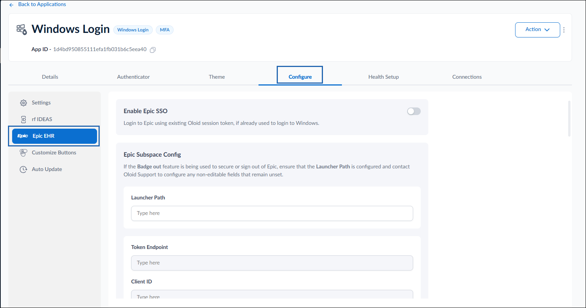
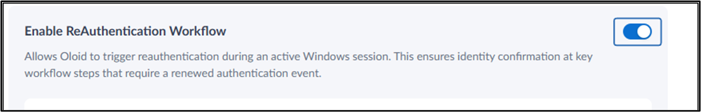
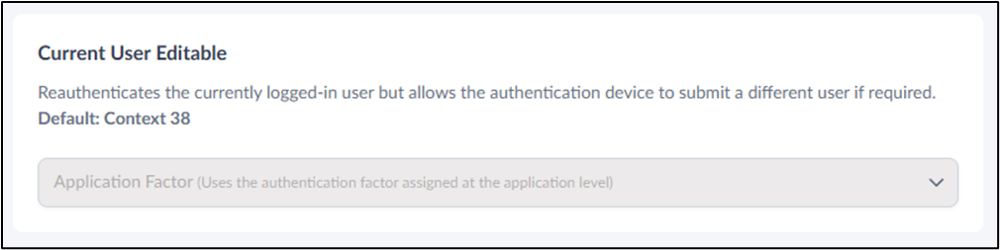
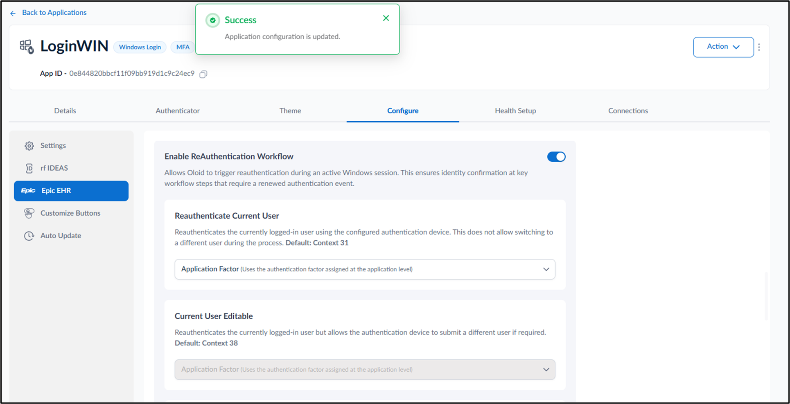

{/* Source: Intercom article 15102516 - https://oloid.help/en/articles/15102516-windows-login-healthcare-how-to-enable-current-user-editable-for-epic-ehr-in-tenant-admin-portal */}
{/* Generated by intercom_to_mintlify.py - re-running overwrites this file. */}

## Introduction

The **Current User Editable** reauthentication workflow allows the currently logged-in user to reauthenticate while also enabling a different authorized user to authenticate if required.

## Prerequisites

- You must have access to Tenant Admin account.
- The Windows Login application must be created in the Tenant Admin Portal, for more information refer: [How to create and configure Application Type - Passwordless](/platform/tenant-admin-portal/how-to-create-and-configure-application-type-passwordless)

## Steps to Enable Current User Editable

1. Log in to the Tenant Admin Portal.
2. On the **Applications** page, select the preferred **Windows Login application**.

   

   The application details page is displayed.

   

3. Click **Configure** tab> **Epic EHR** .

   

   The Epic EHR page is displayed.
4. Do the following:
   1. Turn on **Enable Reauthentication Workflow** toggle button.
   2. Click **Save.**

      

      Current User Editable; Reauthenticates the currently logged-in user but allows the authentication device to submit a different user if required.

      <Note>
        **Note:** The default factor for this authentication is set to application factor and cannot be changed.
      </Note>

      

Current User editable is enabled for Epic EHR.

