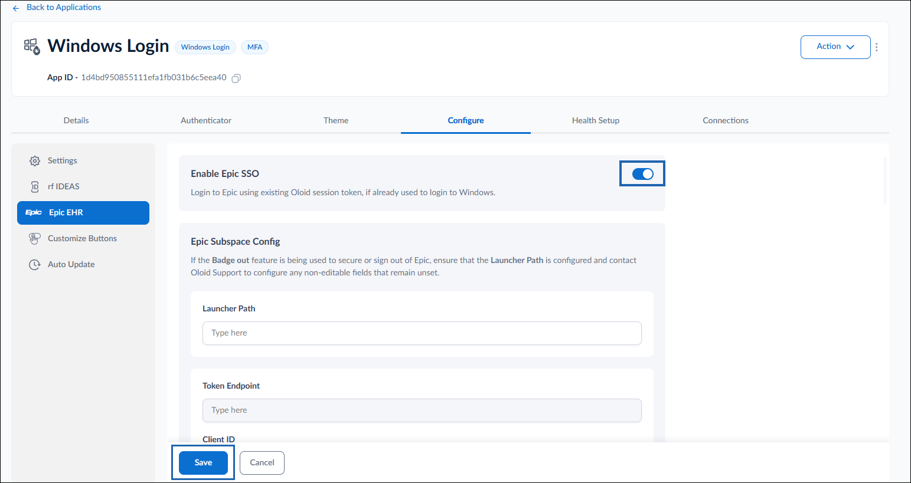
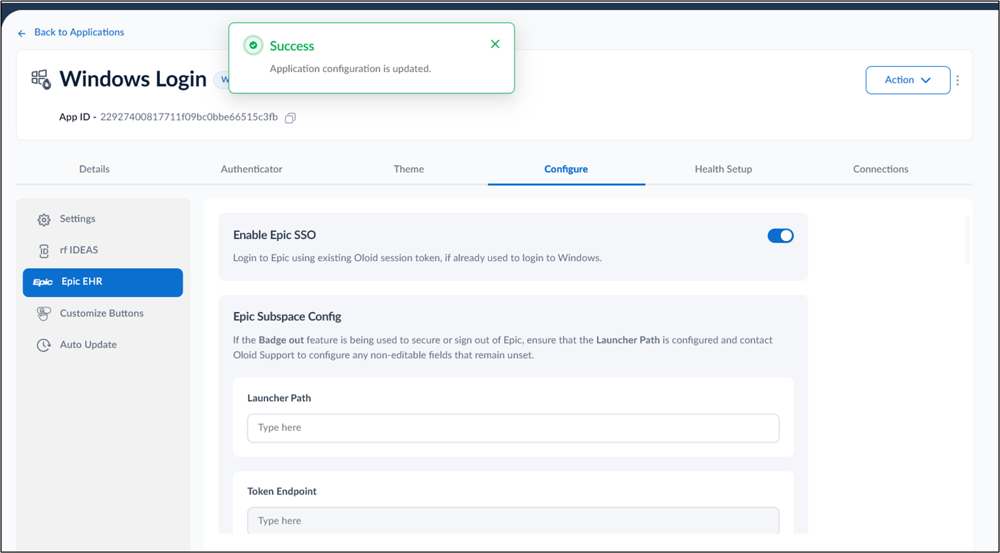

{/* Source: Intercom article 13713982 - https://oloid.help/en/articles/13713982-windows-login-healthcare-how-to-enable-epic-sso-in-the-tenant-admin-portal */}
{/* Generated by intercom_to_mintlify.py - re-running overwrites this file. */}

## Introduction

The **Enable EPIC SSO** feature allows Tenant Admin to configure Single Sign-On (SSO) for applications integrated with Epic EHR.

## Prerequisites

- You must have access to Tenant Admin account.
- The Windows Login application must be created in the Tenant Admin Portal, for more information refer: [How to create and configure Application Type - Passwordless](/platform/tenant-admin-portal/how-to-create-and-configure-application-type-passwordless)

## Steps to Enable EPIC SSO

1. Log in to the Tenant Admin Portal.
2. On the **Applications** page, select the preferred **Windows Login application**.

   

   The application details page is displayed.

   

3. Click **Configure** tab> **Epic EHR** .

   

   The Epic EHR page is displayed.
4. Do the following:
   1. Turn on **Enable Epic SSO** toggle button.
   2. Click **Save.**

      

      Epic SSO is successfully enabled.

---

##### Sync Configuration to Apply Changes

You must sync configuration in the supervisor app to apply changes . For Detailed steps, see [How to sync configuration in Supervisor App](/platforms/windows/supervisor-app/how-to-sync-configuration-in-supervisor-app)
