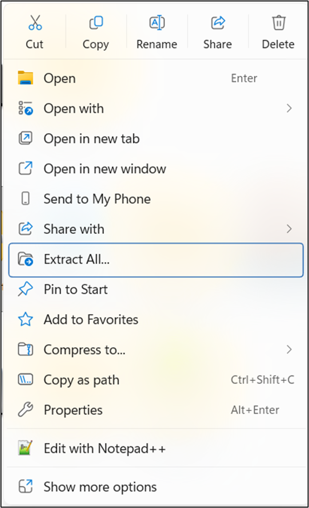
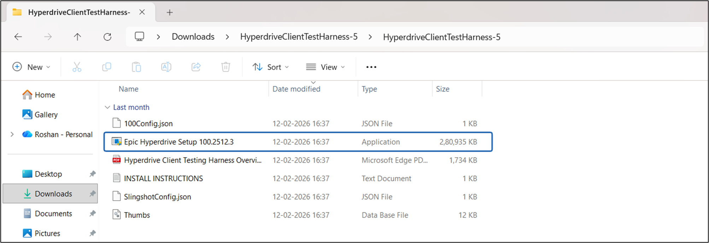
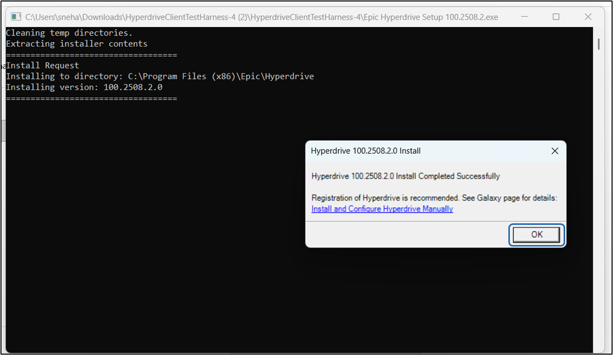
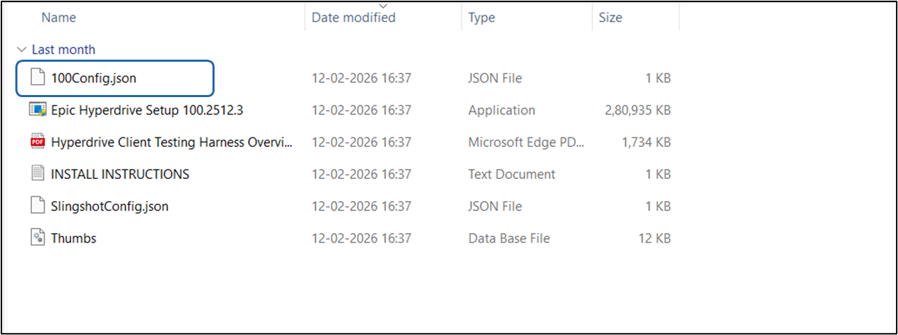
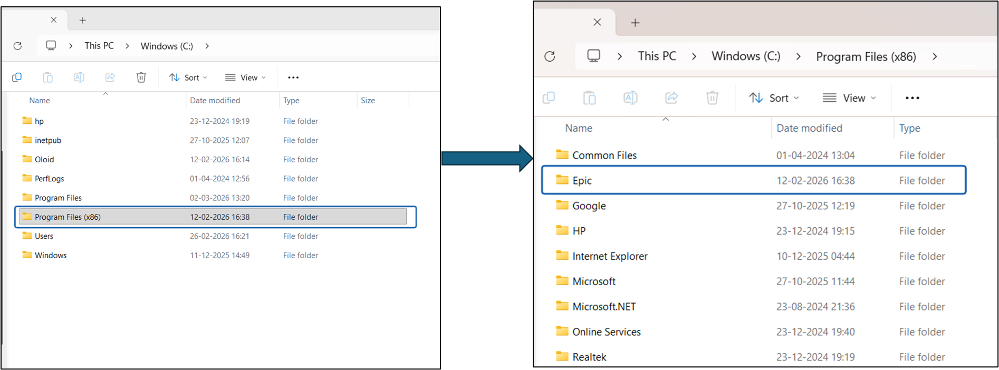
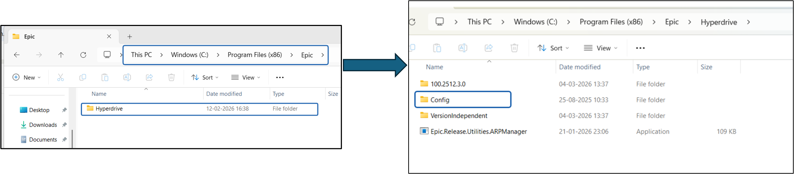
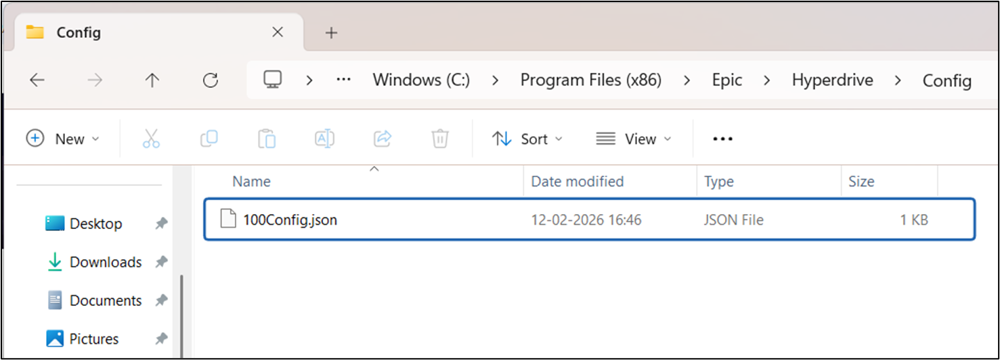
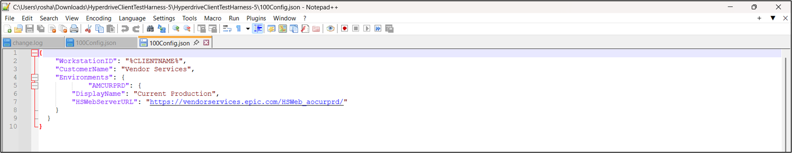
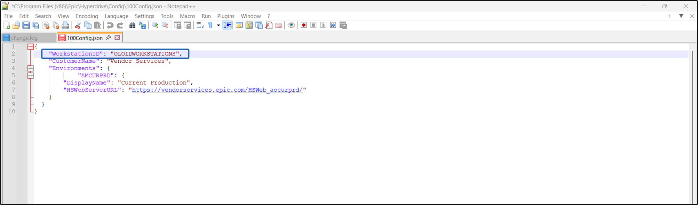

{/* Source: Intercom article 13722773 - https://oloid.help/en/articles/13722773-windows-login-healthcare-how-to-install-epic-hyperspace-for-epic-ehr */}
{/* Generated by intercom_to_mintlify.py - re-running overwrites this file. */}

## Introduction

Installing **Epic Hyperspace (Hyperdrive Client Test Harness)** is required to enable secure authentication workflows and integration with supported applications such as the Windows Authenticator (Healthcare).

## Prerequisites

- You must have access to the **Epic Hyperdrive Client Test Harness installer** provided by your Oloid representative.
- Local administrator rights to install applications on the system.
- Access to the system directory path:
  `C:\Program Files (x86)\Epic\Hyperdrive\Config`
- **Notepad++** installed on the system to modify configuration files.
- Required Workstation ID details based on the configured authentication flow

## Steps to install Epic Hyperspace

1. Download **HyperdriveClientTestHarness-5** file on your system.

   <Note>
     **Note:** Select the version as advised by your Oloid Rep.
   </Note>

   

   The **HyperdriveClientTestHarness-5** file is downloaded in your system.
2. Right-click and select **Extract All** > **HyperdriveClientTestHarness-5.zip** file.

   

   The extracted files will be saved in the same folder as the original zipped file.
3. Double-click on **HyperdriveClientTestHarness-5** file > double click **Epic Hyperdrive setup** file.

   

   The installation pop-up is displayed.

   <Note>
     **Note:** If any of the files are missing, the application prompts to install the missing component.
   </Note>

   

4. Click **Ok** to finish the installation.
   Hyperdrive is successfully installed.

### Setting Up Epic Hyperspace

1. In the **HyperdriveClientTestHarness-5.zip** file, right click the **100config file** and click **Copy.**

   

2. In **C drive** > click **Program files x86** > select **Epic.**

   

3. Select the **Hyperdrive** folder > click **Config File**

   

4. **Right click** and click **paste** the 100config file in this folder.
   1. Click replace in destination.

      

5. Open the **100config** file using **Notepad++**.

   <Note>
     **Note:** Changes may not save in Notepad, it is recomended to use **Notepad++**
   </Note>

   

6. Change the **Workstation ID** to:
   1. For Username and Password flow: "**OLOIDWORKSTATION**"
   2. For SAML flow: "**OLOIDWORKSTATIONSAML**"
7. Click **File** > **Save.**

   

Epic Hyperspace is successfully configured.

<Note>
  **Note:** Now restart your system for the Windows Epic Hyperspace to take effect.
</Note>
