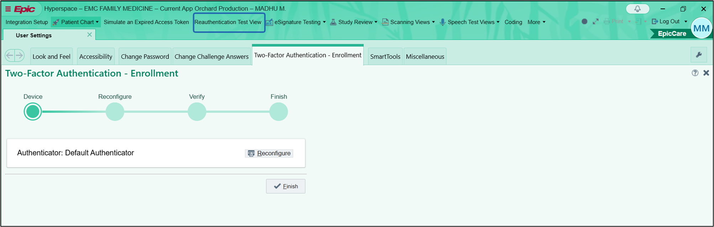
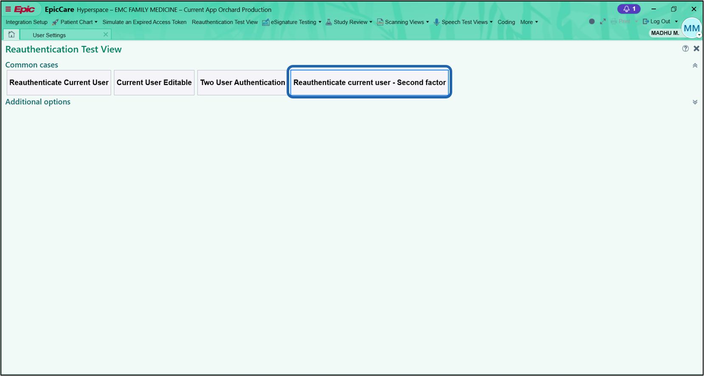
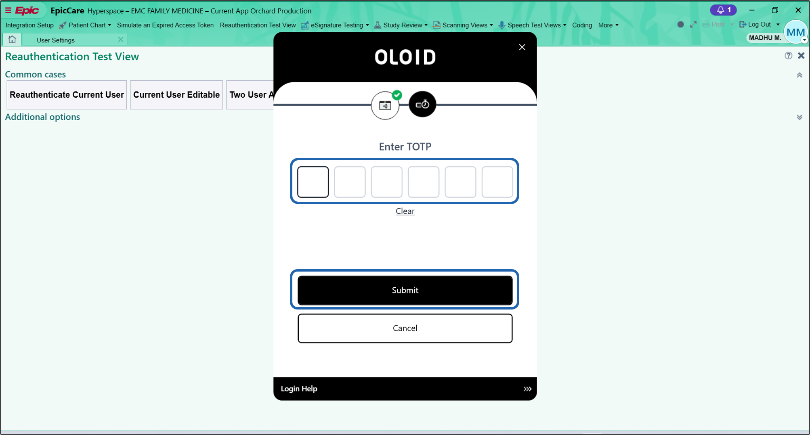
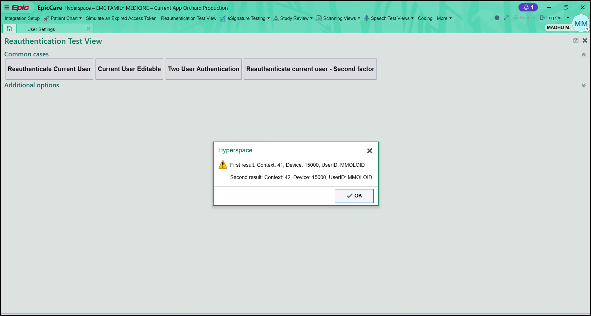

{/* Source: Intercom article 17765597 - https://oloid.help/en/articles/17765597-windows-login-healthcare-how-to-re-authenticate-current-user-second-factor-in-epic-using-badge-and-totp */}
{/* Generated by intercom_to_mintlify.py - re-running overwrites this file. */}

## Introduction

When the Re-Authentication Workflow is enabled for the EPIC EHR application in the Tenant Admin Portal, Oloid prompts the user to re-authenticate during an active Windows session whenever Epic requests it. For the **Reauthenticate Current User – Second Factor** workflow, administrators can select one or more custom factors, such as TOTP (Time-based One-Time Password).

## Prerequisites

- You must have access to Epic Hyperspace.
- Epic Vault Password must be created for the user. Refer: **[How to create Vault Password for a user](/platform/tenant-admin-portal/tenant-admin-portal-how-to-create-vault-password-for-a-user)**
- The badge reader must be connected to the Windows system.
- Ensure the Tray application is running in the background.
- Badge must be assigned to the user. Refer: **[How to assign Badge ID as credential to users](/platform/tenant-admin-portal/how-to-assign-badge-id-as-credential-to-users)**
- TOTP must be enabled in the Tenant Admin Portal. Refer: [Windows Login 2.0 - How to Enable TOTP in the Tenant Admin Portal](/platforms/windows/windows-login/v2/windows-login-2-0-how-to-enable-totp-for-windows-login-in-the-tenant)
- TOTP must be selected as Custom factor. Refer: [Windows Login (Healthcare) - How to Configure Custom Factor for Epic EHR in Tenant Admin Portal](/platforms/windows/industry-workflows/healthcare/windows-login-healthcare-how-to-configure-custom-factor-for-epic-ehr)
- The Reauthenication Workflow must be enabled. Refer: [Windows Login (Healthcare) - How to Configure Reauthentication Workflow for Epic EHR in Tenant Admin Portal](/platforms/windows/industry-workflows/healthcare/windows-login-healthcare-how-to-configure-reauthentication-workflow)
- For first-time TOTP users, an authenticator app is installed on the user's mobile device. Refer: [Windows Login (Healthcare)- How to register an Authenticator app for TOTP](/platforms/windows/industry-workflows/healthcare/windows-login-healthcare-how-to-register-an-authenticator-app-for-totp)

## Steps to Re-Authenticate in Epic Using Badge and TOTP

1. Log in to **Epic Hyperspace** application on your Windows Machine. refer: **[How to log in to Epic Hyperspace using Badge ID + PIN](/integrations/epic/windows-login-healthcare-how-to-log-in-to-epic-hyperspace-using-badge)**
   The **Epic Hyperspace** home page is displayed.

   

2. On the top menu panel of the homepage, click **Reauthentication Test View**.

   

   The Reauthentication Test view page is displayed.
3. Click **Reauthenticate Current User.**

   <Note>
     **Note:** Authentication is based on the factor configured in **Reauthenticate Current User** under the reauthentication workflow. eg: Application factors, First factor only or Second factor only.
   </Note>

   

   The **Scan Badge** screen is displayed.
4. The current user must tap the **Badge** on the **Badge Reader** to scan it.

   <Note>
     **Note:** The current user (the user already logged into Epic Hyperspace) must authenticate.
   </Note>

   

5. The TOTP input screen is displayed.

   <Note>
     **Note:** If multiple custom factors are enabled, the MFA selection screen is displayed. Select **TOTP**.
   </Note>

6. Enter the **TOTP** from the authenticator app.
7. Click **Submit.**

The current user is successfully reauthenticated.

<Note>
  **Note:** If you have not added an authenticator app, the authenticator app registration process starts instead. Complete the steps in Register an Authenticator App (First-Time TOTP Users).
</Note>
