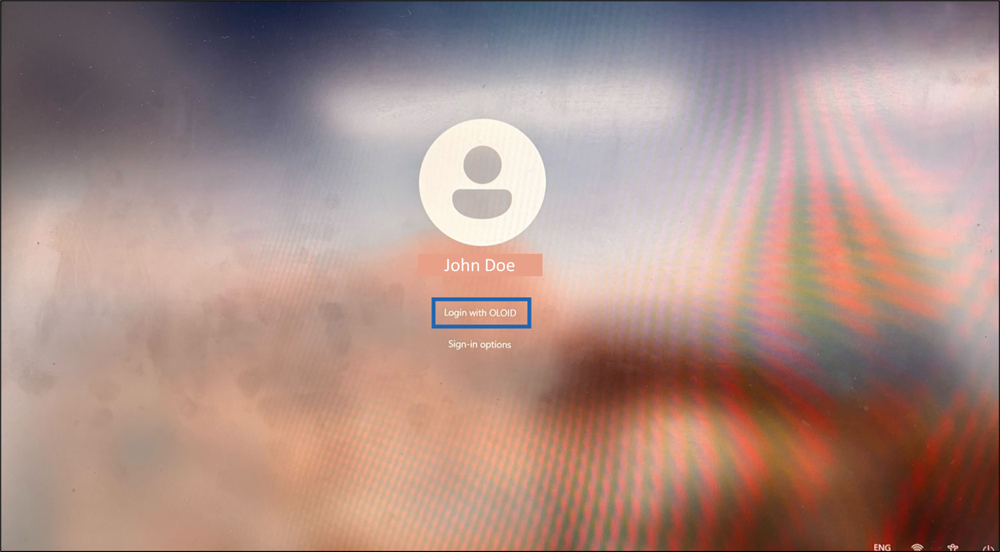
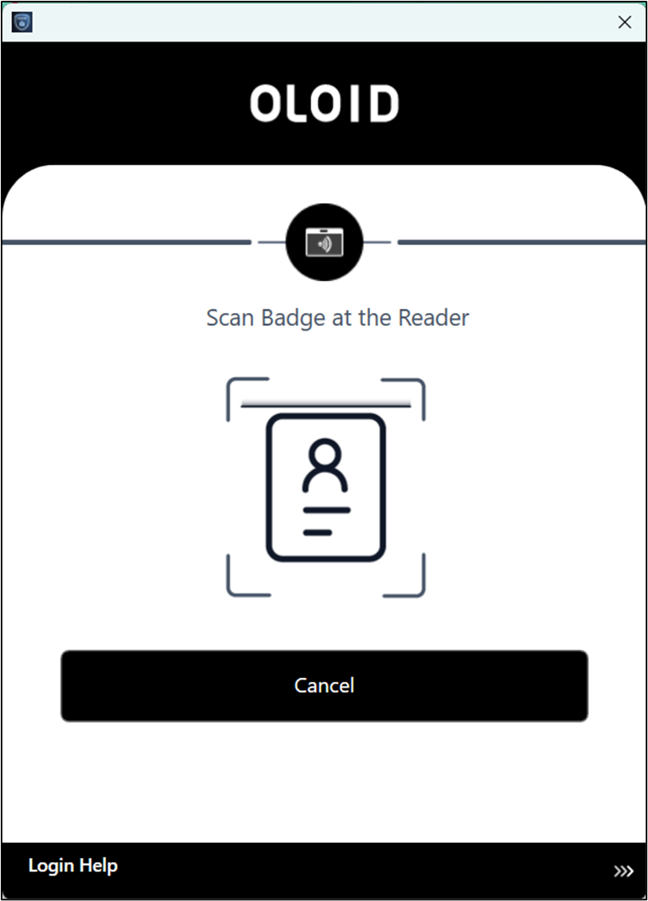
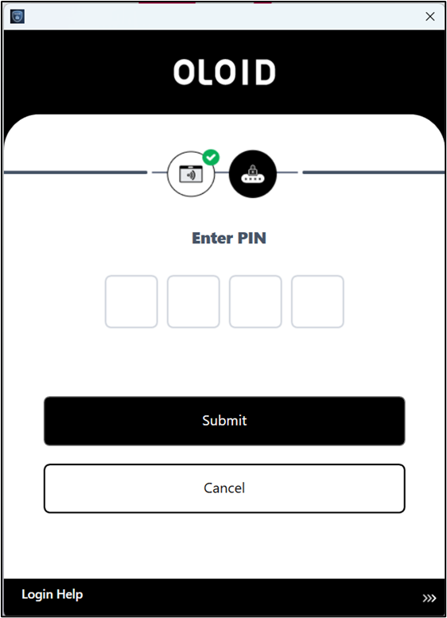
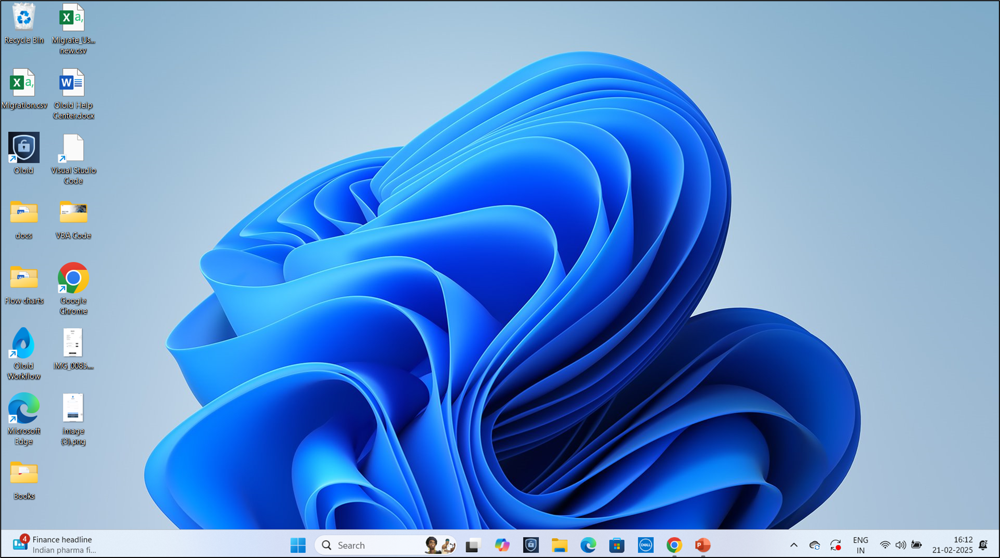
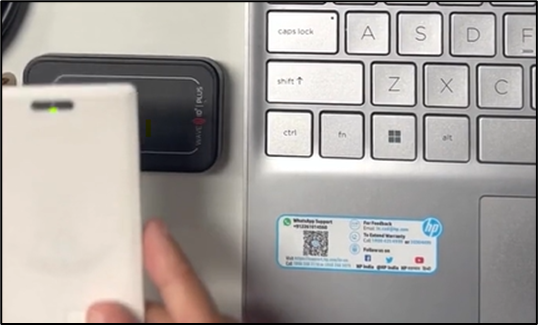
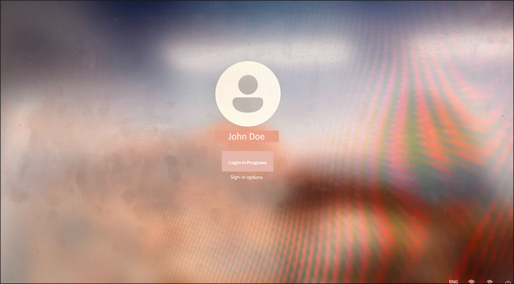
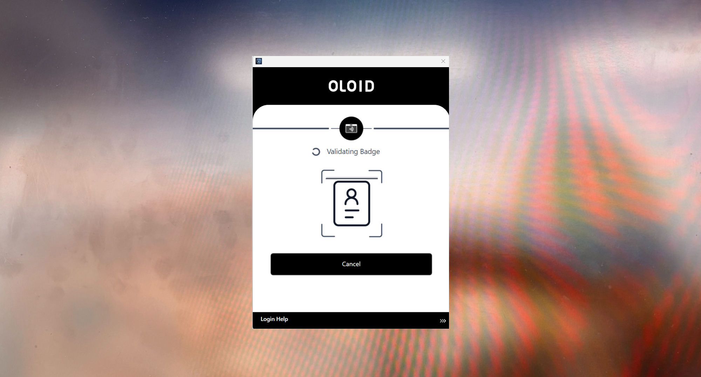
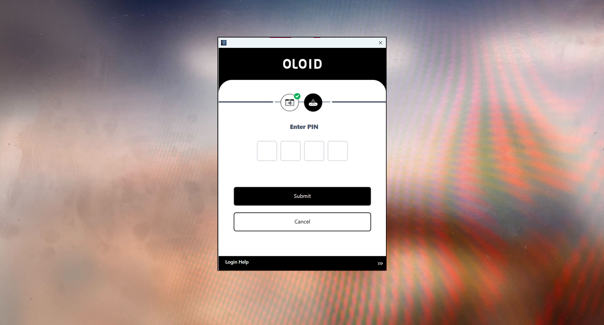
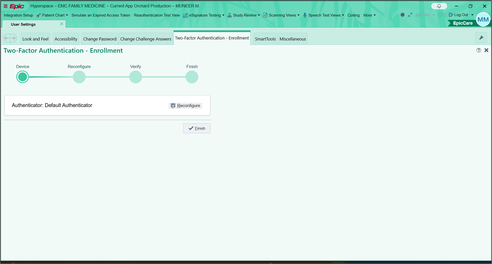

{/* Source: Intercom article 14836306 - https://oloid.help/en/articles/14836306-windows-login-healthcare-how-to-switch-user-sign-out-of-windows-using-badge-out-in-epic-hyperspace */}
{/* Generated by intercom_to_mintlify.py - re-running overwrites this file. */}

## Introduction

The **Switch User** workflow in Epic Hyperspace enables secure session transfer on shared Windows devices. When the **Sign out** option is enabled, all active applications are closed and the system is locked, allowing the next user to authenticate and access the system.

## Prerequisites

- You must have access to Epic Hyperspace.
- Epic Vault Password must be created for the user.
- Ensure that Epic SSO is enabled. Refer: **[Windows Authenticator (Healthcare) - How to Enable Epic SSO in the Tenant Admin Portal](/platforms/windows/industry-workflows/healthcare/windows-login-healthcare-how-to-enable-epic-sso-in-the-tenant-admin)**
- Ensure that the Supervisor app is closed.
- Ensure the Tray application is running in the background.
- Badge must be assigned to the user. Refer: **[How to assign Badge ID as credential to users](/platform/tenant-admin-portal/how-to-assign-badge-id-as-credential-to-users)**
- The PIN must be enabled and assigned to the User. Refer: **[Windows Login - How to Configure PIN Credential in the Tenant Admin Portal](/platforms/windows/windows-login/windows-login-how-to-configure-pin-credential-in-the-tenant-admin)**
- The badge reader must be connected to the Windows system.
- Badge Out options must be configured. Refer:

## Steps to Switch User using Badge ID

1. On the Lock screen, select **Login with OLOID**.

   

   The **Scan Badge** screen is displayed.
   **Note:**
2. Tap the **Badge** on the **Badge Reader** to scan it.

   

   The **Enter PIN** screen is displayed.
3. Enter the **PIN**.

   

   The Windows homepage is displayed.

   

4. Log in to **Epic Hyperspace** refer: **[How to log in to Epic Hyperspace using Badge ID + PIN](/integrations/epic/windows-login-healthcare-how-to-log-in-to-epic-hyperspace-using-badge)**
   User is successfully logged in to **Epic Hyperspace.**

   

5. The Second User must tap the **Badge** on the **Badge Reader** to initiate User Switch.

   <Note>
     **Note:** The User will switch from User 1 to User 2.
   </Note>

   

   All open applications in the system will close, and the **Lock** screen appears

   <Note>
     **Note:** If the Windows Login application is configured with the **Sign out of Windows** option, all open applications in the system will close, and the **Lock** screen will appear.
   </Note>

   

   The **Validating Badge** screen is displayed.

   

   The **Enter PIN** screen is displayed.
6. Enter the **PIN**.

   <Note>
     **Note:** If Multi Factor Authentication (MFA) is enabled the second user must authenticate using the configured second factor, In this case PIN.
   </Note>

   

   The Windows homepage is displayed.

   

7. The Second User must Launch Epic Hyperspace to Login. Refer: **[How to log in to Epic Hyperspace using Badge ID + PIN](/integrations/epic/windows-login-healthcare-how-to-log-in-to-epic-hyperspace-using-badge)**

The User is successfully switched and the second User is logged in to Epic Hyperspace.

