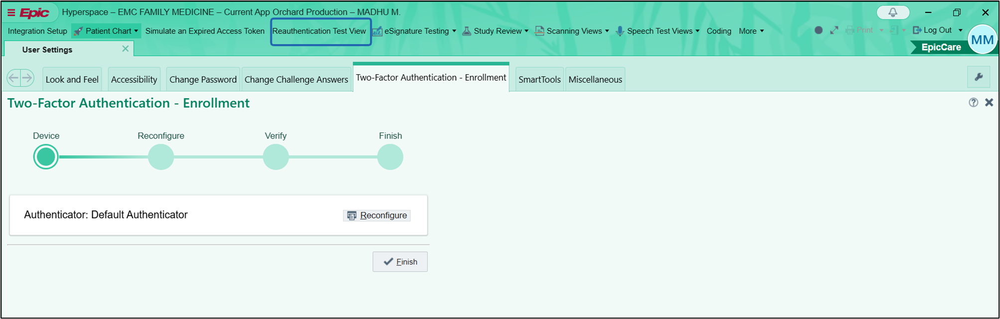
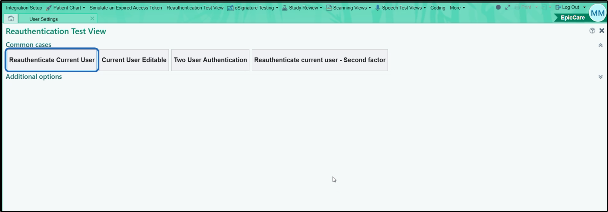
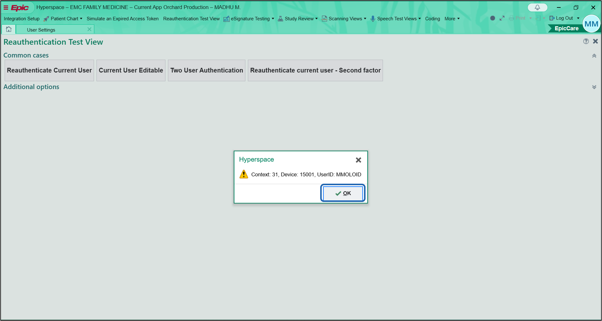

{/* Source: Intercom article 14752988 - https://oloid.help/en/articles/14752988-windows-login-healthcare-how-to-use-reauthenticate-current-user-tab-using-badge-id-in-epic-hyperspace */}
{/* Generated by intercom_to_mintlify.py - re-running overwrites this file. */}

## Introduction

Reauthenticating the current user in **Epic Hyperspace** ensures that the identity of the logged-in user is verified again before proceeding with specific actions. This additional verification step enhances security within active sessions, especially in shared or high-sensitivity environments.

## Prerequisites

- You must have access to Epic Hyperspace.
- Epic Vault Password must be created for the user. Refer: **[How to create Vault Password for a user](/platform/tenant-admin-portal/tenant-admin-portal-how-to-create-vault-password-for-a-user)**
- The badge reader must be connected to the Windows system.
- Ensure the Tray application is running in the background.
- Badge must be assigned to the user. Refer: **[How to assign Badge ID as credential to users](/platform/tenant-admin-portal/how-to-assign-badge-id-as-credential-to-users)**
- The PIN must be enabled and assigned to the user. Refer: **[Tenant Admin Portal - How to Configure PIN](/platform/tenant-admin-portal/tenant-admin-portal-how-to-configure-pin)**

## Steps to Reauthenticate current user in Epic Hyperspace

1. Log in to **Epic Hyperspace** application on your Windows Machine. refer: **[How to log in to Epic Hyperspace using Badge ID + PIN](/integrations/epic/windows-login-healthcare-how-to-log-in-to-epic-hyperspace-using-badge)**
   The **Epic Hyperspace** home page is displayed.

   

2. On the top menu panel of the homepage, click **Reauthentication Test View**.

   

   The Reauthentication Test view page is displayed.
3. Click **Reauthenticate Current User.**

   <Note>
     **Note:** Authentication is based on the factor configured in **Reauthenticate Current User** under the reauthentication workflow. eg: Application factors, First factor only or Second factor only.
   </Note>

   

   The **Scan Badge** screen is displayed.
4. The current user must tap the **Badge** on the **Badge Reader** to scan it.

   <Note>
     **Note:** The current user (the user already logged into Epic Hyperspace) must authenticate.
   </Note>

   

5. Hyperspace pop-up box is displayed. Click **Ok**
   The current user is successfully reauthenticated.

