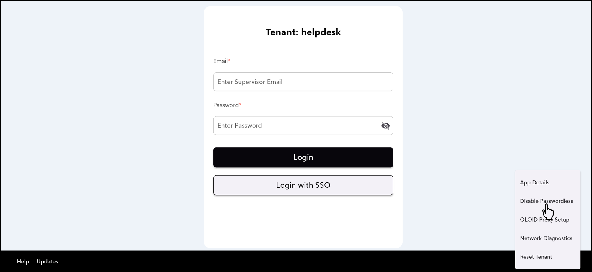
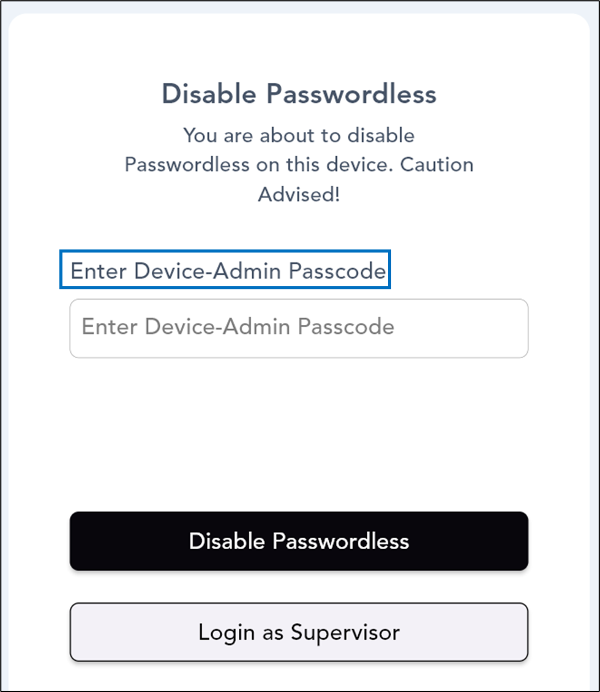
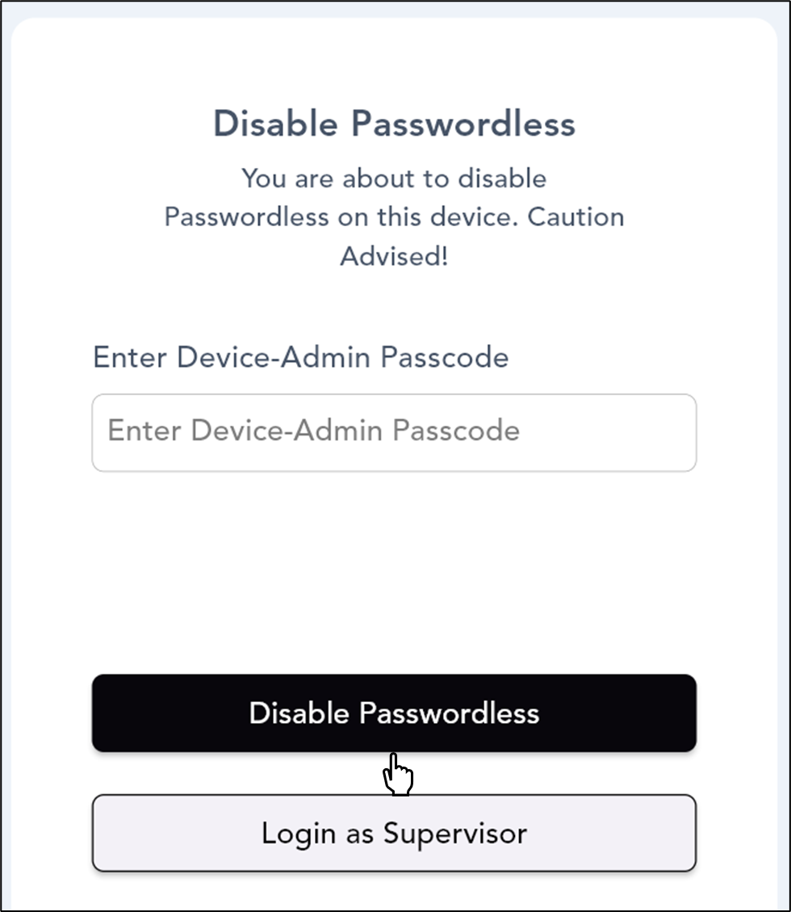
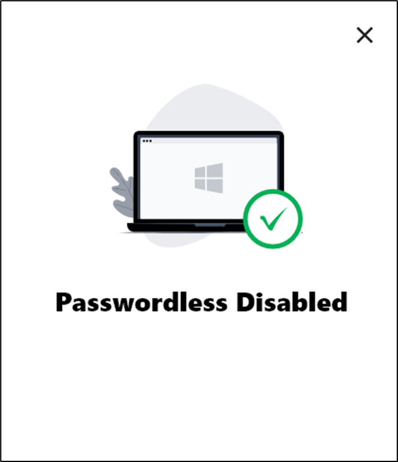

{/* Source: Intercom article 9153890 - https://oloid.help/en/articles/9153890-how-to-disable-passwordless-using-device-admin-passcode-in-supervisor-app */}
{/* Generated by intercom_to_mintlify.py - re-running overwrites this file. */}

**Pre-requisite**

The Supervisor app is already paired. Contact your Admin for the passcode.

For details, refer[How to create device-admin passcode for Supervisor App](/platforms/windows/supervisor-app/windows-login-how-to-create-device-admin-passcode-for-supervisor-app).

To disable passwordless:

1. Double-click on **Supervisor** app.
   The app opens.
2. Do the following:
   1. Click **More Options** > **Disable Passwordless**.

      

      The **Disable Passwordless** screen is displayed.
   2. Enter the **Device-Admin Passcode**.

      <Note>
        **Note:** The Device-Admin Passcode is created in the Oloid Portal.
      </Note>

      

   3. Click **Disable Passwordless**.

      

      The Passwordless is disabled successfully.

      

      The Supervisor app is no longer available on the Windows lock screen.
