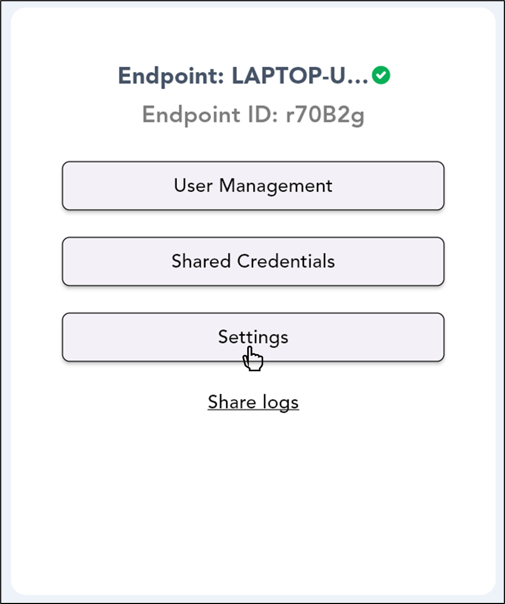
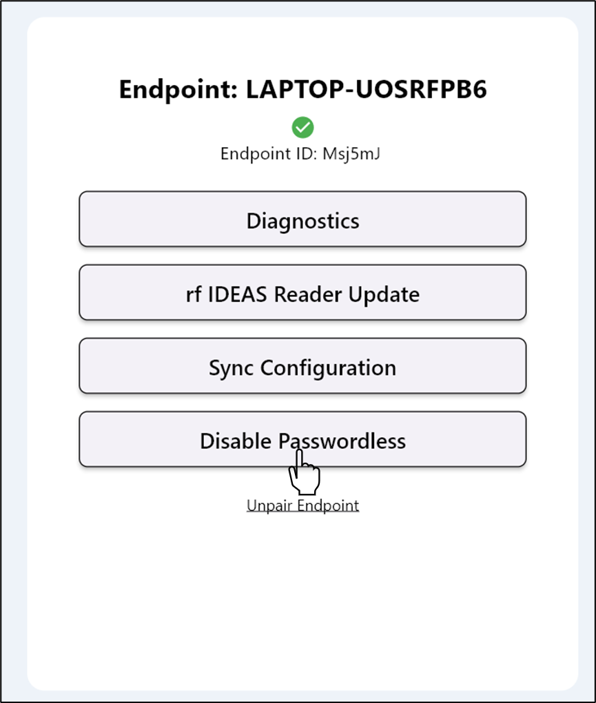
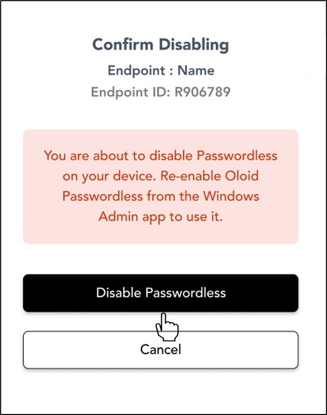

{/* Source: Intercom article 9053832 - https://oloid.help/en/articles/9053832-how-to-disable-passwordless-using-supervisor-app */}
{/* Generated by intercom_to_mintlify.py - re-running overwrites this file. */}

To disable passwordless follow the below steps:

1. Log in to **Supervisor App**.
   The **Admin Home** screen is displayed.
2. Select **Settings**.

   

3. Select **Disable Passwordless**.

   

   The **Confirm Disabling** screen is displayed.
4. Select **Disable Passwordless**.

   

   The Passwordless is disabled successfully.
   The Windows Device Login app is no longer available on the Windows lock screen.
