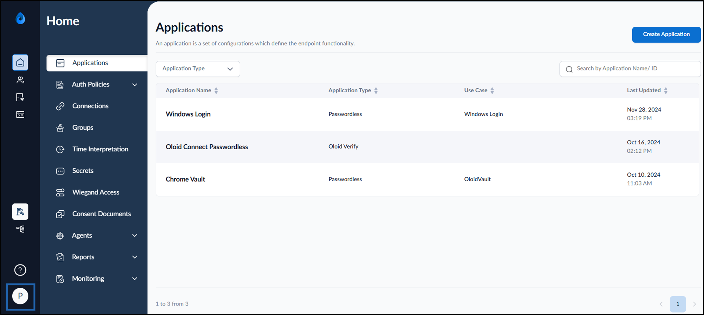
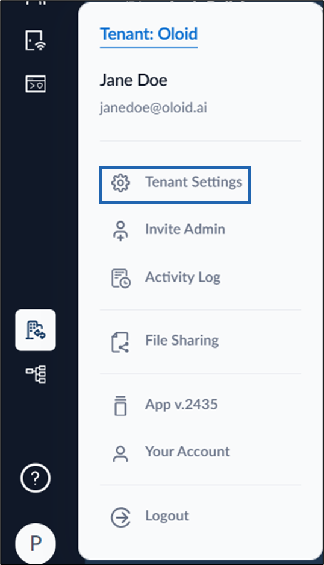
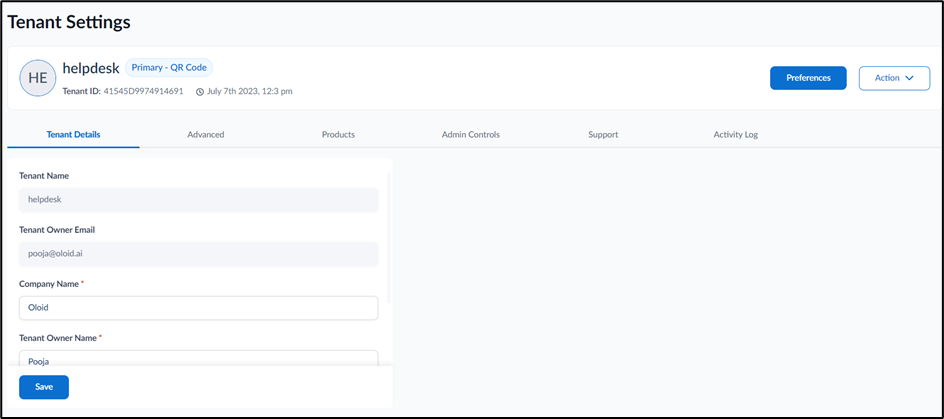
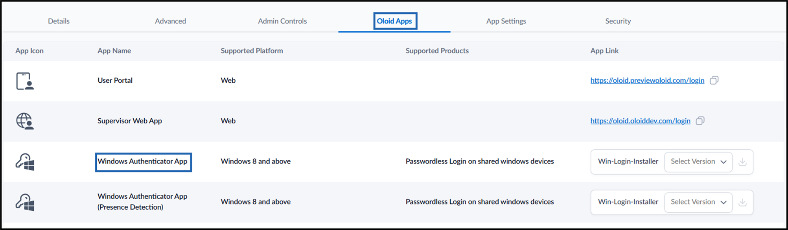
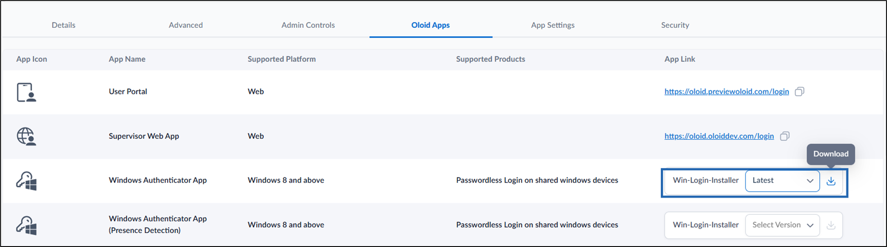

{/* Source: Intercom article 9036607 - https://oloid.help/en/articles/9036607-how-to-download-supervisor-app */}
{/* Generated by intercom_to_mintlify.py - re-running overwrites this file. */}

The Supervisor App can be downloaded from Tenant Settings section in the Tenant Admin Portal.

### Steps to download from Tenant Settings

1. Log in to the **Oloid Portal**.
2. On the homepage of the portal, click **User profile icon** on the bottom left corner of the menu panel.

   

   The user profile menu is displayed.
3. Select **Tenant Settings**.

   

   The **Tenant Settings** screen is displayed.

   

4. Go to **Oloid Apps** tab > **Windows Authenticator App**.

   

5. Select the preferred version from the **Win-Login-Installer** dropdown list, then click the **Download** buttonicon.

   

   The installer file is downloaded to your local device.

## Related Document

### [How to install Supervisor App](/platforms/windows/supervisor-app/windows-login-how-to-install-windows-authenticator-app)
