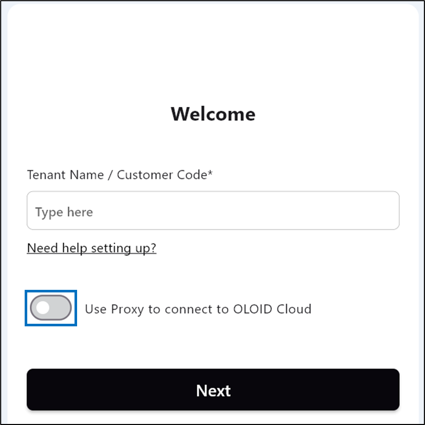
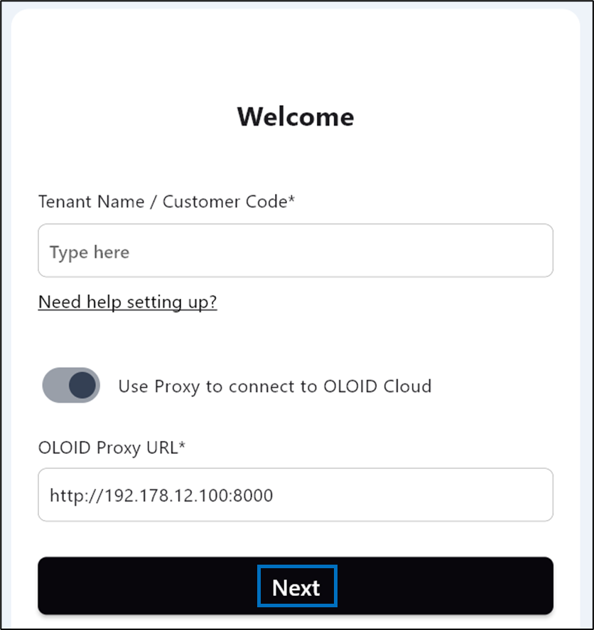
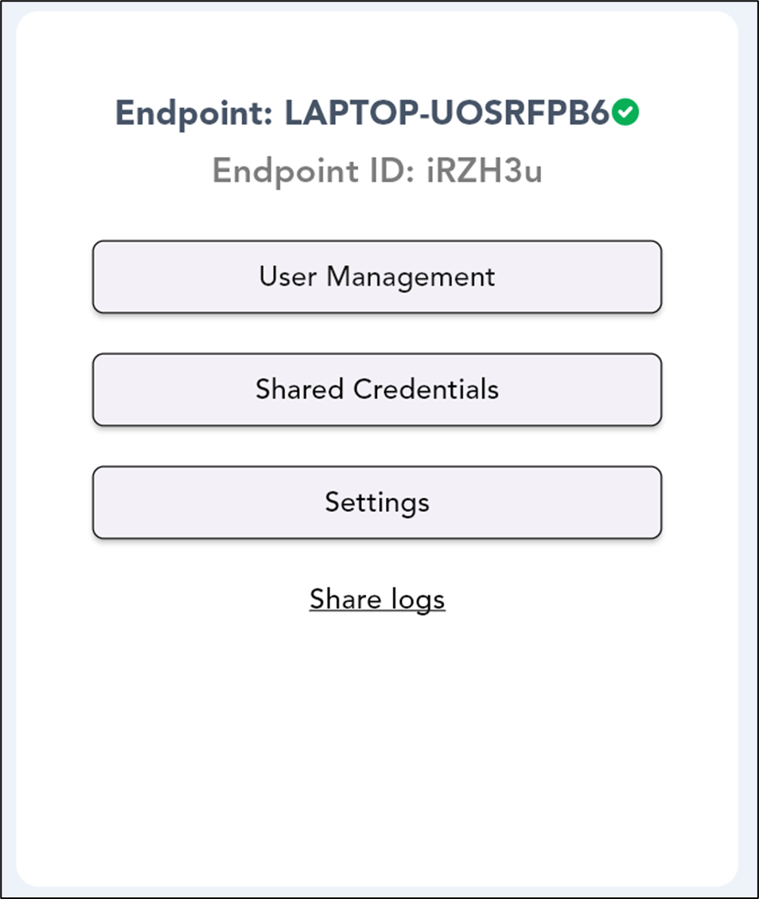
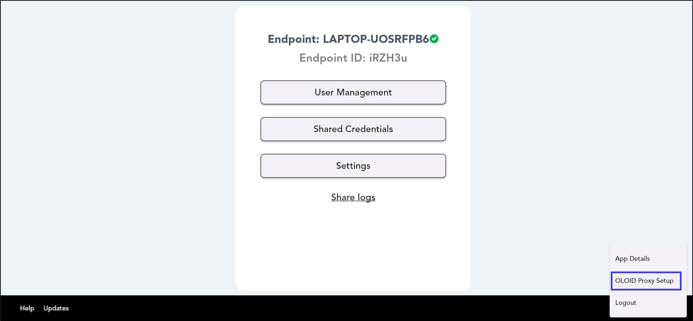
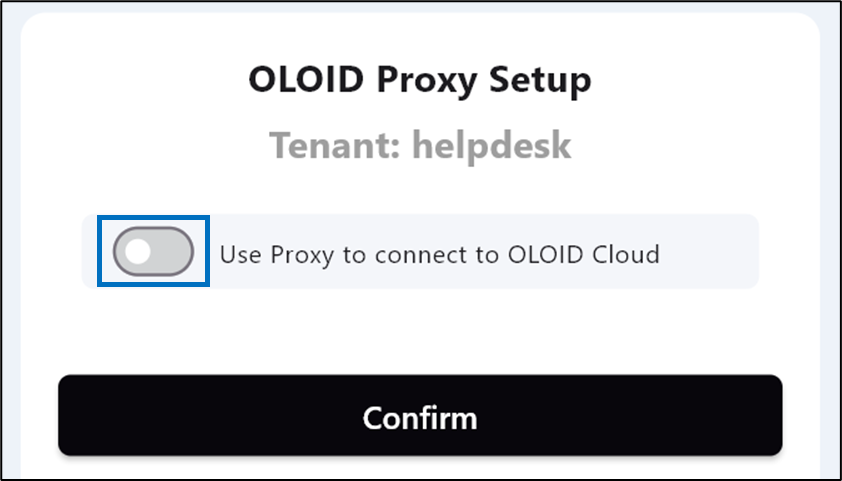
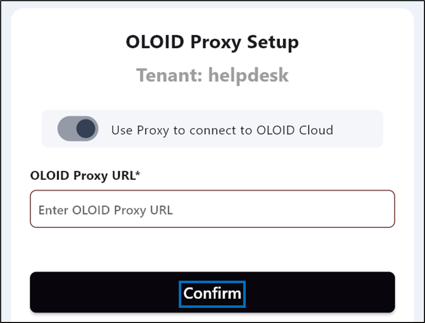
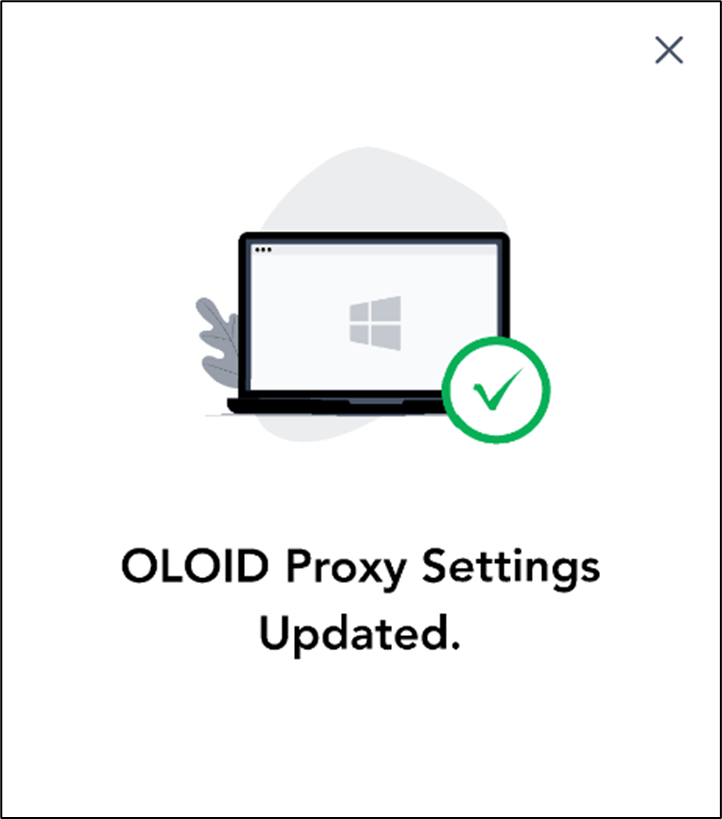

{/* Source: Intercom article 9053378 - https://oloid.help/en/articles/9053378-how-to-enable-oloid-proxy-to-connect-oloid-cloud-using-supervisor-app */}
{/* Generated by intercom_to_mintlify.py - re-running overwrites this file. */}

Enabling Oloid Proxy allows the Supervisor app to work offline using Proxy server.

This document comprises of the following:

- Enabling Oloid Proxy when Tenant is not configured
- Enabling Oloid Proxy when Tenant is already configured

## To enable Oloid Proxy when Tenant is not configured

1. Double-click on the **Supervisor Flow** app.
2. Enable **Use Proxy to connect to Oloid Cloud**.

   

3. Enter **OLOID Proxy URL**.

   <Note>
     **Note:** Contact [Oloid Support](mailto:support@oloid.ai) for the OLOID Proxy Url.
   </Note>

4. Click **Next**.

   

   The **Pair Endpoint** screen is displayed.

## To enable Oloid Proxy when Tenant is configured

1. Log in to the **Supervisor Flow** app.
   The **Admin Home** screen is displayed.

   

2. On the bottom right, select **More Options** > **OLOID Proxy Setup**.

   

   The **OLOID Proxy Setup** screen is displayed.
3. Enable **Use Proxy to connect to Oloid Cloud**.

   

4. Enter **OLOID Proxy URL**.

   <Note>
     **Note:** Contact [Oloid Support](mailto:support@oloid.ai) for the OLOID Proxy Url.
   </Note>

5. Click **Confirm**.

   

   The Oloid Proxy Settings is successfully updated.

   
