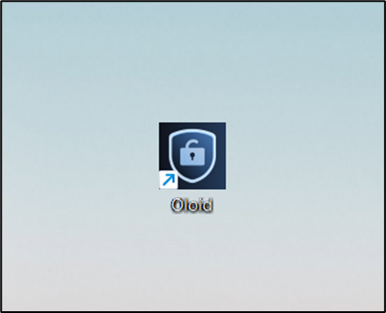
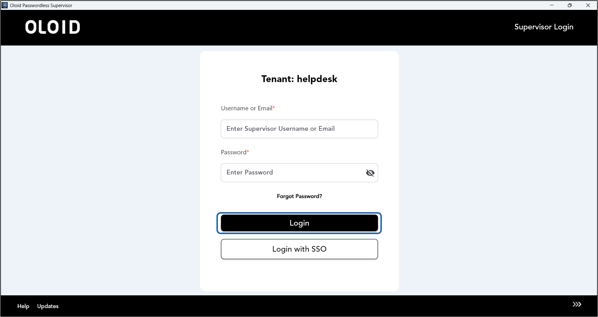
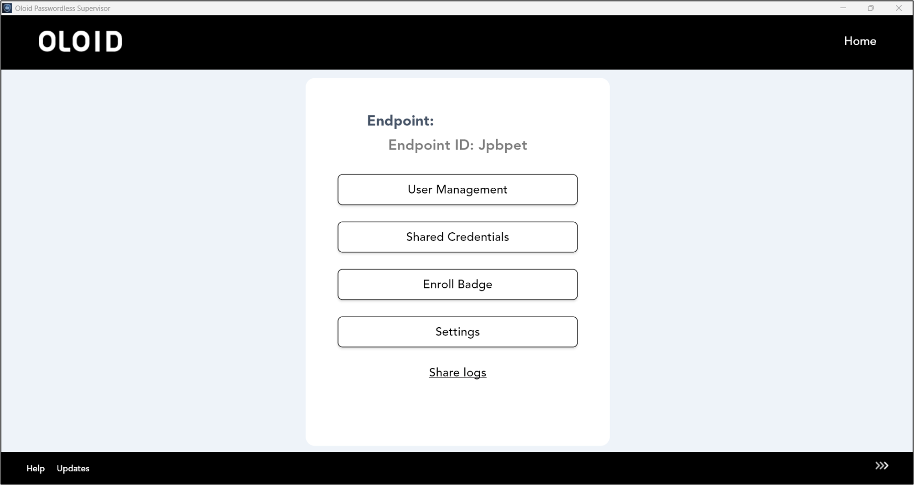

{/* Source: Intercom article 9037188 - https://oloid.help/en/articles/9037188-how-to-log-in-to-supervisor-app */}
{/* Generated by intercom_to_mintlify.py - re-running overwrites this file. */}

## Steps to log in to Supervisor App

1. Double-click on the **Supervisor App** to start.

   

2. Enter your login credentials in the appropriate fields.

   

   <Note>
     **Note:** If this is your first login after installing the application, please enter your Tenant Name and pair the endpoint.
   </Note>

   Refer [How to pair endpoint using Pair as Supervisor in Supervisor App](/platforms/windows/supervisor-app/windows-login-how-to-manually-pair-the-supervisor-app)
3. Click **Login**.
   The Admin Home screen is displayed.

   
