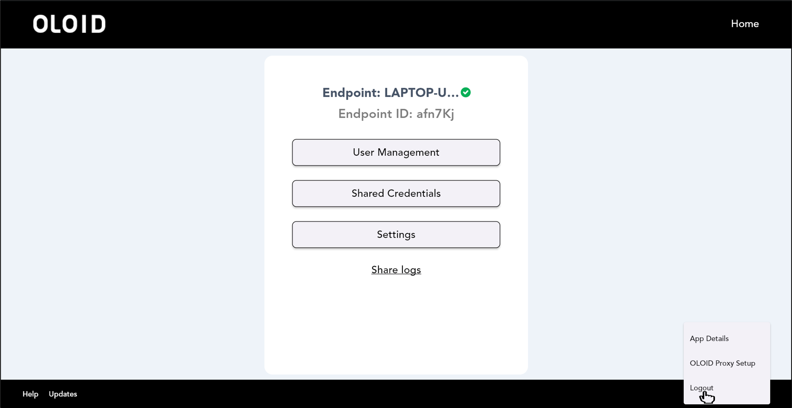

{/* Source: Intercom article 9063736 - https://oloid.help/en/articles/9063736-how-to-log-out-of-supervisor-app */}
{/* Generated by intercom_to_mintlify.py - re-running overwrites this file. */}

To log out:

1. Log in to **Supervisor** App.
   The **Admin Home** screen is displayed.

   <Note>
     **Note:** The app is already paired with the endpoint.
   </Note>

2. On the bottom right, select **More Options > Logout**.

   

   You are successfully logged out of the Supervisor App.
