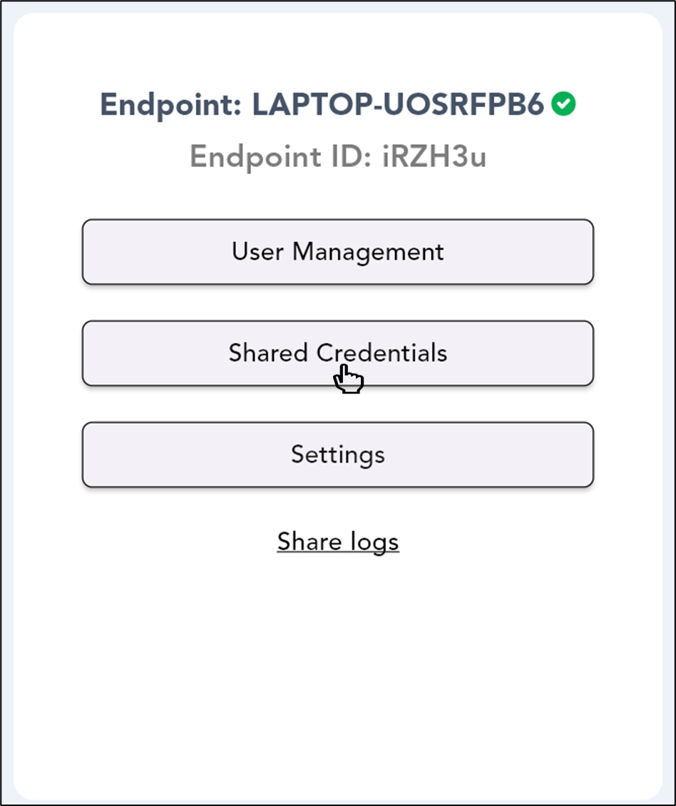
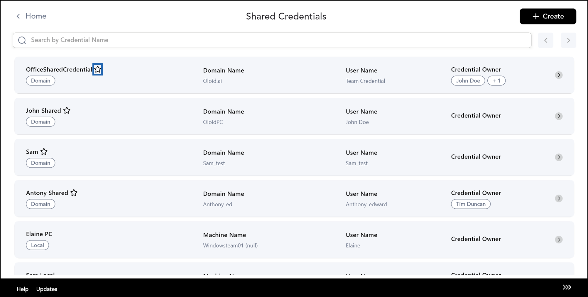
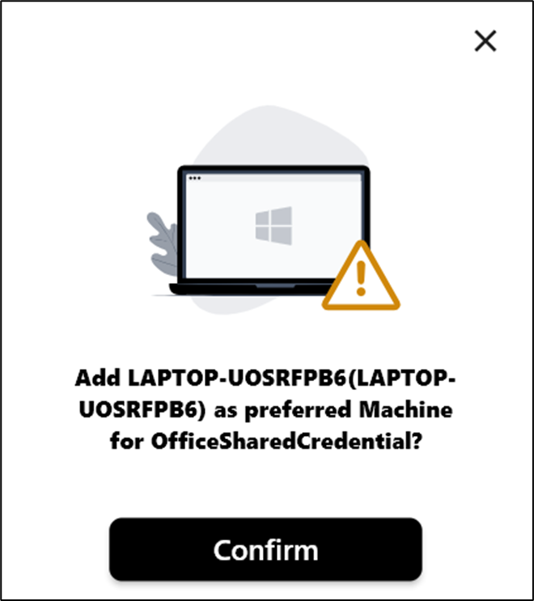
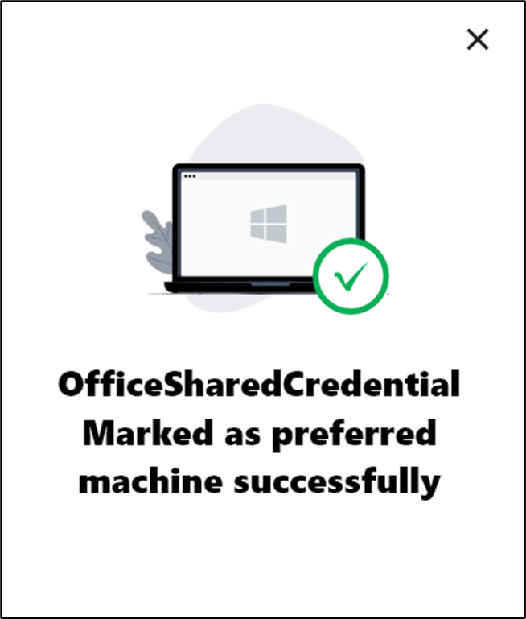

{/* Source: Intercom article 9324029 - https://oloid.help/en/articles/9324029-how-to-mark-as-a-preferred-credential-in-supervisor-app */}
{/* Generated by intercom_to_mintlify.py - re-running overwrites this file. */}

The preferred credential is applicable for domain user.

To mark as preferred credential:

1. On the admin home page, select **Shared Credentials**.

   

   The **Shared Credentials** screen is displayed.
2. Select **Mark as Preferred Credential**icon on a shared credential.

   

3. Select Confirm to add your endpoint as preferred machine on the displayed pop-up box.

   

   The shared credential is marked as preferred machine successfully.

   

   <Note>
     **Note:** To remove shared credential as the preferred machine, you can unstar them.
   </Note>
