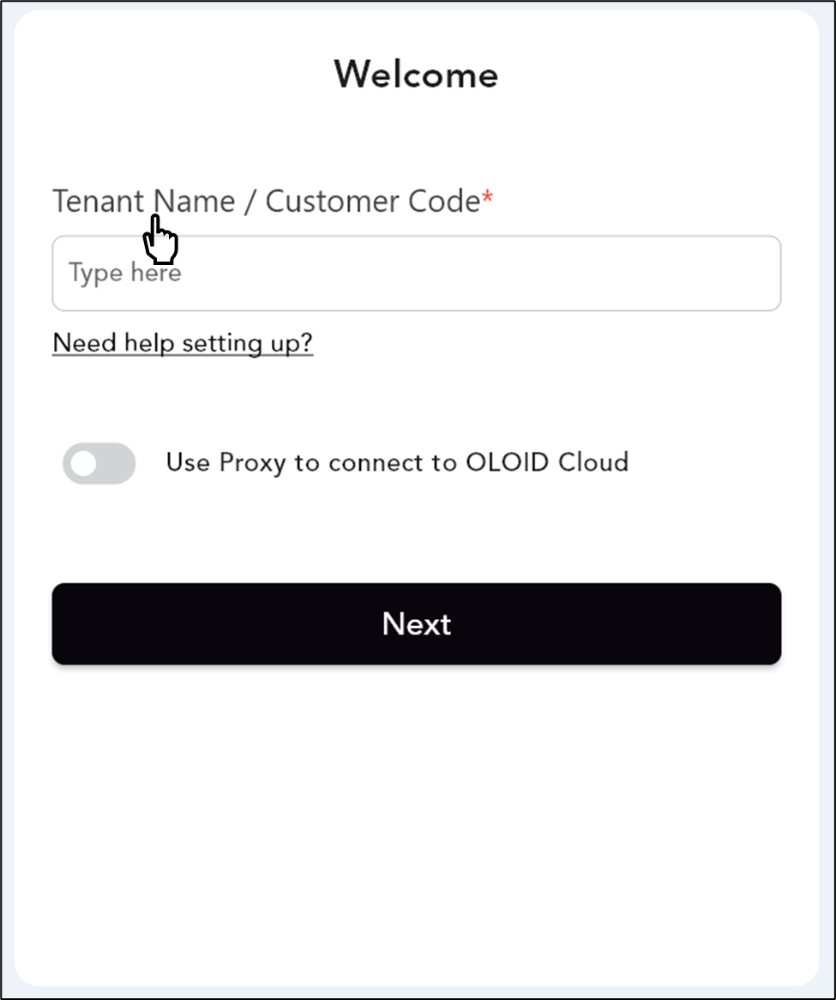
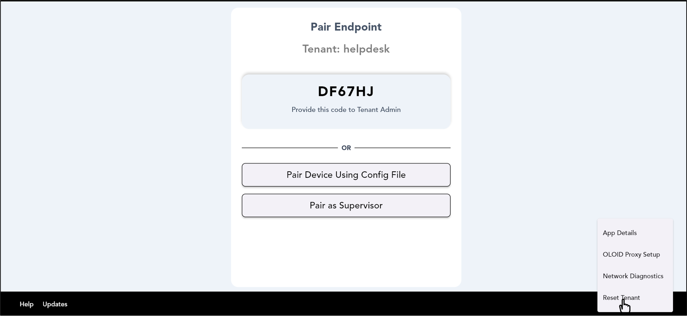
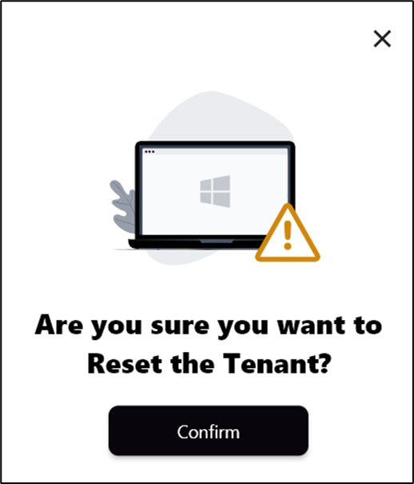

{/* Source: Intercom article 9059054 - https://oloid.help/en/articles/9059054-how-to-reset-tenant-in-supervisor-app */}
{/* Generated by intercom_to_mintlify.py - re-running overwrites this file. */}

To reset tenant:

1. Double-click on the **Supervisor** App.
2. Enter **Tenant Name**.

   

3. Select **Next**.
   The **Pair Endpoint** screen is displayed.
4. On the bottom right, select **More Options** > **Reset Tenant**.

   

   The confirmation pop-up box is displayed.

   

5. Select **Confirm** to reset the tenant.
   The tenant name is reset successfully.
