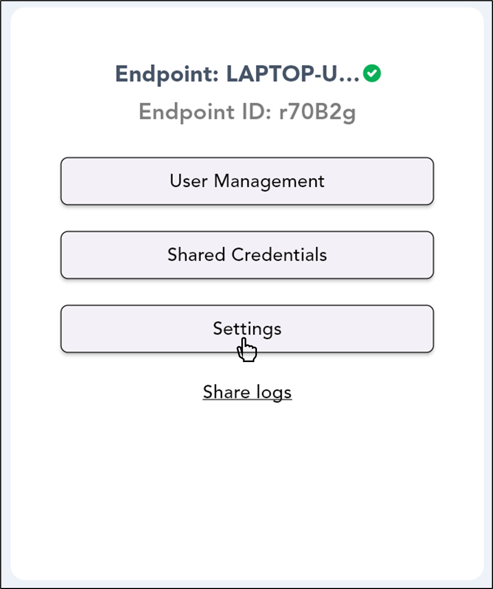
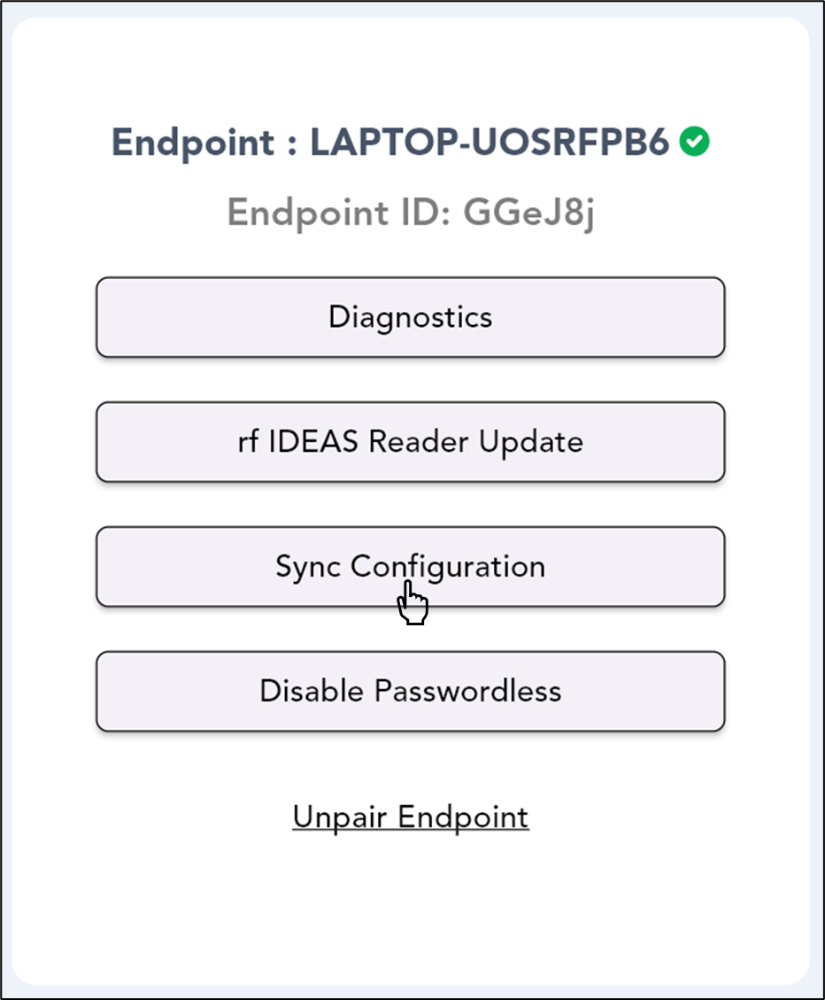
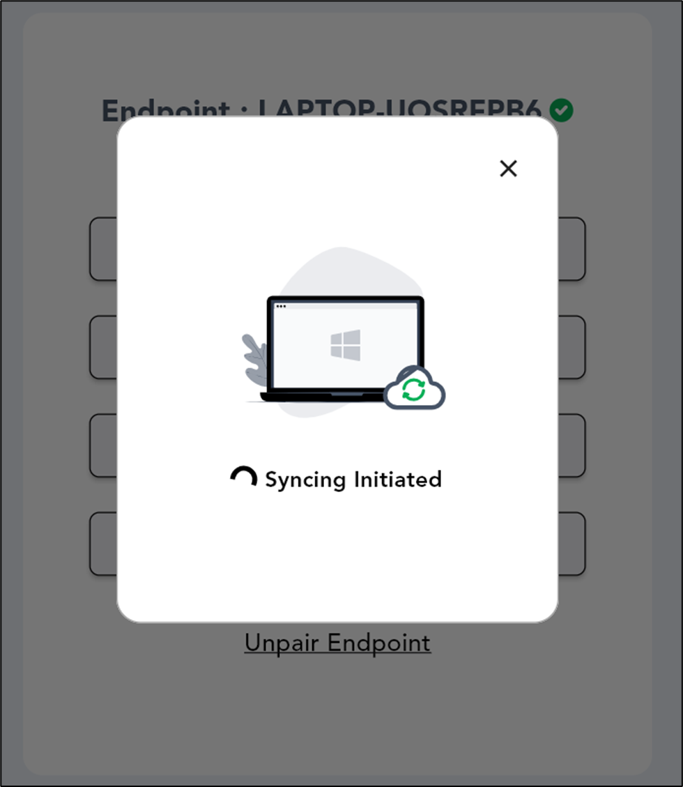
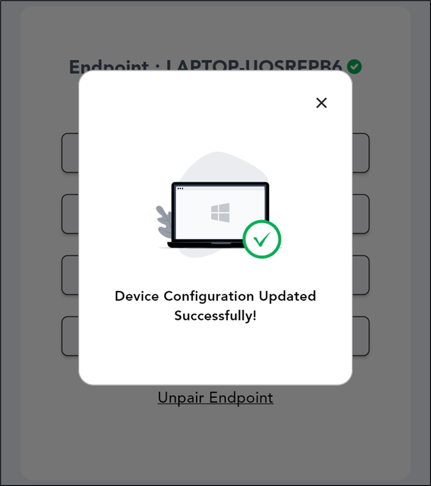

{/* Source: Intercom article 9329264 - https://oloid.help/en/articles/9329264-how-to-sync-configuration-in-supervisor-app */}
{/* Generated by intercom_to_mintlify.py - re-running overwrites this file. */}

To sync configuration:

1. On the admin home page, select **Settings**.

   

2. Select **Sync Configuration**.

   

   The Syncing Configuration is initiated.

   

   The Supervisor App configuration is updated successfully.

   
