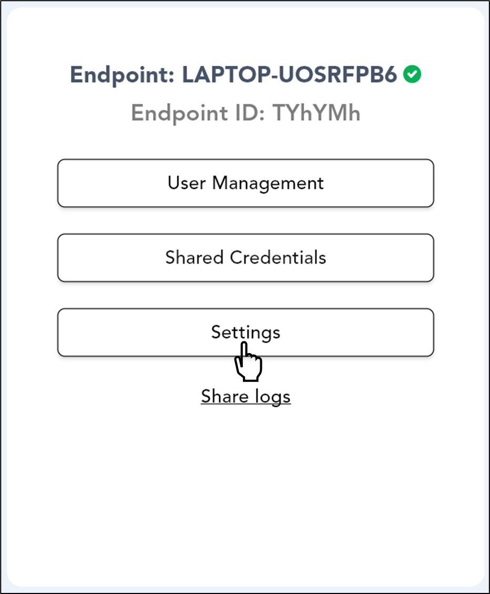
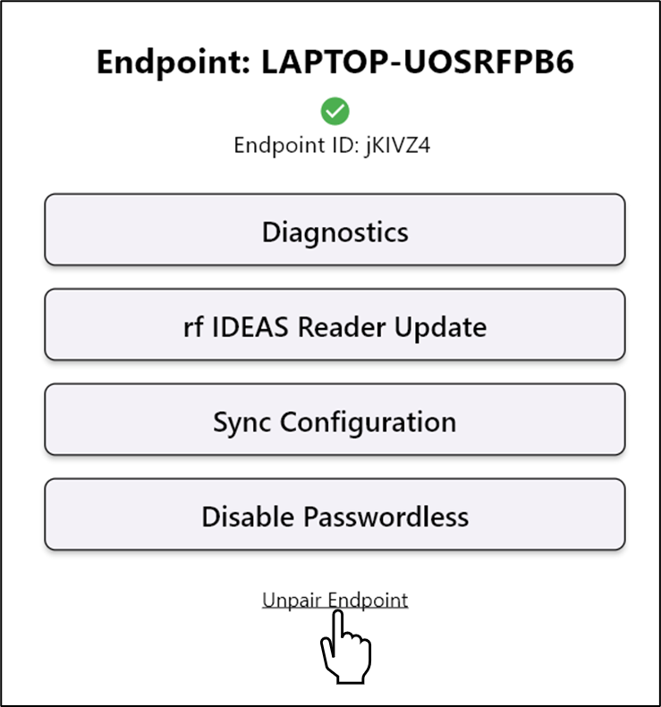
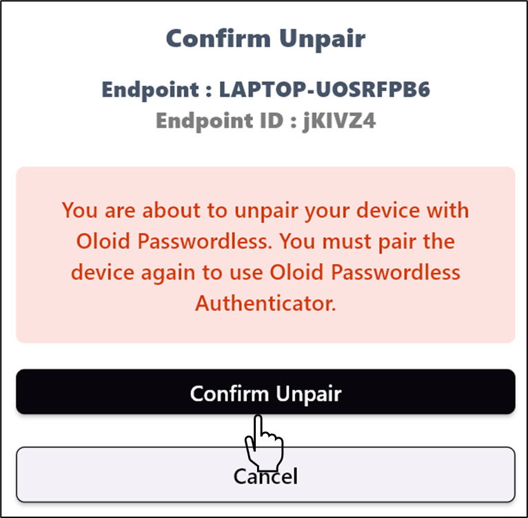

{/* Source: Intercom article 9053859 - https://oloid.help/en/articles/9053859-how-to-unpair-endpoint-using-supervisor-app */}
{/* Generated by intercom_to_mintlify.py - re-running overwrites this file. */}

To unpair endpoint:

1. Log in to **Supervisor** App.
   The **Admin Home** screen is displayed.
2. Select **Settings**.

   

3. Select **Unpair Endpoint**.

   

   The **Confirm Unpair** screen is displayed.
4. Click **Confirm Unpair**.

   

   The Device is unpaired successfully.

   <Note>
     **Note:** You can not unpair the device if it is associated with a group.
   </Note>
