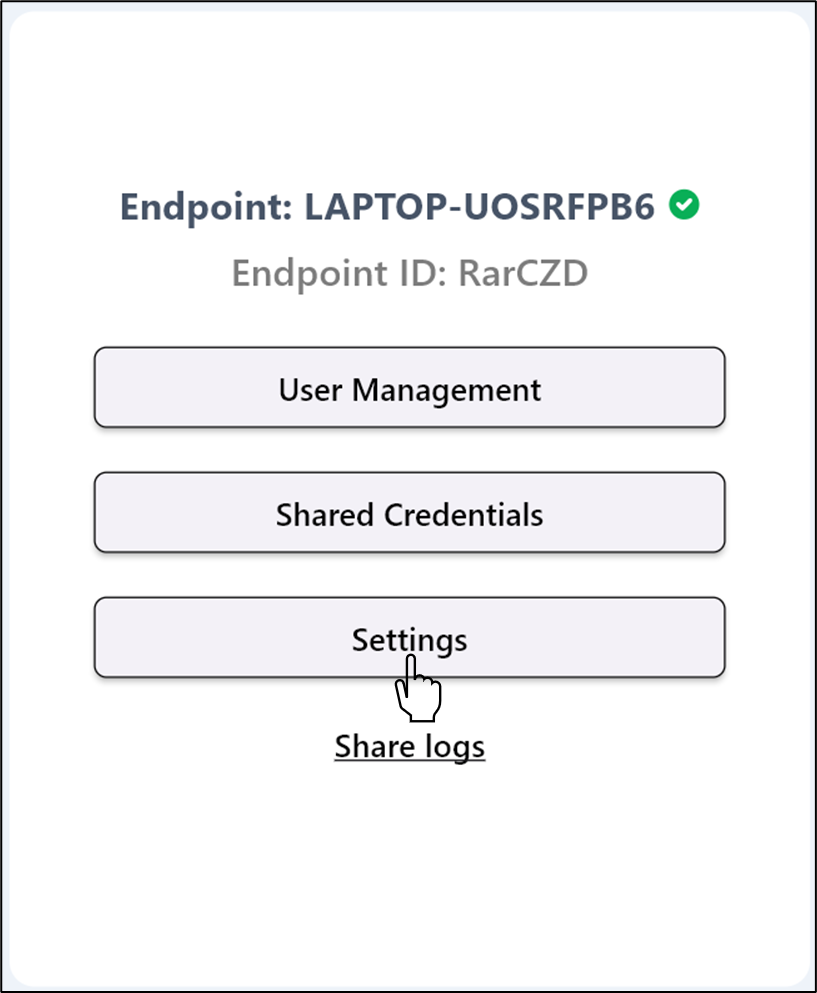
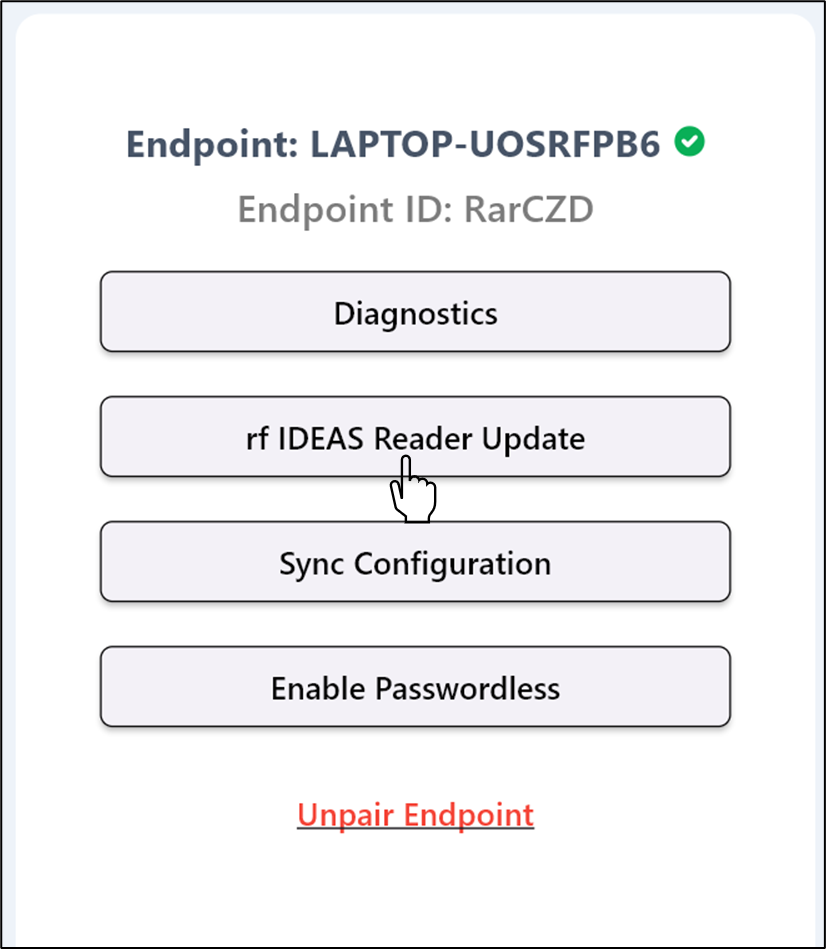
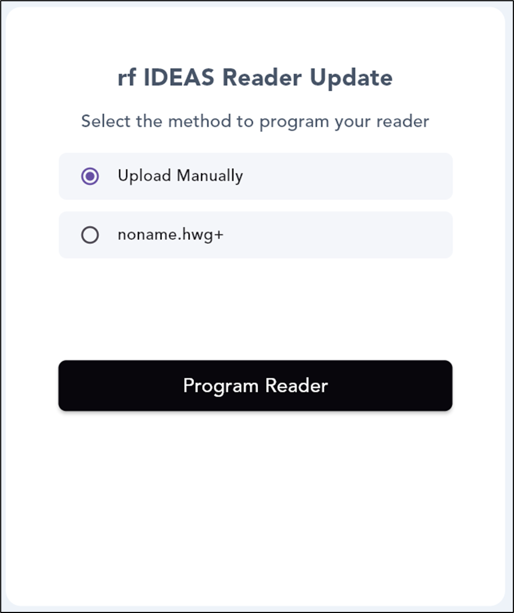
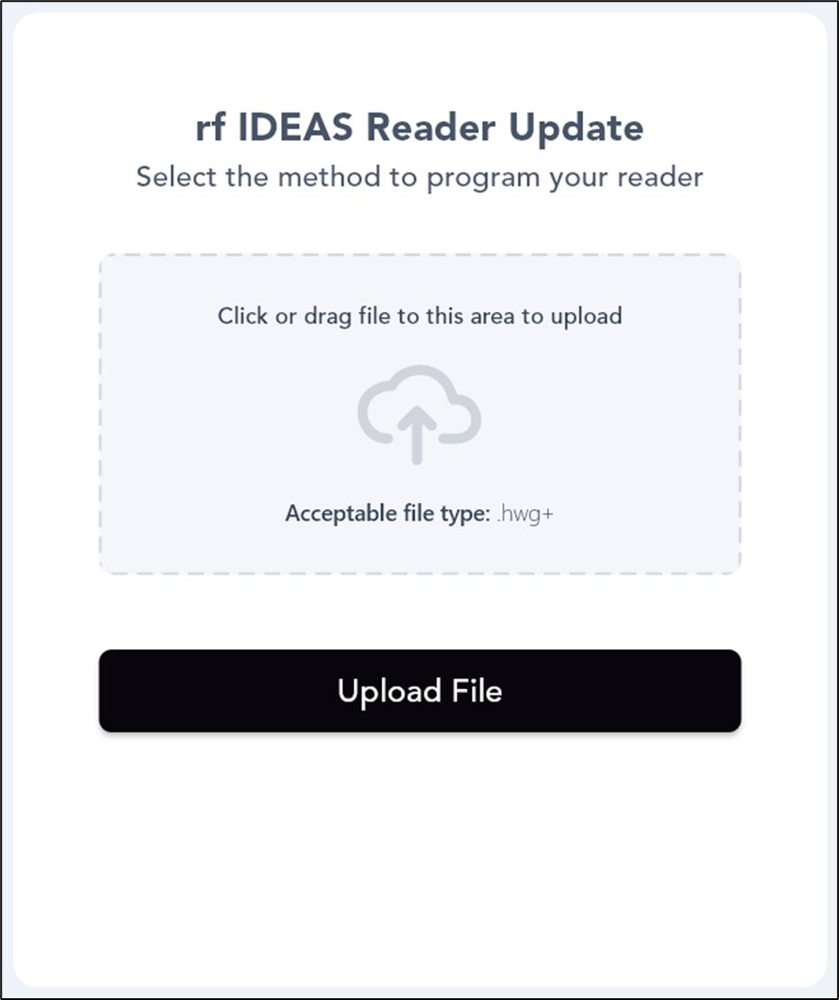
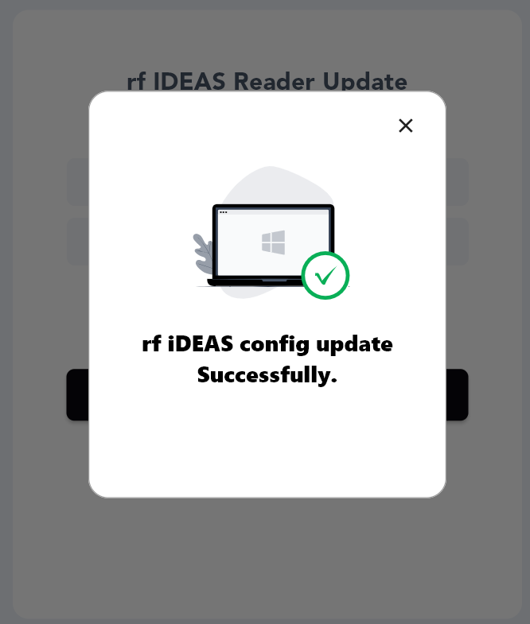
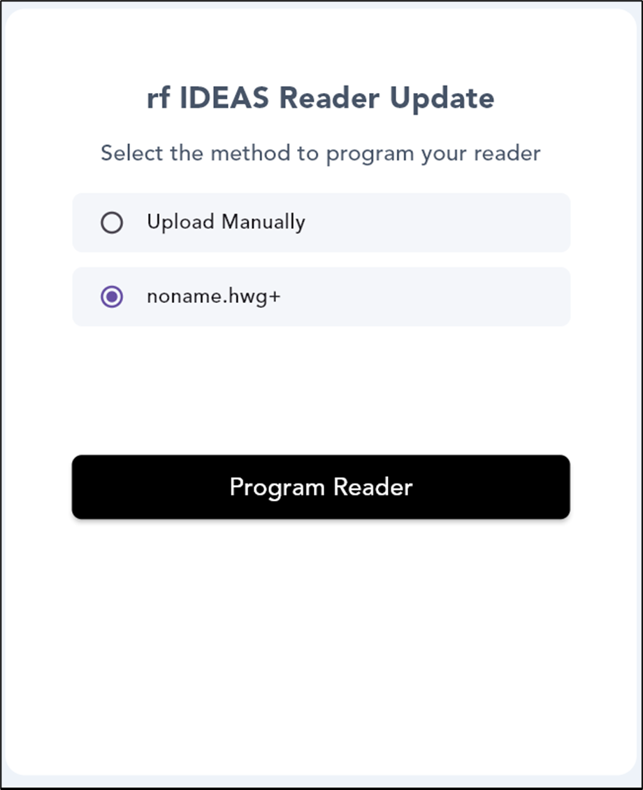

{/* Source: Intercom article 9069684 - https://oloid.help/en/articles/9069684-how-to-update-badge-reader-using-supervisor-app */}
{/* Generated by intercom_to_mintlify.py - re-running overwrites this file. */}

To update badge reader:

1. On the **Admin Home** screen, select **Settings**.

   

2. Select **rf IDEAS Reader Update**.

   

3. Do one of the following:
   1. Upload Manually
   2. Select uploaded file
      The file is uploaded and the badge reader is updated.

## Upload Manually

1. Select **Upload Manually** on the screen.

   <Note>
     **Note:** The badge reader must be connected to the system.
   </Note>

   

2. Click **Program Reader**.
3. Click or drag and drop to upload the .hwg file.

   

4. Click **Upload File**.

<Note>
  **Note:** You can download the .hwg file from Oloid Portal. For more details, refer [How to download HWG file in Oloid Portal](/platforms/windows/supervisor-app/windows-login-how-to-upload-download-hwg-file-in-tenant-admin-portal).
</Note>

The badge reader is updated with the latest configuration.

## Select uploaded file

1. Select the uploaded .hwg file.
   1. **Note:** The badge reader must be connected to the system.

      

2. Click **Program Reader**.
   The badge reader is updated with the latest configuration.

   
