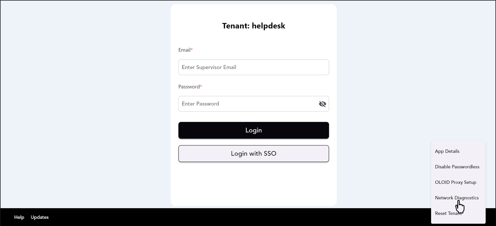
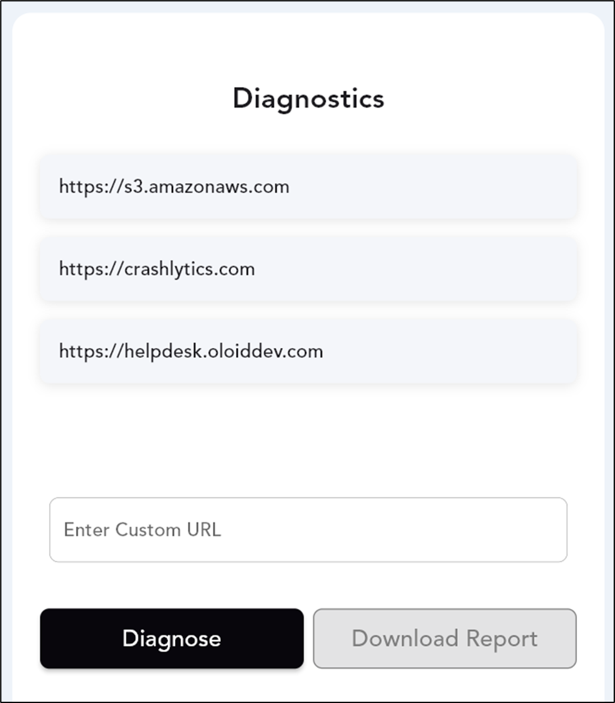
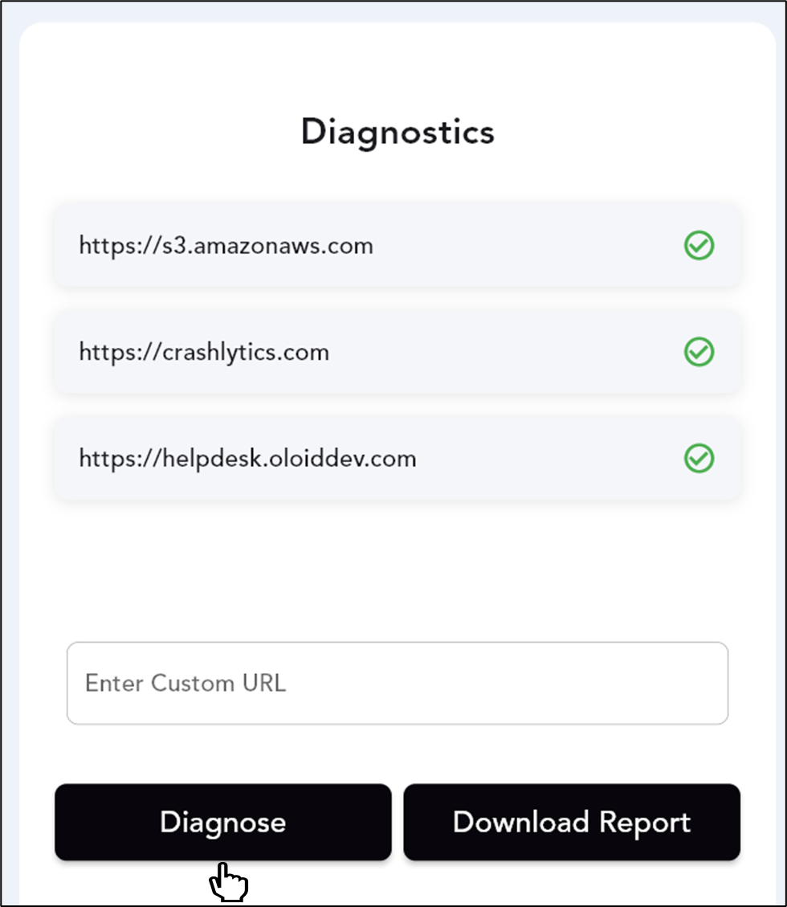
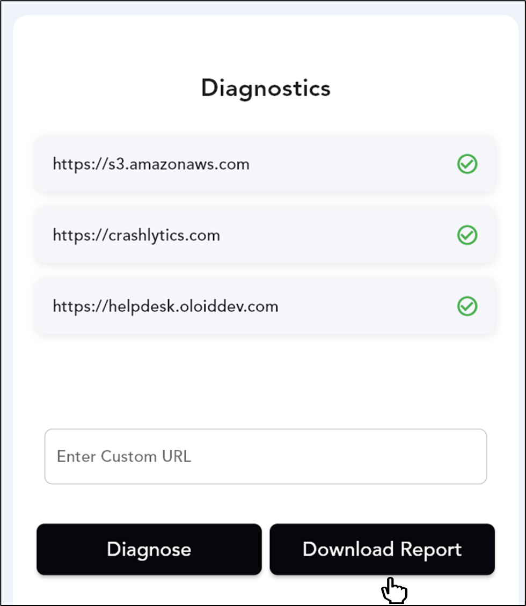
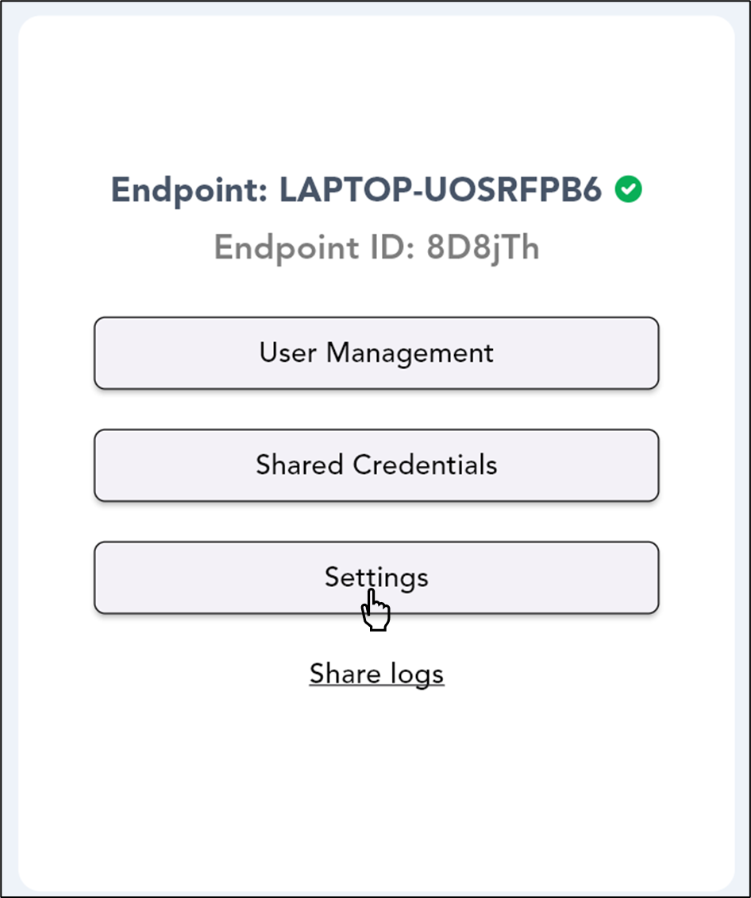
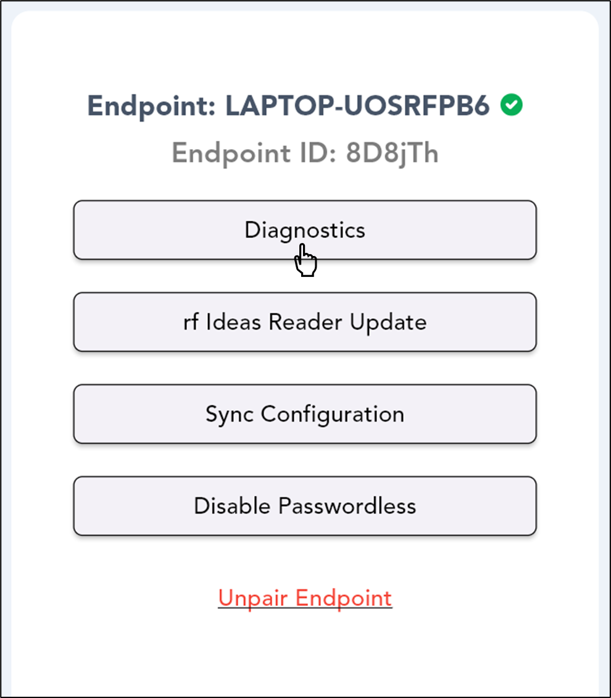

{/* Source: Intercom article 9748593 - https://oloid.help/en/articles/9748593-how-to-view-diagnostics-and-download-report-in-supervisor-app-test-doc-2 */}
{/* Generated by intercom_to_mintlify.py - re-running overwrites this file. */}

You can view and download diagnostics report from Supervisor app in the following ways

- Using Network Diagnostics
- Using Settings Feature

## How to view diagnostics and download report from Network Diagnostics

### To view diagnostics and download report

1. Double-click on Supervisor app.
   The app opens.
2. Click on **More Options** > **Network Diagnostics**.

   

   The **Diagnostics** screen opens.
   You can view all the active URLs.
3. Type **Custom URL** in the text field and press **Enter**. (Optional)

   

4. Do the following:
   1. Click **Diagnose** to refresh the URLs.

      

      The URLs get refreshed with status.
   2. Click **Download Report** to download the diagnostic report.

      

      The diagnostic report is successfully downloaded to the local device.

---

## How to view diagnostics and download report from Settings

### To view diagnostics and download report

1. Double-click on Supervisor app.
   The app opens.
2. Log in to **Supervisor App**.
   The **Admin Home** screen opens.
3. Click **Settings**.

   

   The **Settings** screen opens.
4. Click **Diagnostics**.

   

5. The **Diagnostics** screen opens.
   You can view all the active URLs.
6. Type **Custom URL** in the text field and press **Enter**. (Optional)

   

7. Do the following:
   1. Click **Diagnose** to refresh the URLs.

      

      The URLs get refreshed with status.
   2. Click **Download Report** to download the diagnostic report.

      

      The diagnostic report is successfully downloaded to the local device.
