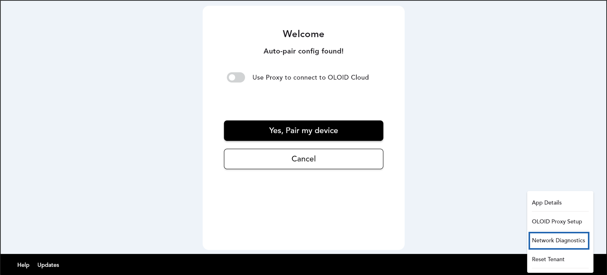
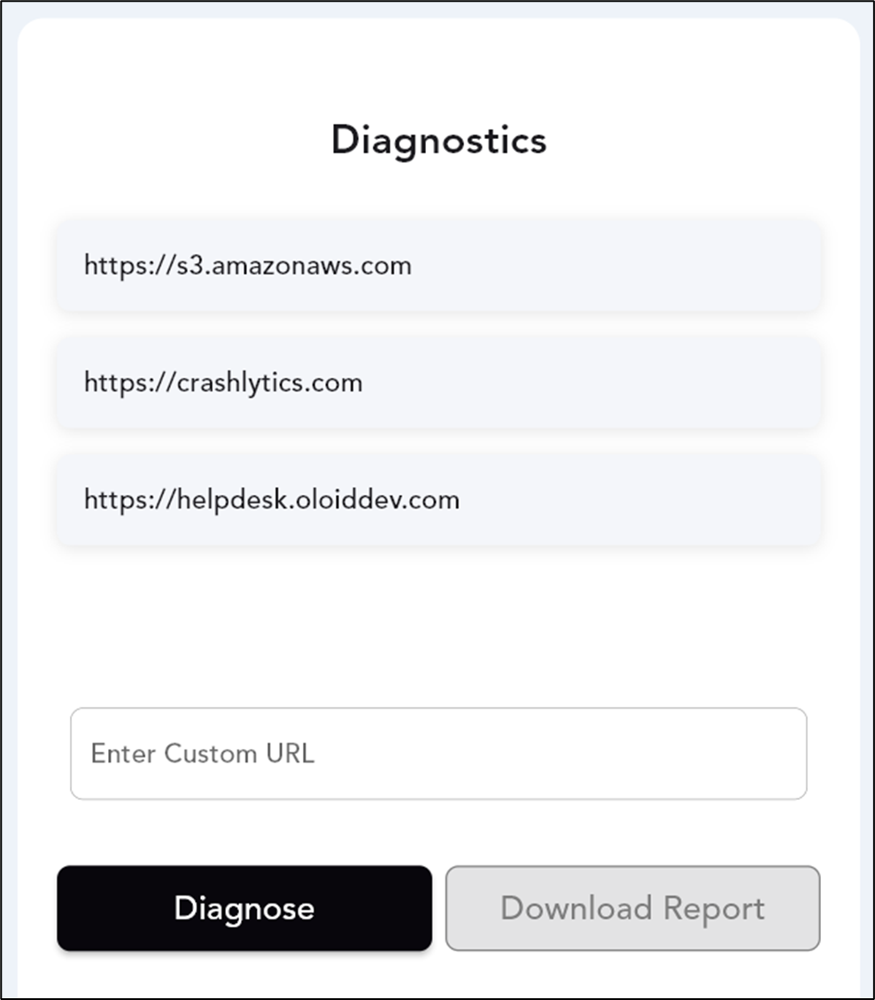
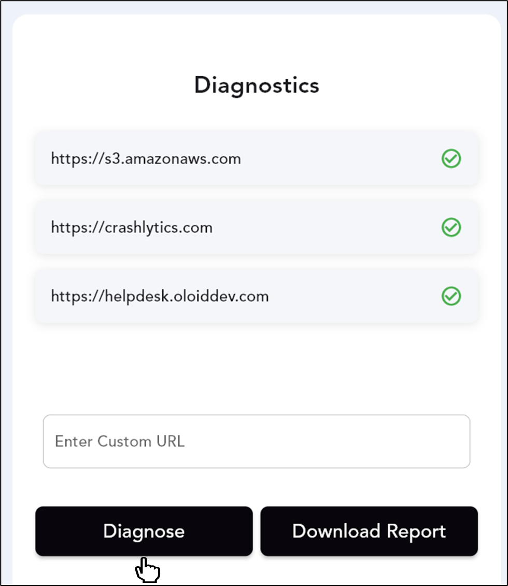
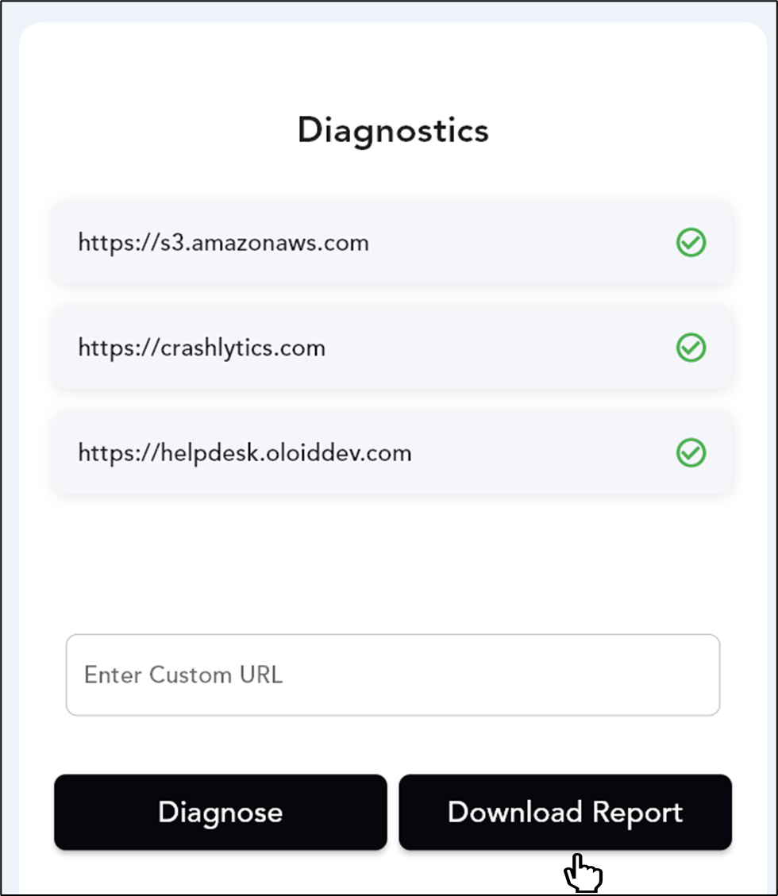
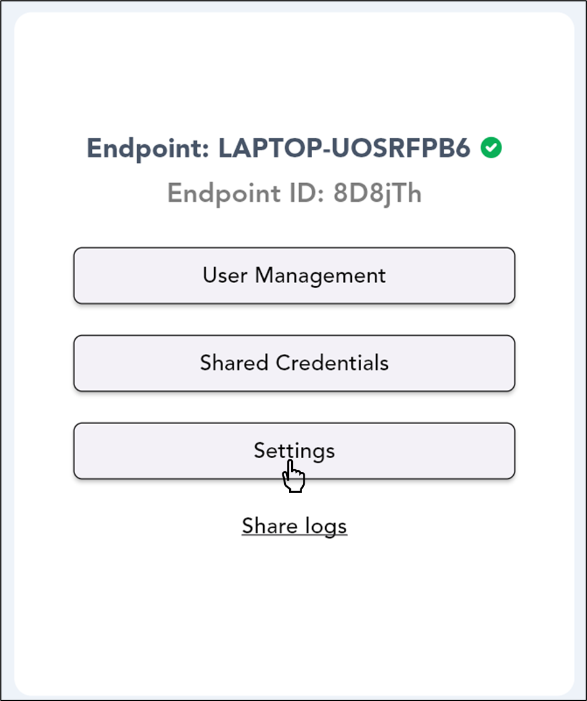

{/* Source: Intercom article 9040866 - https://oloid.help/en/articles/9040866-how-to-view-diagnostics-and-download-report-in-supervisor-app */}
{/* Generated by intercom_to_mintlify.py - re-running overwrites this file. */}

You can view and download diagnostics report from Supervisor app in the following ways:

- [Using Network Diagnostics](#using-network-diagnostics)
- [Using Settings Feature](#using-settings-feature)

## Using Network Diagnostics

To view diagnostics and download report:

1. Double-click on Supervisor app  icon.
   The app opens.
2. Click **More Options** > **Network Diagnostics**.

   

   The **Diagnostics** screen opens. You can view all the active URLs.

   <Note>
     **Note:** Type **Custom URL** in the text field and press **Enter**. (Optional)
   </Note>

   

3. Do the following:
   1. Click **Diagnose** to refresh the URLs.

      

      The URLs get refreshed with status.
   2. Click **Download Report** to download the diagnostic report.

      

      The diagnostic report is successfully downloaded to the local device

## Using Settings Feature

1. Double-click on Supervisor app icon.
   The app opens.
2. Log in to **Supervisor App**.
   The **Admin Home** screen opens.
3. Click **Settings**.

   

   The **Settings** screen opens.
4. Click **Diagnostics**.

   

5. The **Diagnostics** screen opens. You can view all the active URLs.

   

   <Note>
     **Note:** Type **Custom URL** in the text field and press **Enter**. (Optional)
   </Note>

6. Do the following:
   1. Click **Diagnose** to refresh the URLs.

      

      The URLs get refreshed with status.
   2. Click **Download Report** to download the diagnostic report.

The diagnostic report is successfully downloaded to the local device.
