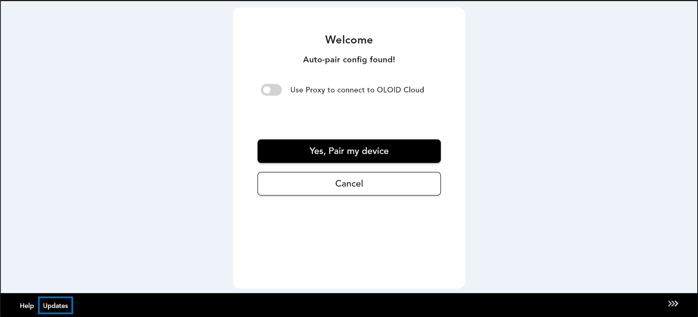
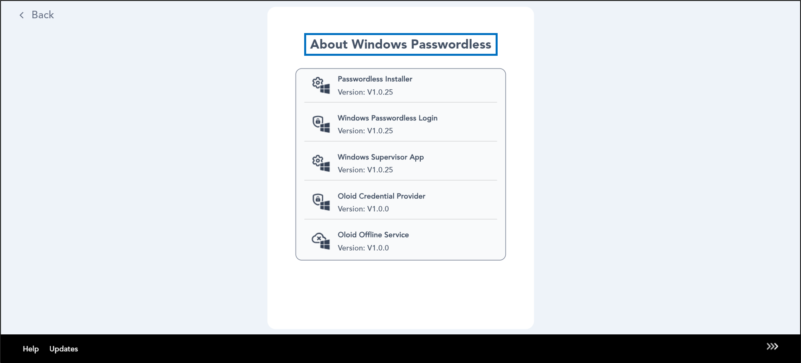

{/* Source: Intercom article 9637783 - https://oloid.help/en/articles/9637783-how-to-view-updates-in-supervisor-app */}
{/* Generated by intercom_to_mintlify.py - re-running overwrites this file. */}

To view updates in Supervisor App :

1. Double-click on Supervisor app  icon.
   The app opens.
2. Select **Updates** in the bottom left.

   

   The **About Windows Passwordless** screen opens.

   

   You can now view the latest updates of the Supervisor App.
