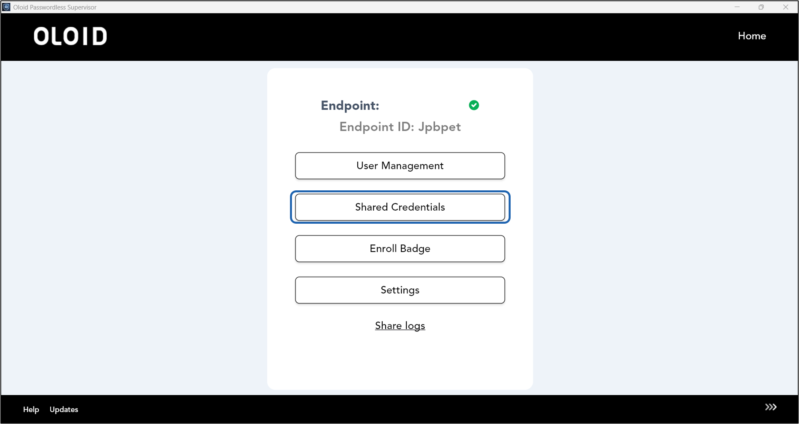
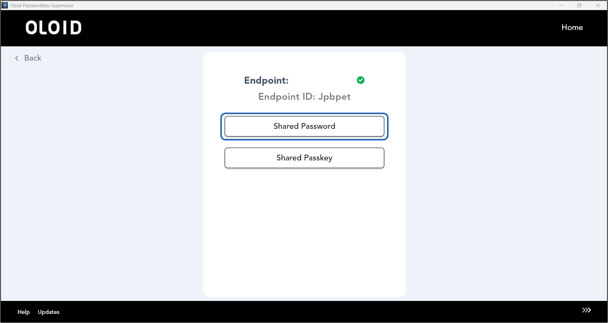
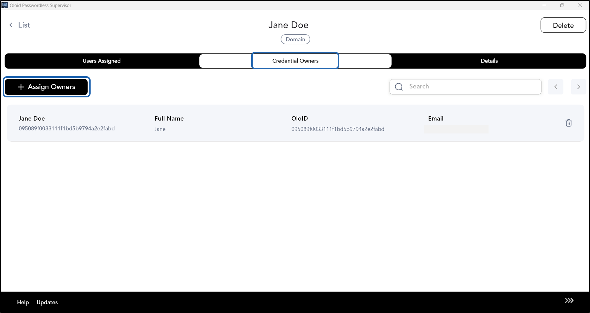
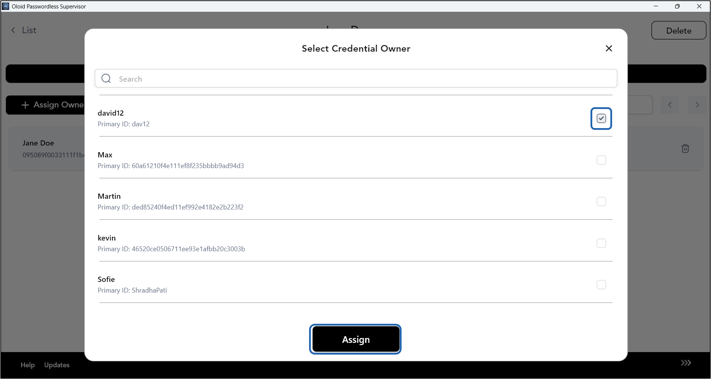
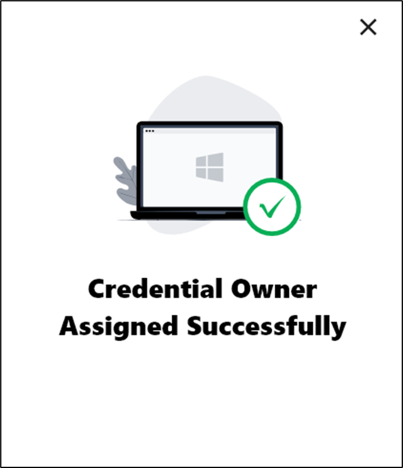
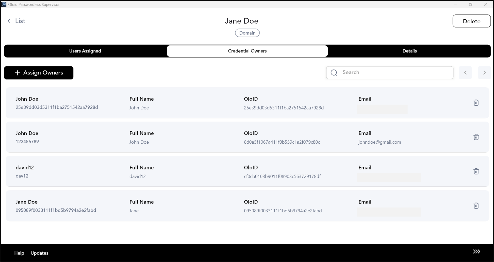

{/* Source: Intercom article 9188537 - https://oloid.help/en/articles/9188537-window-login-how-to-assign-credential-owners-to-shared-password-using-supervisor-app */}
{/* Generated by intercom_to_mintlify.py - re-running overwrites this file. */}

## Introduction

Credential Owners are users who are authorized to manage a shared credential. Assigning Credential Owners allows designated Admins or Supervisors to maintain ownership of shared credentials and manage them as required.

## Prerequisites

- Ensure the endpoint is paired with the Windows Login application. For more information, refer: [Windows Login - How to manually pair the Supervisor App](/platforms/windows/supervisor-app/windows-login-how-to-manually-pair-the-supervisor-app)
- Log in to the Supervisor App using an Admin or Supervisor account. Refer: [How to log in to Supervisor App](/platforms/windows/supervisor-app/how-to-log-in-to-supervisor-app)
- Ensure the shared credential is created. For more information, refer: **[How to Create Shared Credentials Using the Supervisor App](/platforms/windows/supervisor-app/windows-login-how-to-create-shared-password-using-the-supervisor-app)**.

## Steps to Assign Password Owners

1. Log in to **Supervisor App**.
   The **Admin Home** screen is displayed.
2. Select **Shared Credentials**.

   

3. Select **Shared Password**.

   

   The **Shared Password** page is displayed.
4. Select **Credential Owners** tab > **+ Assign Owners**.

   

   The **Select Credential Owner** pop-up box is displayed.
5. You can select credential owner(s) from the displayed list.

   <Note>
     **Note:** You can search the credential owner(s).
   </Note>

6. Click **Assign**.

The credential owner(s) are assigned successfully to the shared credential.

The assigned Credential Owners are displayed in the Credential Owners tab.

---

##### Video Tutorial

Watch the video [How to assign credential owners to shared credentials using Supervisor App- Video Tutorial](/platforms/windows/videos/how-to-assign-credential-owners-to-shared-credentials-using)
