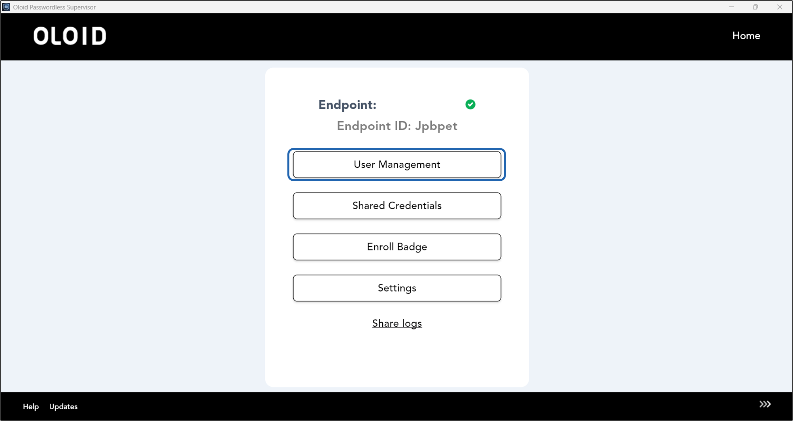
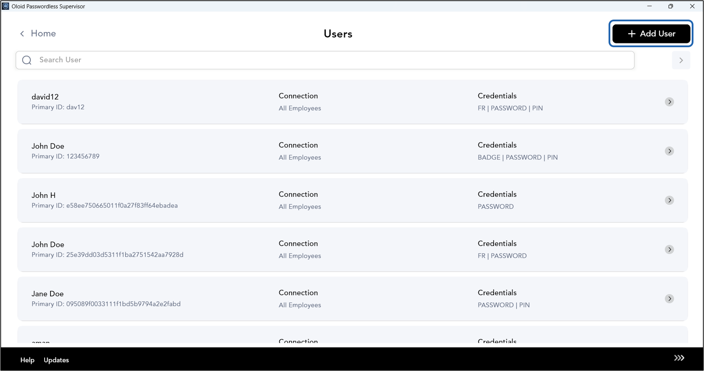
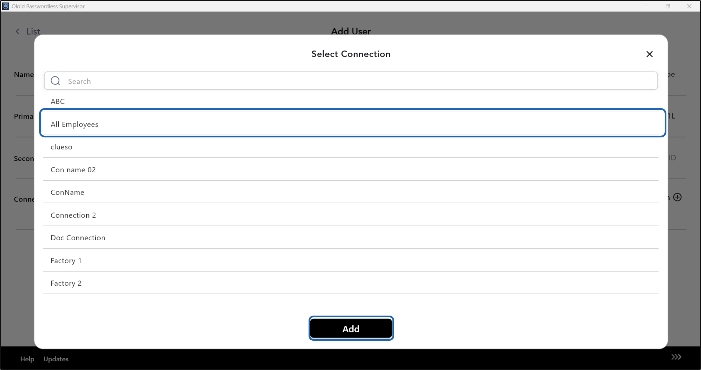
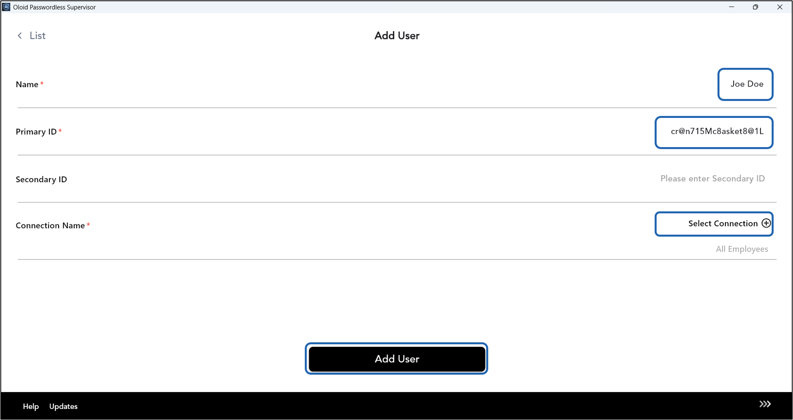
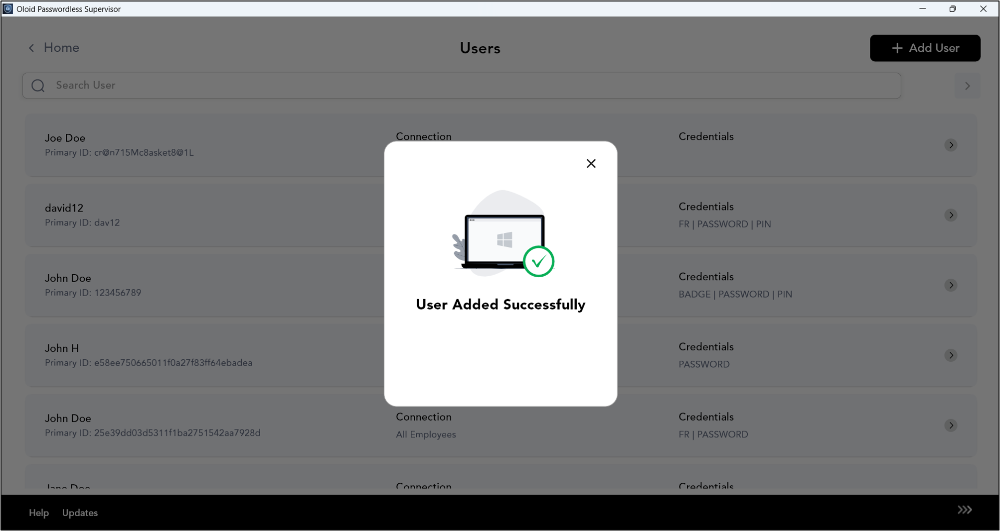
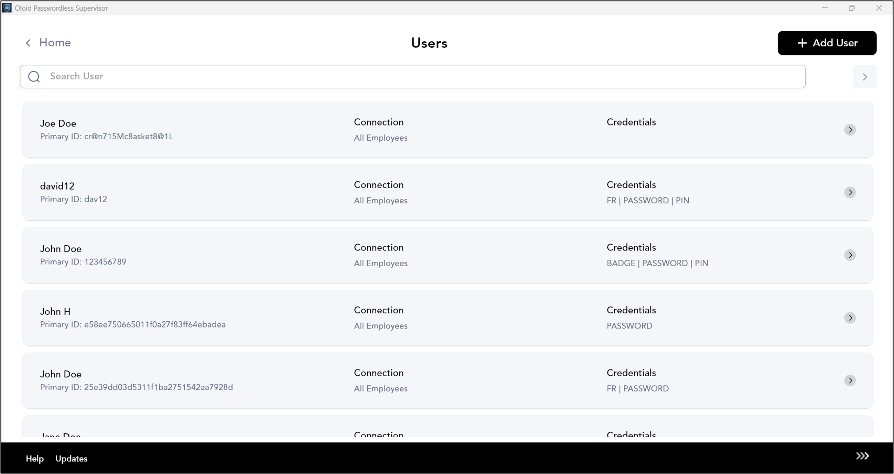

{/* Source: Intercom article 9041346 - https://oloid.help/en/articles/9041346-windows-login-how-to-add-a-user */}
{/* Generated by intercom_to_mintlify.py - re-running overwrites this file. */}

## Introduction

The Add User feature in the Supervisor App allows authorized Admins and Supervisors to create user accounts directly from a paired Windows endpoint.

## Prerequisites

- Ensure the endpoint is paired with the Windows Login application.
- Log in to the Supervisor App using an Admin or Supervisor account. For more, refer [How to log in to Supervisor App](/platforms/windows/supervisor-app/how-to-log-in-to-supervisor-app)
- Ensure the required **Add User** privilege is enabled for the Supervisor. Without this privilege, Supervisors can only view users and their details.
- Ensure the **Add User** action is enabled for the application in the Tenant Admin Portal. If the **Add User** button is unavailable, contact your Tenant Admin. For more information, refer [How to Activate Add User Action on the App for Supervisor](/platforms/windows/supervisor-app/windows-login-how-to-enable-add-delete-users-in-tenant-admin-portal) guide.
- Ensure at least one connection is configured for the selected application in the Tenant Admin Portal.

## Steps to Add User

1. Log in to **Supervisor App**.
   The **Admin Home** screen is displayed.
2. Click **User Management**.

   

   The **Users** screen is displayed.
3. Select **+Add User** at the top right.

   

   The **Add User** screen pop-up box is displayed.
4. Do the following:
   1. Enter **Name**.
   2. Enter **Primary ID**.
   3. Enter **Secondary ID** ( Optional)
   4. Click **Select Connection**.

The Select Connection pop-up box is displayed.

1. Do the following:
   1. Select **Connection** from the list.

      <Note>
        **Note:** You must add connection(s) to the selected application in the Tenant Admin Portal.
      </Note>

   2. Click **Add.**

      

5. Click **Add User**.

The user is successfully added to the application.

The newly added user appears in the Users list.

---

##### Related Videos

Watch our video**[How to Add User in the Supervisor App for Windows - Video Tutorial](/platforms/windows/videos/how-to-add-user-in-the-supervisor-app-for-windows-video-tutorial)**

---

##### Keywords
