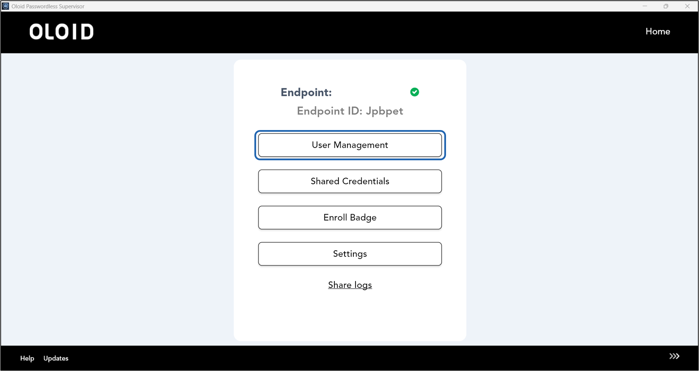
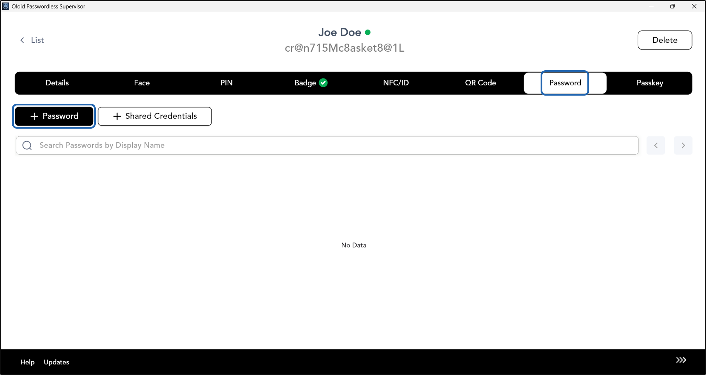
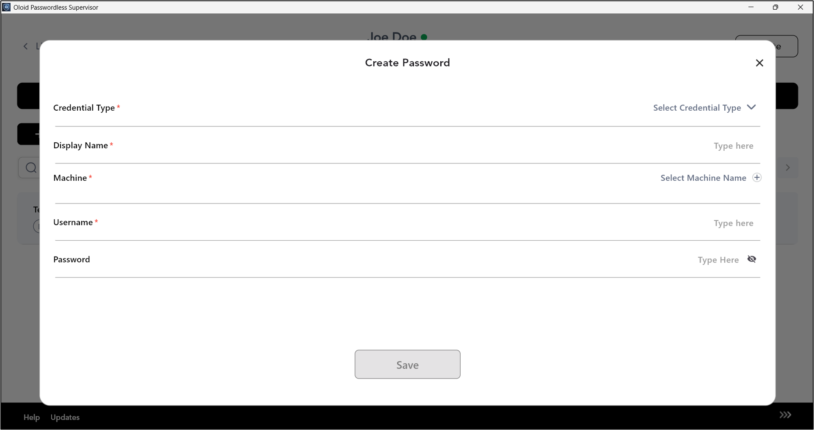
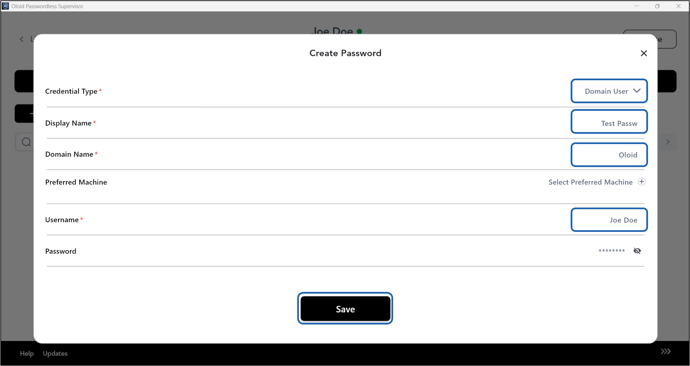
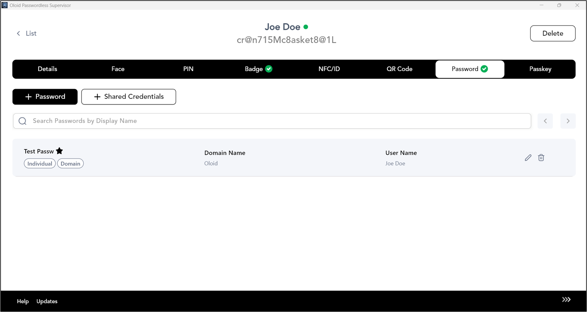
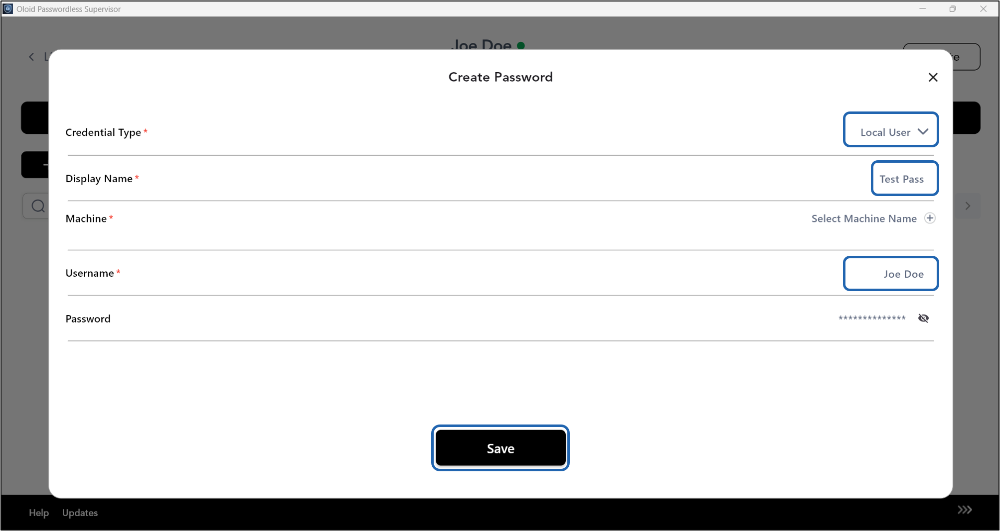
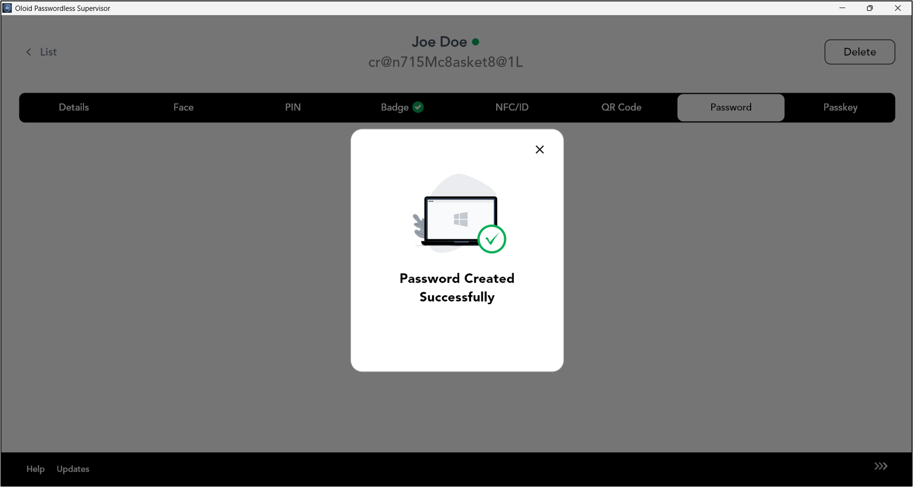
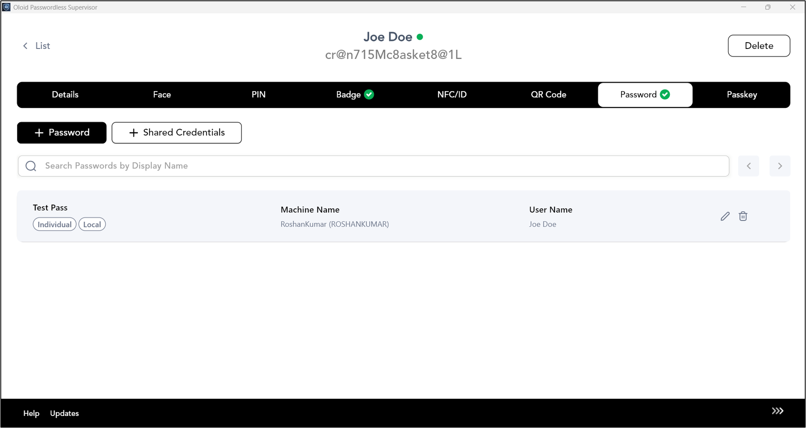

{/* Source: Intercom article 9153831 - https://oloid.help/en/articles/9153831-windows-login-how-to-add-password */}
{/* Generated by intercom_to_mintlify.py - re-running overwrites this file. */}

## Introduction

The **Password** tab in the Supervisor App allows Admin and Supervisor to create Windows credentials for users. Password credentials can be created for either **Domain Users** or **Windows Local Users**, enabling users to authenticate to their assigned Windows devices.

This document comprises of the following:

- [Create credential for domain](#create-credential-for-domain)
- [Create credential for local windows machine](#create-credential-for-local-windows-machine)

## Prerequisites

- Ensure the endpoint is paired with the Windows Login application.
- Log in to the Supervisor App using an Admin or Supervisor account. For more, refer [How to log in to Supervisor App](/platforms/windows/supervisor-app/how-to-log-in-to-supervisor-app)
- Ensure at least one connection is configured for the selected application in the Tenant Admin Portal. For more information, refer: [How to Configure a Connection in the Tenant Admin Portal](/platform/tenant-admin-portal/tenant-admin-portal-how-to-configure-a-connection-in-the-tenant-admin)
- Ensure User is created. Refer: **[Windows Login - How to Add a User](/platforms/windows/supervisor-app/windows-login-how-to-add-a-user)**

## Steps to Add Password

1. Log in to **Supervisor App**. For more, refer to [How to log in to Supervisor App](/platforms/windows/supervisor-app/how-to-log-in-to-supervisor-app)
   The **Admin Home** screen is displayed.
2. On the Admin Home screen, select **User Management**.

   

   The **Users** screen is displayed.
3. Select a user to view details.

   

   The **Details** tab is displayed.
4. Select **Password** tab> **+Password**.

   

   The **Create Password** pop-up box is displayed.

   

### Create credential for domain

1. Select **Domain User** from the **Credential Type** drop-down list.
2. Enter **Display Name**.
3. Enter **Domain Name**.
4. Select one or more **Preferred machines**. By default, the paired endpoint is selected.
5. Enter **Username** of your Windows account.
6. Enter **Password** of your Windows account.
7. Click **Save**.

   

   The Password is successfully created.

   

   The credential is created and displayed under the **Password** tab.

   

### Create credential for local Windows machine

1. Select user type as **Local User** from **Select Credential Type** dropdown.
2. Enter **Display Name**.
3. Select **Machine Name**. (System Default paired machine name is selected)

   <Note>
     **Note:** You can select only single machine name.
   </Note>

4. Enter **User Name**.
5. Enter **Password**.
6. Click **Save**.

The Password is successfully created.

The credential is created and displayed under the **Password** tab.

---

##### Video Tutorial

Watch our video **[How to add Password in the Supervisor App for Windows - Video Tutorial](/platforms/windows/videos/how-to-add-password-in-the-supervisor-app-for-windows-video-tutorial)**
